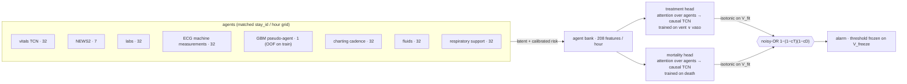

# Sentinel

Early warning of deterioration in the ICU, hour by hour, from eight modality
agents fused by a two-head network. Trained and tested on MIMIC-IV; validated
zero-shot on eICU-CRD (208 hospitals).

**Task.** For ICU stays of at least 12 h that are event-free through hour 6,
predict at every hour whether invasive ventilation, a vasoactive agent or
in-hospital death begins within the next 24 h (`label_24h`, prevalence 4.74%
of test hours). Scoring starts at h6; hours 0–5 are history. Cohort
definition: `results.md`, `scripts/mimic_cohort.sql`.

## The flagship: two-head ALL-8

Each agent emits a latent vector and a calibrated risk per hour. The two
heads are the same ~25k-parameter `LatentFusionNet` (attention across agents
within an hour, a causal TCN over time with a ~29 h receptive field) and
differ only in their training label. Noisy-OR recombines them with no fitted
weight. Full description: `results_fusion.md`, "The flagship architecture",
and T9.

Code: agents in `src/agents/`, fusion in `src/orchestrator/fusion.py`, the
evaluation harness in `src/fusion_common.py` and `src/fair_capability.py`,
the flagship fit in `scripts/two_head.py`.

## Headline results

All on the MIMIC-IV test split (361,229 hours) unless marked; CIs are
patient-clustered. Section numbers refer to `results_fusion.md`.

| claim | number | where |
|---|---|---|
| Ranking, 10 seeds | AUPRC **0.309**, AUROC 0.823 (seed 42: 0.3141). NEWS2 0.114, equal-information GBM 0.287; paired CI vs the GBM clear of zero in 10/10 seeds | T9, T18, scoreboard |
| Death ranking (mortality head alone) | AUPRC 0.340, AUROC 0.946, 1.8× the GBM | T9 |
| Against the eCART-style GBM | ΔAUPRC +0.0287 [+0.0252, +0.0323] over seeds, CI clear in 10/10; earlier in 66% of discordant first alarms | T19 |
| Timing against NEWS2 at matched volume | earlier more often than later in 10/10 seeds; median lead +0.95 h [+0.52, +1.38]; long leads are mostly first-hour flags | T18 |
| Alarm budget | at equal quiet-stay false-alarm rate, catches 2–5 points more deteriorations than the eCART- and YAIB-style GBMs; the margin comes from first-hour flags | T28 |
| External validation, zero-shot | eICU-CRD, 208 hospitals: keeps 80% of its lift; beats all three published specs at matched charting density, 30/30 seed × spec intervals clear | T22 |
| Calibration transfer | does not transfer; about 500 local patients recover 85% of it | T23 |
| Fine-tuning on eICU | +0.060 AUPRC over zero-shot (0.129 → 0.189, 5 seeds), on unseen test hospitals | `docs/eicu_finetune.md` |
| Footprint | runs on one laptop CPU core, no GPU, 2.0 GB; measured on four machines | T21, `docs/cpu_benchmark_matrix.md` |
| What the latents buy | risk scores alone tie the latents on ranking; only the latents lead NEWS2 at 2% | T27 |
| Swapping in YAIB's TCN | ties alone, costs the flagship (−0.0045, 9/10 seeds) | T26 |

Every T-section's code is kept, negative results included (LatentCast,
distillation, the LLM explanation cards, the text arm): the write-ups cite
them as ablations. Benched agents the flagship never uses were removed: the
waveform ECG variants, the notes agents, and the week-1 PhysioNet-2019
baseline. Their results stay recorded in `results.md` and `results_ecg.md`,
and their code is on `experiment-demo`.

## Layout

| path | contents |
|---|---|
| `results_fusion.md` | the main write-up: T1–T23, T26–T28, and the full Reproduce block |
| `results.md`, `results_ecg.md` | the GBM-vs-orchestrator baseline results; ECG integration |
| `docs/` | eICU fine-tune, CPU benchmark matrix, references |
| `src/` | cohort, agents, fusion, baselines, evaluation helpers |
| `scripts/` | SQL extracts, fetchers, one script per experiment |
| `tests/` | `pytest`; no test needs patient data |
| `configs/` | eICU fine-tune settings |

## Reproducing

1. **Access.** MIMIC-IV, MIMIC-IV-ECG, MIMIC-IV-Note and eICU-CRD need
   PhysioNet credentialing and a signed data use agreement. Extraction runs on
   BigQuery (`scripts/fetch_*.py`). Set `SENTINEL_BQ_STORAGE=0` on a project
   without billing, and dry-run queries first.
2. **Environment.** `python -m venv .venv && .venv/bin/pip install -r
   requirements.txt` covers the cohort, the GBMs and the harness. Install a
   PyTorch wheel for your platform yourself (`+cpu` runs everything except
   the GPU-timed benchmarks). A few experiments need extras: `lightgbm` (T10),
   `wfdb` and `neurokit2` (ECG features), `transformers` (notes, text arm),
   `matplotlib` (figures), and `fairseq-signals` for ECG-FM in its own
   `.venv-ecgfm`.
3. **Runs.** Every experiment's command is in the Reproduce block at the end
   of `results_fusion.md`. Run fusion and scoring with `OMP_NUM_THREADS=1`;
   the fusion chain is bit-identical only on one CPU thread.
4. **Tests.** `.venv/bin/python -m pytest`.

## Data handling

Everything under `data/`, `models/` and `logs/` is credentialed data, derived
from it, or model weights trained on it. It is gitignored and must never be
committed or shared outside the DUA. Result files written for sharing are
aggregate-only and pass an id gate before they are saved
(`alarm_budget.assert_aggregate_only`).

## History

This branch is a single-commit snapshot. It holds `experiment-demo` at
e41984a without the demo dashboard and slides, plus the eICU fine-tune from
`eicu-finetune` (PR #3). Full history and authorship are on those branches,
including the commits some write-ups cite by hash. The real-time streaming
experiments (T24, T25) are on `live-version`.
