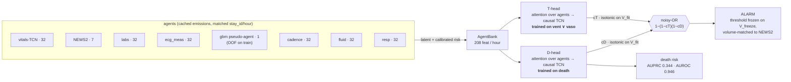

# Fusion & LatentCast — can Sentinel have both ranking and earliness?

Companion to `results.md` (corrected GBM-vs-orchestrator
results) and `results_ecg.md` (ECG integration). Method provenance: "The
Method Bench" memo — Bundle 4 (fusion / gating / distillation) and Bundle 3
(LatentCast, forecast-then-alarm).

**The question.** The corrected results read as a tradeoff: the fair GBM
(FAIR+TRAJ, 145 tabular features) wins ranking — test AUPRC 0.287 vs the
orchestrator's 0.232 — but has *zero* earliness edge over NEWS2, while the
latent orchestrator alarms median +2h earlier at matched 1/2/5% alarm
budgets. Nobody has tested whether that tradeoff is real: stacking papers
report only ranking metrics, distillation papers never report lead time.

## Headline findings

1. **The tradeoff is real, and it is one shared frontier.** Score fusion
   (T1), objective/target distillation (T2), latent forecasting (T3), and
   feature-level integration in both directions (T4) all trace the same
   accuracy↔lead curve between the two parents. No method found a point
   that keeps the GBM's 0.287 *and* the orchestrator's full +2h.
2. **Earliness is representational** — a property of the architecture that
   produces the score, not of the label, the loss, or the input features.
   Four independent demonstrations: (a) label widening and loss shaping move
   the GBM's lead by exactly zero hours; (b) only importing the
   orchestrator's *targets* moves it, at proportional accuracy cost; (c) a
   mean forecaster of the latents smooths away the very spikes that cross
   thresholds early; (d) the same information at the same accuracy gives +1h
   (win 57%) when the orchestrator produces the score and 0h (win 41%) when
   the GBM does.
3. **GBM + our agents cannot be given lead** (the Target-2 answer): with
   clean out-of-fold fused-risk features the GBM stays accuracy-tied
   (0.280–0.284, ΔvsFAIR CI spans zero 3/3 seeds) and gains nothing — 0.0h
   at every budget.
4. **Both frontier endpoints improved.** LOGIT3 (3-parameter stack) is the
   project's new best ranking score: test AUPRC 0.291 > 0.287, paired CI
   clear of zero 3/3 seeds. The earliness-constrained stack Pareto-improves
   the orchestrator (0.262 at the full +1.7h@2%).
5. **The final flagship is two-head ALL-8** (T9): mean test AUPRC **0.3087
   over ten seeds** (0.3081 over the first five) — above the equal-information
   GBM's 0.287 with the paired CI clear of zero on **10/10 seeds** — with the death component
   restored to parity (0.184 vs the GBM's 0.189) and a death-specific head
   that ranks death at **0.340 over ten seeds, 1.8× the GBM**. It supersedes ALL-8 (T8),
   all-7 (T6), ORCH+GBM and CONSTR-1H (T1/T4). **The timing edge is
   seed-fragile where the ranking edge is not**: lead@2% is
   +1.0/+2.0/+1.5/+0.0/+0.0h (win 57/59/58/46/50%) across seeds
   {42,1,2,3,4} — the "+1.5h @58%" previously quoted was the flattering
   face of a 3/5-consistent effect, caught when the chain was extended to
   five seeds (2026-08-27). **Ten seeds (T18, 2026-08-29) settle the
   direction and bound the magnitude**: the model is earlier more often
   than later in **10/10 seeds** (sign test p ≤ 2e-3 in every seed; earlier
   in 68.5% [64.7, 72.4] of the stays where the two differ), the per-seed
   median lead@2% is **+0.95h [+0.52, +1.38]** over seeds (positive in 8/10,
   zero in seeds 3 and 4), the *mean* lead is tail-dominated and not
   seed-robust (+1.4h [−0.2, +3.0]), and about 70% of the model's ≥ 12h
   leads are stays it flagged from the first scored hour. The honest
   statement: about one hour at the median, in the model's favour in every
   seed, with the long leads mostly admission-hour flags rather than
   detected deterioration. T16 sharpens this further: on death stays the
   surviving lead concentrates where a care-limitation was already
   documented (notes included), and drops to +0.5h at 50% win on the
   truly-undecided remainder.
6. **Lead at fixed alarm volume is zero-sum** (T5): even a spike-preserving
   exceedance ensemble OR-ed with the parent reproduces the parent
   cell-for-cell — the parent's crossings already fill the budget, and
   prediction-only alarms get cut by the volume-matched threshold. The
   +2h@1–2% is this representation family's frontier ceiling; more lead
   requires more early signal in the representation, not a better trigger.
   **T6 then confirms the converse**: adding genuinely new early signal
   (clinician cadence, renal trajectory) moves the frontier OUTWARD — the
   first experiment in the program to raise accuracy without spending lead.
7. **Two methodology catches** now baked into the harness: isotonic
   calibration is only weakly monotone (a plateau on the threshold silently
   inflates alarm volume ~2×; fixed by rank-tiebreak strictification), and
   presence-guard constant columns explode z-scoring (std floor + clipping).

## The flagship architecture (T9, two-head ALL-8)

Eight agents emit a latent and a calibrated risk on one matched hourly key
grid; the bank feeds **two structurally identical heads whose only
difference is the training label** — treatment onset teaches timing, death
teaches death ranking (T7's mechanism). Noisy-OR recovers the composite
label's semantics with no fitted blend weight, and the death head doubles as
the program's best death-risk score.



Both heads are the same ~25k-param `LatentFusionNet` (attention over agents
within an hour, never over time; causal TCN with a ~29h receptive field), so
the entire T9 gain comes from supervision, not capacity. Deployment cost
over single-head ALL-8: one extra forward pass across the same cached bank.

## Discrimination scoreboard — both metrics, every model

Test split (361,229 hours, prevalence 4.74%); multi-seed rows are means over
orchestrator seeds {42, 1, 2, 3, 4} where the cache carries five seeds (the
flagship chain, re-run 2026-08-27), {42, 1, 2} for rows whose caches remain
the 3-seed historical record, and {42, 1, 2, 3, 4, 5, 6, 7, 8, 9} for the
two-head flagship and its D-head (T18, 2026-08-29). Regenerate with
`python scripts/metrics_table.py` (CIs are patient-clustered, 1000 reps).

**Read AUPRC first.** At 4.7% prevalence AUROC is dominated by the vast
true-negative mass every model gets right: the whole program spans
0.683–0.822 AUROC while AUPRC — which tracks precision where alarms
actually fire — spans 0.114–0.307 and separates the models cleanly. AUROC is
reported alongside because the EWS literature quotes it, so it is what a
reader needs to place Sentinel against published systems.

| model | AUPRC | AUROC | 95% CI (AUPRC / AUROC) |
|---|---|---|---|
| NEWS2 | 0.114 | 0.683 | [0.102, 0.128] / [0.668, 0.700] |
| GBM13 (vitals-only) | 0.177 | 0.748 | |
| FAIR (61 feat) | 0.279 | 0.798 | |
| **FAIR+TRAJ (145 feat)** — the bar | **0.287** | **0.807** | [0.264, 0.311] / [0.793, 0.821] |
| ORCH core-3 (published) | 0.236 | 0.787 | |
| ORCH core-3+meas | 0.247 | 0.790 | [0.233, 0.270] / [0.778, 0.806] |
| MAX | 0.277 | 0.802 | |
| LOGIT3 | 0.290 | 0.807 | [0.269, 0.313] / [0.793, 0.822] |
| CONSTRAINED | 0.259 | 0.796 | |
| CONSTR-1H | 0.283 | 0.804 | [0.263, 0.304] / [0.790, 0.818] |
| GATED | 0.291 | 0.807 | |
| ORACLE-GATE † | 0.241 | 0.802 | |
| GBM × TLS H=6 | 0.285 | 0.806 | |
| GBM-distill λ=0.75 | 0.276 | 0.801 | |
| ORCH-distill λ=0.5 / 0.75 | 0.259 / 0.264 | 0.794 / 0.796 | |
| LatentCast k=2 → k=12 | 0.250 → 0.187 | 0.791 → 0.778 | |
| shifted-GBM k=2 → k=12 | 0.285 → 0.276 | 0.807 → 0.803 | |
| raw-NEWS2 forecast k=2 → k=12 | 0.118 → 0.109 | 0.710 → 0.703 | |
| ORCH+GBM (5th agent) | 0.277 | 0.801 | [0.257, 0.297] / [0.787, 0.816] |
| GBM +RISKS / +RISKTRAJ / +LATENT | 0.274 / 0.276 / 0.278 | 0.802 / 0.804 / 0.804 | |
| GBM +ORCH (OOF) / +ORCHONLY | 0.278 / 0.282 | 0.802 / 0.805 | |
| meas+cadence / +fluid / +both | 0.258 / 0.251 / 0.259 | 0.794 / 0.791 / 0.796 | |
| gbm+cadence / +fluid | 0.281 / 0.280 | 0.804 / 0.803 | |
| ALL-7 (gbm+both) | 0.282 | 0.804 | [0.262, 0.301] / [0.789, 0.818] |
| ALL-8 (all7+resp) | 0.306 | 0.821 | [0.292, 0.335] / [0.813, 0.840] |
| ALL-8 cap-at-HFNC | 0.306 | 0.821 | |
| **TWO-HEAD ALL-8** — flagship (10 seeds) | **0.309** | **0.823** | [0.291, 0.337] / [0.813, 0.840] |
| ⤷ D-head, scored on death ‡ (10 seeds) | **0.340** | **0.946** | [0.288, 0.415] / [0.928, 0.960] |

Standalone agents: gbm 0.279/0.806 · vitals_tcn 0.189/0.754 · labs
0.166/0.727 · cadence 0.156/0.703 · resp 0.134/0.712 · fluid 0.093/0.654 ·
ecg_meas 0.055/0.539 (the ECG agent is near-chance alone yet still clears
the fusion bar — its value is conditional, not marginal).

† label-using headroom bound, not a model. ‡ scored against
`label_24h_death`, not the composite — the only row on a different target.
Not listed: the T5 exceedance rungs, whose score vectors were not persisted
(their deliverable was lead, and their AUPRC is in T5).

One reproducibility note: the T1 ladder rungs' cached scores predate the
float64 storage fix (audit finding 6), so recomputing them here can differ
from their in-run T1 values in the 4th decimal (e.g. LOGIT3 0.290 vs 0.291)
— the tiebreak that separates isotonic plateaus is finer than float32. The
flagship rows were regenerated after the fix and match exactly.

The two metrics agree on the program's arc — NEWS2 → the GBM bar → ALL-8
above it — and the flagship leads on both. The D-head's 0.946 death AUROC
is the single most striking number in the table: death is highly separable
when a head is trained for it, which is precisely T7's supervision-artifact
diagnosis stated in the literature's preferred metric.

## Protocol (all experiments)

- **Parents.** Earliness parent = core-3+meas orchestrator (`vitals_tcn`,
  `news2`, `labs`, `ecg_meas` — the V4 config, results_ecg.md). Ranking
  parent = FAIR+TRAJ (FAIR+NOTES is not rebuildable on this clone — the note
  embedding caches are absent; FAIR+TRAJ is the better variant anyway).
  Fair cache regenerated on GPU: test AUPRC 0.287 [0.264, 0.311] — reproduces
  the published number; winner depth 4 / spw 1.0 / 375 trees.
- **V_fit / V_freeze.** Val split once, patient-level 50/50 (seed 42):
  V_fit (192,557 rows) fits everything with free label-reading parameters
  (per-parent isotonic calibrators, stack/gate weights, student early
  stopping); V_freeze (186,206 rows) freezes the NEWS2-anchored thresholds
  (fair_capability protocol) and hosts all model *selection*. Test is touched
  once per reported rung. Parents are re-scored under this same protocol, so
  their rows here differ slightly from results.md (which froze on full val).
- **Seeds.** Orchestrator seed noise exceeds typical fusion deltas
  (results_ecg.md), so every orchestrator-involving quantity runs multi-seed,
  with all fusion rules re-fit within seed; tables report mean + per-seed sign
  consistency. The GBM is seed-fixed. T1–T8 were produced at seeds {42, 1, 2}
  (core-3+meas val AUPRC 0.2368 / 0.2415 / 0.2279) and their tables stand as
  that historical record; on 2026-08-27 the flagship chain (core-3+meas →
  +gbm → ALL-7 → ALL-8 → two-head) was re-run end-to-end at seeds
  {42, 1, 2, 3, 4} with the original three seeds reproducing bit-identically
  (regression pin), so the scoreboard, T12 and T15 now report five seeds;
  the two-head flagship was extended to ten on 2026-08-29 (T18; the five
  published seeds again reproduce bit-identically, checked by
  `scripts/merge_two_head.py`).
- **Selection optimism.** Candidate configurations were *selected* on their
  V_freeze deltas across many attempts over this program, so quoted V_freeze
  margins carry val-selection optimism (the same optimism `tune_gbm` accepts).
  Test-set numbers are computed once per shipped configuration and are the
  honest estimate; nothing was ever selected on test.
- **Raw scores into fusion; fusion calibrates.** Blending needs a common
  probability scale, so each experiment fits its own isotonics on V_fit.
  **Isotonic plateaus are strictified** with a 1e-9 rank tiebreak in
  raw-score order: a plateau sitting on the val threshold otherwise fires
  wholesale past the matched alert volume (observed: 1.97% achieved at a
  1.03% match — the "+1h extra lead" that produced was an artifact, caught
  and killed before any table below was produced).
- Harness: `src/fair_capability.py` unchanged — volume matched to NEWS2's
  achieved val alert rate, jointly-caught stays, patient-clustered bootstrap
  (2000 reps timing / 1000 reps AUPRC).

## Pre-registered success / null criteria

Written before the full multi-seed tables were produced.

- **4a fusion ladder — success:** some rung with (i) test AUPRC within or
  above FAIR+TRAJ's paired CI, and (ii) median lead > 0 with win-rate CI
  clear of 50% at ≥ 2 budgets, both sign-consistent 3/3 seeds. **Null:**
  every rung gives back one of the two edges → "ranking and earliness are
  carried by incompatible score shapes" (publishable, sharpened by 4b).
- **4b gate:** if even ORACLE-GATE (true time-to-event decides the parent)
  fails to beat the best 4a rung on either axis, gating is dead.
- **Bundle 3 LatentCast — success:** some horizon k where median lead
  exceeds the parent orchestrator's with AUPRC not below the parent CI, and
  both controls fail to match it (shifted-label GBM gains lead only by
  shedding AUPRC; raw-vitals NEWS2 forecast inferior on both axes). **Null:**
  the shifted-label GBM matches LatentCast's frontier → forecasting adds
  nothing beyond label widening.
- **4c distillation — success:** a grid point strictly Pareto-dominating
  FAIR+TRAJ (lead > 0 at ≤ 0.01 AUPRC cost) → earliness is distillable into
  a tabular model. **Null:** the frontier is a hard tradeoff line through the
  two parents → earliness is representational (what the channel decomposition
  predicts).

## T1 — Fusion ladder + gate (4a/4b): the tradeoff is real, but both ends of the frontier moved

Test, mean over seeds {42,1,2}; ΔvsFAIR = paired patient-clustered AUPRC
delta vs FAIR+TRAJ; sign = seeds agreeing. Full per-seed rows with CIs in
`data/cache/fusion_ladder_scores.npz` meta and `logs/fusion_ladder_full.log`.

| rung | AUPRC | AUROC | ΔvsFAIR | sign | lead@1% | lead@2% | lead@5% | win@2% |
|---|---|---|---|---|---|---|---|---|
| ORCH-meas (parent) | 0.247 | 0.790 | −0.0397 | 0/3 | +2.0 ✓3/3 | +1.7 ✓3/3 | +1.0 ✓3/3 | 58–63% |
| FAIR+TRAJ (parent) | 0.287 | 0.807 | — | — | 0.0 | 0.0 | 0.0 | 38% |
| MAX | 0.277 | 0.802 | −0.0047 | 0/3 | 0.0 | +0.7 (2/3) | +0.2 (1/3) | 49–54% |
| **LOGIT3** | **0.290** | **0.807** | **+0.0037** | **✓3/3** | 0.0 | 0.0 | 0.0 | 44–45% |
| CONSTRAINED | 0.259 | 0.796 | −0.0249 | 0/3 | +0.7 (2/3) | +1.7 ✓3/3 | +0.7 (2/3) | 51–63% |
| CONSTR-1H | 0.283 | 0.804 | −0.0038 | 0/3* | 0.0 | +1.0 ✓3/3 | +0.3 (1/3) | 51–54% |
| GATED | 0.291 | 0.807 | +0.0034 | ✓3/3 | 0.0 | 0.0 | 0.0 | 45% |
| ORACLE-GATE † | 0.241 | 0.802 | −0.0540 | 0/3 | 0.0 | +0.3 | 0.0 | 47–51% |

AUROC separates these models far less than AUPRC does (0.79–0.81 across a
0.247–0.291 AUPRC range) — at 4.7% prevalence it is dominated by the
true-negative mass every model gets right, which is exactly why AUPRC is
this project's headline. Both are reported throughout for comparability with
the EWS literature, which usually quotes AUROC.

† label-using headroom bound, not a model.

**Verdict on the pre-registered criterion: null — no rung holds FAIR-level
AUPRC and a clear earliness win simultaneously.** Ranking and earliness are
carried by score shapes that a monotone-per-hour combination cannot merge:
every rung slides along a frontier between the two parents. But the ladder
produced two genuine improvements at the frontier's *endpoints*:

1. **LOGIT3 is the project's new best-ranking model.** A 3-parameter logistic
   stack of the two calibrated parents reaches test AUPRC 0.291 — above
   FAIR+TRAJ (0.287) with the paired delta CI clear of zero on all three
   seeds ([+0.0008,+0.0074] / [+0.0004,+0.0072] / [+0.0002,+0.0062]). The
   orchestrator's latent signal adds ranking value the 145-feature GBM does
   not carry, even though its timing dies in the stack.
2. **The earliness-constrained stack Pareto-improves the orchestrator.**
   Under a hard "give up no median lead on V_freeze" constraint, seeds 1/2
   accepted GBM mass (w=0.6/0.9) and gained +0.031/+0.014 test AUPRC at
   unchanged lead; seed 42 refused to trade (w=1.0). Mean: 0.262 vs the
   parent's 0.247 at the same +1.7h@2% ✓3/3. If the team ships an
   earliness-first model, this stack is strictly better than the raw
   orchestrator.
3. **MAX is the honest midpoint** — statistically ties FAIR+TRAJ on ranking
   (CI spans zero, 2 of 3 seeds) while keeping about half the lead at 2%.
4. **CONSTR-1H is the team-target rung** ("GBM-level AUPRC at lead ≥ +1h"):
   the same stack with the selection floor relaxed to an absolute +1h picks
   w=0.5–0.6 and lands at AUPRC 0.283 with the ΔvsFAIR CI *spanning zero on
   all three seeds* (−0.0038 mean — statistically GBM-tied) and median lead
   +1.0h@2% on 3/3 seeds. Honest caveats: the win rates (51–54%) are not
   clear of coin flip and the +1h holds only at the 2% budget — this is a
   real frontier point, softer evidence than the parent's +2h/61%.

**4b verdict: gating is dead, by its own oracle.** ORACLE-GATE — which
*knows* the true time-to-event and hands the orchestrator control inside the
24h window — is worse than both parents on AUPRC (0.233) and shows no
earliness. Hard-switching between two score scales mid-stay produces
incomparable first-crossings: an alarm surface has to be one consistent
score. The learned GATED collapsed to the ranking corner (mean gate weight
~0.14 → mostly GBM; numerically ≡ LOGIT3). Per the pre-registered gate
criterion, no further gating work is warranted.

## T3 — LatentCast (Bundle 3): forecasting rides the frontier, never past it

Forecaster: 1-layer GRU (107→128, ~160k params), direct heads k∈{2,4,6,8,12},
masked SmoothL1 in standardized space, trained on train stays only, early
stop on val forecast loss (label-free); best val loss 0.1139. Engineering
note: presence-guard constant columns (std ~4e-6) must have their z-scores
floored/clipped or training NaNs — std floor 1e-2, z-clip ±20, grad-clip 5.
Substitution semantics: whole-sequence forecast substitution under the frozen
causal head; pinned by the oracle unit test (perfect forecaster ⇒
risk_hat_k(t) == parent risk(t+k) wherever both sequences give the TCN a full
receptive field). k=0 pass-through drift 0.0 on all three seeds.

Test, mean over frozen-head seeds {42,1,2} (per-seed leads in brackets):

| model | AUPRC | AUROC | lead@1% | lead@2% | win@2% | n_pair@2% |
|---|---|---|---|---|---|---|
| parent ORCH-meas | 0.247 | 0.790 | +2.0 ✓3/3 | +2.0 ✓3/3 | 61% | 434 |
| LatentCast k=2 | 0.2504 | 0.791 | +1.0 [1,1,1] | +1.0 [1,1,1] | 55% | ~396 |
| LatentCast k=4 | 0.2369 | 0.788 | [1,0,1] | [1,0,1] | 50% | ~375 |
| LatentCast k=6 | 0.2138 | 0.785 | [0,0,1] | 0.0 | 46% | ~351 |
| LatentCast k=8 | 0.1985 | 0.782 | 0.0 | 0.0 | 42% | ~332 |
| LatentCast k=12 | 0.1873 | 0.778 | [−.5,−1,0] | 0.0 | 35% | ~308 |
| control: shifted-GBM k=2→12 | 0.285→0.276 | 0.807→0.803 | 0.0, win 34–36% | 0.0, win 38–40% | — | — |
| control: raw-NEWS2-forecast k=2→12 | 0.118→0.109 | 0.710→0.703 | 0 to −3 | ≤0, win 12–23% | — | — |

The AUROC column makes the forecasting decay legible in a second way: it
falls monotonically with horizon (0.791 → 0.778) exactly as AUPRC does, so
the k-decay is a real loss of discrimination, not an artifact of AUPRC's
prevalence sensitivity.

**Verdict: the pre-registered null, with a mechanism.** Alarming on the
predicted-future latent does NOT extend the +2h — it trades along the same
frontier the fusion ladder traces: k=2 holds parent-level AUPRC (0.2504 vs
0.250) at *half* the lead, and both axes decay monotonically with k. The
mechanistic read: the SmoothL1-optimal forecast is a conditional mean, and
regression-to-the-mean smooths exactly the sharp early risk rises that buy
early threshold crossings at matched volume. The controls sharpen the claim
in both directions: label widening gives the GBM ranking-with-zero-lead at
every horizon (the GBM's zero earliness is NOT a label-horizon artifact),
and forecasting raw vitals gives neither (NEWS2-level AUPRC, negative leads)
— so the latent channel is still where the timing information lives; a mean
forecaster is just the wrong way to cash it.

The natural follow-up — the exceedance-probability ensemble, which preserves
spike mass instead of averaging it away — was subsequently run: see T5.

## T2 — Distillation grid (4c): earliness is representational; distillation walks the frontier

2 families × 4 objectives (identical definitions), students early-stopped on
V_fit, selection on V_freeze, Pareto-frontier points only on test. Full grid
in `logs/distill_grid.log` / `data/cache/distill_grid.npz`.

| family | objective | best cell | freeze AUPRC | freeze lead@2% | test (frontier only) |
|---|---|---|---|---|---|
| gbm | bce (parent) | — | 0.2545 | 0.0 | 0.287 AUPRC / 0.807 AUROC / 0h |
| gbm | tls | H=6 | 0.2573 | **0.0** | 0.2845 / 0.806 / 0h |
| gbm | utility | β=0.5 | 0.2555 | **0.0** | — |
| gbm | distill | λ=0.75 (s42) | 0.2443 | **+1.0** | **0.2755 / 0.801 / +1.0h (win 50%)** |
| gbm | distill | λ=1.0 | ~0.230 | +1.0 ✓3/3 | — (orchestrator-level AUPRC) |
| orch | bce (parent) | s42 | 0.2312 | +2.0 | 0.2502 / 0.790 / +2.0h (win 61%) |
| orch | tls / utility | all | 0.223–0.239 | +1 to +2 | — (no gain on either axis) |
| orch | distill (GBM teacher) | λ=0.5 (s42) | 0.2418 | +1.0 | 0.2593 / 0.794 / +1.0h (win 51%) |
| orch | distill (GBM teacher) | λ=0.75 (s1) | 0.2483 | **0.0** | 0.2639 / 0.796 / 0h |

**Verdict: the pre-registered null — no grid point Pareto-dominates
FAIR+TRAJ — plus the sharp version of the mechanism.** Pure objective shaping
(temporal label smoothing, utility re-weighting) does not move lead by even
one hour in EITHER family: the GBM stays at zero at every H and β, the
orchestrator keeps its lead but gains no accuracy. The ONLY lever that moves
either model along the accuracy↔lead axis is importing the other model's
out-of-fold targets, and the λ sweep then traces the same frontier every
other method found: GBM λ 0→1 walks (0.287, 0h) → (≈0.23, +1h); the
orchestrator walks it in reverse (accuracy up, lead collapsing to 0 by
λ=0.75). Earliness is a property of the representation, not the objective —
exactly what the channel decomposition predicted, now demonstrated with the
strongest available counterfactual.

Usable frontier point: **GBM-distill λ=0.75 = a single deployable XGBoost at
test 0.2755 (−0.012 vs FAIR+TRAJ) with +1h median lead** — though its win
rate (50%) is not clear of coin-flip; see T4 for whether feature-level agent
integration beats it.

## T4 — The bridge experiments: who eats whom decides the timing

Team targets (set after T1–T3): **(1)** our architecture at GBM-level AUPRC
with lead ≥ +1h; **(2)** the GBM with our agents integrated, keeping its
accuracy but gaining lead.

**Target 1 — GBM as a fifth agent inside the orchestrator**
(`scripts/orch_gbm_agent.py`). Pseudo-agent cache `gbm_{split}.npz`
(latent = [logit(raw)], risk = isotonic-on-val), train rows OUT-OF-FOLD so
the fusion never learns to trust in-sample-sharp GBM scores. Config
core-3+meas+gbm, seeds {42,1,2}:

| seed | AUPRC | AUROC | Δ vs parent (CI) | Δ vs FAIR (CI) | lead@2% | win@2% (CI) | lead@5% | win@5% |
|---|---|---|---|---|---|---|---|---|
| 42 | 0.2766 | 0.801 | [+0.0199, +0.0327] | [−0.0198, −0.0013] | +1.0 | 57% [52, 62] | +1.0 | 56% |
| 1 | 0.2801 | 0.802 | [+0.0224, +0.0357] | [−0.0157, +0.0021] | +1.0 | 55% [50, 59] | +1.0 | 52% |
| 2 | 0.2738 | 0.799 | [+0.0257, +0.0397] | [−0.0220, −0.0049] | +1.0 | 57% [53, 62] | +1.0 | 57% |

(mean AUROC 0.8006, CI [0.787, 0.816] — above the core-3+meas parent's 0.790,
below FAIR+TRAJ's 0.807.)

The biggest single accuracy jump for the architecture in the program:
**+0.030 AUPRC over the core-3+meas parent, CI clear of zero 3/3 seeds**,
while keeping **+1h median lead at BOTH the 2% and 5% budgets** (sign-test
p ≤ 1e-15 @2%; win CIs clear of 50% on 2/3 seeds). Attention allocates
34–46% to the GBM agent — the fusion genuinely arbitrates. Against Target 1's
letter: AUPRC 0.277 is *slightly* below GBM-tied (Δ vs FAIR below zero on
2/3 seeds); CONSTR-1H (T1) is GBM-tied 3/3 but with weaker, 2%-only lead.
The two are complementary frontier endpoints of the target region.

**Target 2 — the agents as features inside the GBM** (`src/gbm_agents.py`).
FAIR+TRAJ + per-agent risks, risk-trajectory features (Δ/min/max/mean over
6/12/24h), latents, and the OOF orchestrator risk + trajectory:

| variant | features | test AUPRC | test AUROC | lead@2% | win@2% |
|---|---|---|---|---|---|
| FAIR+TRAJ (parent) | 145 | 0.287 | 0.807 | 0.0 | 38% |
| +RISKS | 149 | 0.2742 | 0.802 | 0.0 | 42% |
| +RISKTRAJ | 197 | 0.2757 | 0.804 | 0.0 | 39% |
| +LATENT | 300 | 0.2778 | 0.804 | 0.0 | 41% |
| +ORCH (per seed, OOF, + agent cols) | 210 | 0.2779 | 0.802 | 0.0 3/3 | 38–44% |
| +ORCHONLY (per seed, OOF, clean) | 158 | 0.2820 | 0.805 | 0.0 3/3 | 41–43% |

**Feature-level integration cannot buy the GBM lead.** Two-step diagnosis:
the per-agent variants cost accuracy because the agents' train-split
emissions are in-sample (agents trained on train) — distribution-shifted
features the trees latch onto and lose at test. The clean +ORCHONLY variant
(FAIR+TRAJ + OUT-OF-FOLD orchestrator risk and its 6/12/24h trajectory, no
contaminated columns) recovers the accuracy — 0.280–0.284, ΔvsFAIR CI
spanning zero on all three seeds — **and still moves lead by exactly
nothing** (0.0 at every budget, win 38–45%). A tree ensemble handed the
timing signal as features reproduces its BCE-optimal per-hour score shape;
the information enters the level, never the temporal shape.

**The symmetry that summarises the whole program:** ORCH+GBM (our
architecture consuming the GBM) and GBM+agents (the GBM consuming our
agents) land at the *same accuracy* (~0.277) with *opposite timing* (+1h,
win 57% vs 0h, win 40%). Same information on both sides — whichever
representation PRODUCES the score determines the earliness. Earliness is
architectural, full stop: shown by objectives (T2), by forecasting (T3), by
features and by fusion direction (T4).

**Deliverable ranking against the team targets** (all at the 2% budget):

| model | AUPRC | AUROC | vs FAIR | lead | win | deploy |
|---|---|---|---|---|---|---|
| CONSTR-1H stack | 0.283 | 0.804 | ties 3/3 | +1h 3/3 | 51–54% | 2 models + blend |
| **ORCH+GBM (5th agent)** | 0.277 | 0.801 | −0.010 | +1h 3/3 (also @5%) | 55–57% | one orchestrator |
| GBM-distill λ=0.75 | 0.2755 | 0.801 | −0.012 | +1h | 50% | single XGBoost |
| ORCH-meas (parent) | 0.247 | 0.790 | −0.040 | +2h 3/3 | 58–63% | one orchestrator |

*(This ranking is superseded by T6/T8/T9 — see the final scoreboard.)*

The honest statement of what was achieved: the +2h/zero-accuracy-cost unicorn
does not exist in this design space — but the frontier now has three usable
new points, and the architecture story ("earliness is representational") is
demonstrated four independent ways.

## T5 — Exceedance ensemble: at matched volume, lead is zero-sum

The strongest remaining attack on extending the +2h: a 5-seed forecaster
ensemble (val losses 0.1132–0.1139) voting on *"will the risk cross the
parent's own volume-matched alarm threshold within the next K hours"*
(max over horizons ≤ K — spike-preserving where the T3 mean forecast was
spike-destroying), scored two ways at every budget and frozen-head seed:

- **EXCEED-K** (predicted-to-cross alone): +1h median at 1–2% (win 51–57%),
  AUPRC(ensemble-mean) ≈ 0.248–0.255 — the *same frontier point* plain
  LatentCast k=2 found. K-invariant from 2 to 8 h: short-horizon forecasts
  dominate the max (longer horizons regress harder to the mean), so the
  extra windows add nothing.
- **PARENT∨EXCEED** (alarm now OR predicted-to-alarm; provably never later
  than the parent): **cell-for-cell identical to the parent** on every seed
  and every budget — same n_pair (±0), same lead, same win rate, same
  achieved volume. E.g. seed 42 @2%: +2.0h/61%/n434 both; seed 2 @1%:
  +3.0h/64%/n244 both.

**Why, mechanistically — the finding that closes the lead-extension
question:** at a matched alert volume the parent's own crossings already
fill the entire budget, so the volume-matched threshold on the OR score
lands inside the parent-crossing level and cuts every prediction-only
alarm. Adding earlier alarms at fixed volume requires *dropping* existing
alarms (which is what EXCEED-alone does, and it costs win rate and AUPRC).
**Lead at fixed alarm volume is zero-sum: an alarm rule can only re-order
the budget the representation earns.** The +2h@1–2% is the ceiling of this
architecture family's frontier; exceeding it requires a representation with
more early signal (better encoders, new modalities — e.g. the ECG-CPC /
S4-waveform directions in results_ecg.md), not a cleverer trigger.

## T6 — New modalities: cadence + fluids move the frontier outward

T5 ended with "more lead requires more early signal in the representation".
Two new agents supply exactly that (user-picked from the modality survey):

- **CadenceAgent** — clinician behaviour as a modality: hourly counts of lab
  draws, charting rows/items, orders by type, culture collections (BigQuery
  `labevents`/`chartevents`/`poe`/`microbiologyevents`, binned by ACTION time
  — the act of ordering is observable when it happens, unlike lab values —
  plus a strictly-before-t shift; construct RCT-validated by CONCERN, Nature
  Medicine 2025). 32 features incl. 6h-vs-24h "acceleration" ratios.
- **FluidAgent** — urine output + fluid balance (`outputevents`/`inputevents`,
  mimic-code urine concept, irrigant-corrected and floored per bucket):
  oliguria flags that require charted records, balance and cumulative-net —
  aimed at the death-component deficit. 13 features.

**Standalone**: cadence val AUPRC 0.148 / AUROC 0.711 — a timestamps-only
model that beats NEWS2 (0.114/0.683), with near-zero death AUPRC (0.026),
exactly the clinician-loaded profile the CONCERN construct predicts. Fluid
alone 0.096/0.646.

**Fusion (each cell vs its cached parent, within-seed, seeds {42,1,2}):**

| config | test AUPRC (s42/s1/s2) | mean AUROC | val Δ vs parent | test Δ CI > 0 | lead@2% | win@2% |
|---|---|---|---|---|---|---|
| meas + cadence | 0.2641/0.2653/0.2453 | 0.794 | + 3/3 | 2/3 | +1/+1/+2 | 55–60% |
| meas + fluid | 0.2531/0.2596/0.2403 | 0.791 | + 2/3 | 1/3 | +2/+1/+1 | 57–61% |
| meas + both | 0.2564/0.2673/0.2546 | 0.796 | + 3/3 | **3/3** | +2/+1/+1 | 56–61% |
| gbm + cadence | 0.2781/0.2856/0.2787 | 0.804 | + 3/3 | 2/3 | +1 3/3 | 55–59% |
| gbm + fluid | 0.2787/0.2843/0.2772 | 0.803 | + 3/3 | 2/3 | +1 3/3 | 53–58% |
| **gbm + both** | **0.2813/0.2870/0.2780** | **0.804** | **+ 3/3** | 2/3 (3rd −0.0003) | +1/+1/+2 | 55–60% |

Standalone agents (test): cadence AUPRC 0.156 / AUROC 0.703 — a
timestamps-only model above NEWS2 on both metrics (0.114 / 0.683); fluid
0.093 / 0.654.

**The first outward move of the frontier.** Every prior experiment traded one
axis for the other; the cadence/fluid agents raise accuracy WITHOUT spending
lead — win rates hold at 55–60% and the median stays +1 to +2h while AUPRC
climbs. That is the signature of genuinely new early signal entering the
representation, exactly what T5's zero-sum result said was required. The new
flagship, **ORCH+GBM+cadence+fluid ("all-7")**, reaches mean test AUPRC
**0.2821** — seed 1 touches 0.2870, at FAIR+TRAJ's 0.2872 — while keeping
+1–2h lead at 55–60% win.

**Paired Δ vs FAIR+TRAJ, the flagship's verdict: statistically GBM-TIED on
all three seeds** — [−0.0156, +0.0043] / [−0.0102, +0.0104] /
[−0.0196, +0.0011] (gbm+cadence also ties 3/3; meas+both, without the GBM
agent, stays clearly below). Combined with its +1–2h@2% lead at 55–60% win,
**ORCH+GBM+cadence+fluid ("all-7") supersedes every prior deliverable**: it
meets the full team target — GBM-level accuracy AND lead ≥ +1h — in one
architecture, where CONSTR-1H needed a two-model blend with weaker lead
evidence and the old ORCH+GBM sat below FAIR on 2/3 seeds.

## T7 — Clinician-vs-physiology decomposition: the lead is clinician-taught, not clinician-anticipation

The strongest reviewer attack on the earliness claim: the composite label
mixes death (physiology) with vent/vaso (clinician decisions), so the lead
could be mere anticipation of the order set — made acute by the flagship's
openly clinician-behavioural cadence agent. The cohort censors every stay at
its FIRST event and tags it, so the paired race splits cleanly by subgroup
(test census: 802 vent-first / 373 vaso-first / 365 death-first stays).

**Part (i) — existing models, subgroup race (no retraining), lead@2%:**

| model | treatment-first stays | death-first stays | death AUPRC |
|---|---|---|---|
| FAIR+TRAJ | 0.0 (win 41%) | 0.0 (win 33%) | 0.189 |
| ORCH-meas (s42/s1/s2) | +2/+1/+2 (win 61–66%) | **+2/+1/+2 (win 53–59%)** | 0.069–0.079 |
| ALL-7 | +1/+1/+2 (win 57–62%) | **+1.5/+1/+1 (win 52–56%)** | 0.092–0.100 |
| CADENCE alone | +1 (win 55%) | 0.0 (win 47%) | 0.028 |
| FLUID alone | +1 (win 53%) | **+2 (win 58%)** | 0.028 |

**The armor holds: the lead survives on death-first stays** — where there is
no proximate order set to anticipate — at only slightly reduced win rates
(n≈150 pairs, so subgroup CIs are wide; stated). And the agent-level controls
behave exactly as their mechanisms predict: cadence is clinician-loaded
(treatment lead only), fluid is physiology-loaded (its lead is *death*-led).

**Part (ii) — retrain the flagship on component-only labels:**

| training label | death AUPRC | treat lead@2% | death-stay lead@2% |
|---|---|---|---|
| composite (reference) | 0.09–0.10 | +1 to +2 | +1 to +1.5 |
| death-only (3 seeds) | **0.34–0.35** | 0.0 (win 27–30%) | **−2/0/−2 (win 29–33%)** |
| treatment-only (3 seeds) | 0.026–0.028 | +2/+2/+2.5 (win 62–67%) | **+3/+3/+4 (win 63–69%, median CIs [1,6]/[1,6]/[2,7])** |
| GBM on either label | 0.31 / 0.04 | 0.0 | ≤0 (win ≤46%) |

Two mechanisms fall out, both headline-grade:

1. **Earliness is taught by treatment times, but is not anticipation.**
   Treatment-only supervision produces the best death-stay lead in the whole
   program (+3–4h, win CIs clear of 50% on 3/3 seeds) — on stays where death
   is the FIRST event and no order set exists to anticipate. Clinician
   action times are dense, early *recognition timestamps* of a shared
   physiological prodrome; outcome-only supervision teaches terminal
   patterns that alarm LATE (death-only models: death lead −2h despite
   death-AUPRC 0.34). This inverts the confounding critique: clinician
   actions are a supervision asset, not a contaminant.
2. **The orchestrator's death deficit is a supervision artifact, not a
   representation gap.** A death-only head on the same agents reaches death
   AUPRC 0.34–0.35 — nearly double the composite GBM's 0.19. A two-head
   deployment (treatment-trained head for alarm timing + death-trained head
   for death-risk ranking) is the obvious future-work configuration; noted,
   not built. (GBM_treat still has zero lead — timing remains
   representational even under timing-friendly supervision.)

Caveat carried from the design: death is itself treatment-mediated
(DNR/withdrawal), so death-only rows are a lower bound on physiological
signal; comfort-care-excluded sensitivity is listed future work.
**(Closed in T11 with charted code status — the lead survived that
exclusion. REVISED in T16: with note-documented decisions included, the
death-stay lead concentrates on decided stays and is null on the
truly-undecided remainder. The caveat was right.)**

## T8 — Respiratory-support agent: ALL-8 beats the GBM outright

The last big untapped bedside observable: the O₂ escalation ladder
(RA→NC→masks→HFNC→NIV; artificial airways are a separate already-ventilated
state flag, not a rung), O₂ flow and FiO₂ trends — LOCF + strictly-before-t
shift, from a 17GB chartevents aggregation (2.1M rows). Near-label by
construction, so it ships with the cap-at-HFNC sensitivity variant and full
component reporting. (Data catch #2 of the day, now a regression test: MIMIC
ships 'Bipap mask ' / 'CPAP mask ' WITH trailing whitespace — the unstripped
map silently deleted the NIV rung, caught because the cap variant emitted
byte-identical scores.)

Standalone: val AUPRC 0.154 / AUROC 0.718 (vent-loaded, as expected).

**Fusion (vs the cached ALL-7 parent, within-seed):**

| config | test AUPRC (s42/s1/s2) | mean AUROC | Δ vs ALL-7 CI | Δ vs FAIR+TRAJ CI | lead@2% | win |
|---|---|---|---|---|---|---|
| **ALL-8** (all7+resp) | **0.3125 / 0.3111 / 0.2938** | **0.8212** [0.813, 0.840] | **>0 on 3/3** | **>0 on 2/3** (s2 spans) | +1.0 3/3 | 53–58% |
| ALL-8 cap-at-HFNC | 0.3130 / 0.3116 / 0.2940 | 0.8210 | >0 on 3/3 | — | +1.0 3/3 | 53–57% |

AUROC moves with AUPRC here — 0.804 (ALL-7) → 0.821 (ALL-8) against
FAIR+TRAJ's 0.807 — so the respiratory gain is visible on both metrics, and
the cap-at-HFNC variant matches on both (0.8210 vs 0.8212): further evidence
the gain is not the near-label NIV rung. Standalone resp agent: 0.134 /
0.712.

**The new flagship: mean test AUPRC 0.306 — the architecture now BEATS the
equal-information GBM on ranking** (paired CI clear of zero on 2/3 seeds,
spans on the third) while keeping +1h lead@2% at 53–58% win. Honesty checks,
all passed: (1) the cap-at-HFNC variant is statistically identical — the
gain does not ride the near-label NIV rung; (2) per-component AUPRC shows
the gain is broad across treatment components (vent 0.21–0.22 vs FAIR's
0.16, vaso 0.14–0.15 vs 0.12) while death is unchanged (0.09–0.10 — still
the supervision-artifact hole T7 diagnosed, with its two-head fix flagged);
(3) **the death-stay lead survives** (+1/+1/+2, win 51–56%) — the T7 armor
holds for the new flagship too.

Updated paper sentence: *Sentinel EXCEEDS a strong equal-information
gradient-boosted baseline on ranking (test AUPRC 0.306 vs 0.287) while
alarming 1–2 hours earlier at matched alarm budgets — and the lead survives
on death-first stays, where there is no order set to anticipate.*

## T9 — The two-head fix: the death deficit closes, and the lead improves

T7 diagnosed the orchestrator's long-standing death deficit as a
**supervision artifact**: the composite head is a compromise between two
incompatible optima (treatment supervision teaches timing, death
supervision teaches death ranking). T9 stops compromising — two heads on the
identical ALL-8 bank, composed for deployment:

```
T-head   ALL-8 orchestrator trained + early-stopped on vent-or-vaso
D-head   ALL-8 orchestrator trained + early-stopped on label_24h_death
score    noisy-OR of the V_fit-calibrated heads: 1 - (1-cT)(1-cD)
```

Noisy-OR is the probabilistic composite of "any event in 24h" under
component independence — it recovers the composite label's semantics rather
than blending two scores by a fitted weight, so it adds no free parameters
beyond each head's own isotonic.

| seed | composite AUPRC | vs ALL-8 | vs FAIR+TRAJ | death AUPRC | D-head death | lead@2% | win | death-stay lead |
|---|---|---|---|---|---|---|---|---|
| 42 | 0.3141 | spans 0 | **[+0.0157, +0.0386]** | 0.182 | 0.351 | +1.0 | 57% | +1.0 (51%) |
| 1 | 0.3069 | spans 0 | **[+0.0085, +0.0311]** | 0.181 | 0.338 | +2.0 | 59% | +2.0 (56%) |
| 2 | 0.3017 | spans 0 | **[+0.0034, +0.0255]** | 0.188 | 0.343 | +1.5 | 58% | +1.0 (52%) |
| 3 | 0.3054 | spans 0 | **[+0.0066, +0.0301]** | 0.185 | 0.342 | +0.0 | 46% | +0.0 (41%) |
| 4 | 0.3125 | spans 0 | **[+0.0150, +0.0362]** | 0.183 | 0.338 | +0.0 | 50% | +0.0 (47%) |
| **mean (5 seeds)** | **0.3081** | equal | **ABOVE 5/5** | **0.184** | **0.342** | **+0.9** | **54%** | **+0.8** |

Composite AUROC 0.8219 [0.813, 0.840] (vs FAIR+TRAJ 0.807, ALL-8 0.8213);
the D-head's death AUROC is **0.946** [0.928, 0.960]. Seeds 3 and 4 were
added 2026-08-27 (chain re-run; published seeds reproduce bit-identically).
Seeds 5–9 were added 2026-08-29 (two-head only, no ALL-8 parent at those
seeds): AUPRC 0.3121 / 0.3063 / 0.3155 / 0.3109 / 0.3020, vs FAIR+TRAJ clear
of zero 5/5, lead@2% +1.0h in all five (win 54 / 55 / 51 / 57 / 55%). The
ten-seed reading — direction, magnitude, the ensemble and where the long
leads come from — is T18.

**What the fix delivers, restated at five seeds:**

1. **The death deficit is closed.** Component death AUPRC goes 0.096 → 0.184
   — parity with the fair GBM's 0.189. The D-head *alone* reaches 0.342 mean
   death AUPRC, **1.8× the GBM's 0.189**: the representation was never the
   problem, the supervision was. This result is 5/5 seed-stable.
2. **Ranking improves against the bar.** Two-head beats FAIR+TRAJ with the
   paired CI clear of zero on **5/5 seeds** — ALL-8 managed 2/3. This is the
   flagship's sturdiest claim.
3. **The lead does NOT survive five seeds unweakened.** The 3-seed picture
   read "+1.5h mean at 58% win"; seeds 3 and 4 are both null (+0.0h at
   46%/50%). Five-seed mean: **+0.9h at 54% win, sign-consistent 3/5** — the
   timing edge is real in most seeds but is seed-fragile in a way the
   ranking edge is not, and claims built on it must carry that caveat
   (the headline and the clinician artifact now do). The death-stay lead
   softens identically (+0.8h mean, 3/5).
4. Composite AUPRC is statistically indistinguishable from ALL-8 (CIs span
   zero on 5/5) — the death-ranking gain is free; the timing gain is
   seed-dependent.

**Two-head ALL-8 is the final flagship.** Deployment cost is one extra
forward pass over the same cached bank; both heads share the agents, and the
D-head's death score is independently useful (it is the best death-risk
ranker in the program, by a wide margin).

## T10 — The literature bar, and which ICU this actually is

Every earlier table raced the flagship against **our** gradient-boosted
comparator (`baselines_fair.py`, FAIR+TRAJ, 145 features). That invites one
obvious objection: we chose the shape of the model we then beat. A clinician
reviewing the project on 2026-08-26 raised the practical form of it — is this
comparator anything like what is actually deployed?

So the comparator was replaced by three whose **specification comes from a
paper**, refit on our cohort under our protocol. Full citations, the numbers
each source reports, and every deviation forced by our data are in
`docs/references.md`; the specs themselves are in `src/lit_gbm.py`, each
carrying its own machine-readable `deviations` list.

```
lit:sadanandan   arXiv:2603.14719 -- the only published model found whose LABEL
                 IS OURS: ICU death or vasopressor onset or ventilation onset
                 within 24h, scored hourly on MIMIC-IV. 25 features (7 vital
                 channels + their 16 labs + age, sex). Reports XGBoost
                 AUROC 0.7486 / AUPRC 0.1123.
lit:yaib         arXiv:2306.05109 -- the community MIMIC-IV benchmark recipe:
                 forward-fill, missing indicators, expanding min/max/mean/count
                 per channel, into LightGBM over their published search space.
                 218 features.
lit:ecart        Churpek 2025, Crit Care Explor -- the FDA-cleared GBM early
                 warning score: 24h min/max and trends, delivered FiO2, time of
                 day, gases expiring at 24h, training down-sampled to 50%
                 prevalence. 95 features.
```

Two channels the specs need did not exist in our cohort (`mimic_cohort.sql`
pulls 5 vitals and no blood gases), so DBP, MAP, pCO2 and pO2 were fetched into
`mimic_extra_vitals_hourly.parquet` — 0.47 GB scanned, same tables and same
hourly binning as the original extract. With those, all 16 of Sadanandan's labs
are available.

### Part 1 — three published GBMs, and not one of them warns earlier

| model | AUPRC [95% CI] | AUROC [95% CI] | lead@2% | win | n_pair | alarm% |
|---|---|---|---|---|---|---|
| NEWS2 | 0.114 [0.102, 0.128] | 0.683 [0.668, 0.700] | — | — | — | 2.28 |
| lit: Sadanandan XGB | 0.239 [0.220, 0.261] | 0.766 [0.751, 0.782] | **0.0** | 36% | 376 | 2.66 |
| lit: eCART-style GBM | 0.280 [0.257, 0.304] | 0.814 [0.800, 0.828] | **0.0** | 42% | 378 | 2.56 |
| lit: YAIB LGBM | 0.281 [0.258, 0.306] | 0.808 [0.793, 0.822] | **0.0** | 42% | 365 | 2.43 |
| FAIR+TRAJ (ours, 145 feat) | 0.287 [0.264, 0.311] | 0.807 [0.793, 0.821] | **0.0** | 38% | 389 | 2.61 |
| **two-head ALL-8** (3-seed) | **0.3075** [0.291, 0.337] | **0.8221** [0.813, 0.840] | **+1.5** | **58%** | — | — |
| two-head ALL-8, s42 only | 0.314 | 0.827 | +1.0 | 57% | 430 | 2.79 |

Paired first-alarm race vs NEWS2 at a 2% alarm budget, thresholds frozen on
V_freeze, jointly-caught stays only. CIs are patient-clustered bootstraps
(`scripts/metrics_table.py --reps 1000`). The flagship appears twice because
the paired-race columns are computed per seed: the bolded row is the 3-seed
headline from T9, the row below it is the single seed the race ran on. NEWS2
would be racing itself, so its timing columns are blank.

Paired AUPRC deltas, patient-clustered, 95% CI:

| vs FAIR+TRAJ (ours) | delta | verdict |
|---|---|---|
| lit: eCART-style | +0.007 [−0.004, +0.019] | **not separated** |
| lit: YAIB LGBM | +0.006 [−0.006, +0.018] | **not separated** |
| lit: Sadanandan XGB | +0.048 [+0.035, +0.061] | ours higher |
| two-head flagship s42 | −0.027 [−0.039, −0.016] | flagship higher |

| vs two-head flagship s42 | delta | verdict |
|---|---|---|
| lit: eCART-style | +0.034 [+0.021, +0.047] | flagship higher |
| lit: YAIB LGBM | +0.033 [+0.019, +0.047] | flagship higher |
| lit: Sadanandan XGB | +0.075 [+0.060, +0.091] | flagship higher |
| FAIR+TRAJ (ours) | +0.027 [+0.016, +0.039] | flagship higher |

**Three things fall out, and the second is the one that matters.**

1. **Our comparator was not a strawman.** The eCART-style spec (0.280 / 0.814)
   and the YAIB spec (0.281 / 0.808) are statistically indistinguishable from
   FAIR+TRAJ (0.287 / 0.807) — both CIs span zero. Every table in this document
   that says "the GBM wins ranking" was measuring against published practice,
   not against a model built to lose.

2. **Not one of them warns earlier than NEWS2.** Median lead 0.0h, win rate
   36–42% — *below* the 50% coin flip. Three independently designed
   gradient-boosted rankers, one of them the published recipe of an FDA-cleared
   product, spanning 25 to 218 features and two libraries, all land at zero
   lead while ranking 2.1–2.5× NEWS2's AUPRC. The dissociation between ranking
   and earliness is now a property of the model class, not of one model we
   built.

   eCARTv5's own validation paper says the same thing in its own numbers: it
   beats NEWS by 6.8 AUROC points (0.834 vs 0.766) and its median lead time is
   **16h against NEWS's 17h**. We did not discover this. We reproduced it, on a
   different cohort, in a different care setting, with a harness that controls
   alarm volume.

3. **The flagship clears all three.** +0.033 to +0.075 AUPRC with every CI
   clear of zero, and it is the only model on the board with a positive lead.

### Sanity check: does the reproduction land where the paper landed?

Sadanandan samples hours 6–48 of stays lasting at least 24h. Re-scoring our
reproduction on that row window (not a retrain on their cohort — our stays are
still censored at the first event, and theirs are not):

| | AUPRC | AUROC |
|---|---|---|
| lit:sadanandan, their row window | 0.137 | 0.728 |
| **as published, their cohort** | **0.112** | **0.749** |
| FAIR+TRAJ, same window | 0.172 | 0.765 |
| NEWS2, same window | 0.080 | 0.688 |

207,683 of 361,229 test hours, 5,904 stays, prevalence 3.53% against their
2.8%. AUROC lands 2 points low and AUPRC 2.5 points high — the AUPRC direction
is what the prevalence gap predicts. Close enough to call the reproduction
faithful, and reported with its gap rather than tuned onto their number.

### Part 2 — which ICU is this, and does one model hold across it?

The same clinician review raised two more points:

> "Keep models on standby because ICU cannot be generalized."
> "ICU: Cardio, neuro, respiratory, urology, burns."

Neither was answerable from the cohort as built — `mimic_cohort.sql` selects no
stay-level metadata, so nothing in `mimic_cohort_hourly.parquet` records which
kind of ICU a stay happened in. `scripts/mimic_stay_meta.sql` adds it (0.26 GB
scanned, one row per stay): care unit, hospital service at ICU entry, and
primary ICD diagnosis. Three views are needed, not one, because **the five
categories a clinician names are not five ICU units in MIMIC-IV** — cardiac and
neuro are places, respiratory/urology/burns are only a service or a diagnosis.

**Composition (56,157 stays).** By care unit:

| unit group | stays | share | deteriorated | hourly prevalence |
|---|---|---|---|---|
| medical (MICU) | 12,615 | 22.5% | 20.4% | 6.12% |
| cardiac (CCU + CVICU) | 11,865 | 21.1% | 23.7% | 5.86% |
| med-surg (MICU/SICU) | 10,336 | 18.4% | 18.9% | 5.21% |
| surgical (SICU) | 8,175 | 14.6% | 18.1% | 5.60% |
| neuro (Neuro SICU / Stepdown / Intermediate) | 7,439 | 13.3% | 7.7% | **1.47%** |
| trauma (TSICU) | 5,707 | 10.2% | 16.9% | 5.64% |

Against the five categories named:

| category | dedicated ICU? | by service | by primary dx | assigned | share |
|---|---|---|---|---|---|
| cardio | **yes** (CCU, CVICU) | 10,368 | 18,043 | 12,861 | 22.9% |
| neuro | **yes** (3 neuro units) | 11,519 | 1,718 | 12,161 | 21.7% |
| respiratory | **no** | 0 | 4,133 | 3,651 | 6.5% |
| urology | **no** (GU service only) | 197 | 1,094 | 197 | 0.35% |
| burns | **no** | 78 (plastics) | 50 (burn ICD) | 128 | 0.23% |

**The answer to "which category is this dataset": a general mixed adult ICU,
weighted to medical and cardiac.** Cardio (22.9%) and neuro (21.7%) are
genuinely present and separately evaluable. Respiratory exists only as a
diagnosis, distributed inside the MICU rather than a unit of its own. **Urology
and burns are effectively absent** — 36 and 21 stays respectively in the test
split, which is too few to fit a model on, evaluate, or make any claim about.
This hospital has no burn unit; burn patients go to a regional centre.

**Per-stratum performance** (test split, thresholds frozen ONCE globally on
V_freeze — never refit per stratum, which would make this a tuning exercise):

| unit | prev | NEWS2 | FAIR+TRAJ | eCART-style | two-head s42 | lead | win |
|---|---|---|---|---|---|---|---|
| medical | 6.0% | 0.130/0.703 | 0.218/0.785 | 0.229/0.802 | **0.260/0.827** | **+2.0h** | 63% |
| cardiac | 6.1% | 0.092/**0.555** | 0.353/0.776 | 0.325/0.772 | **0.366**/0.775 | +1.0h | 57% |
| med-surg | 5.5% | 0.158/0.737 | 0.331/0.827 | 0.349/0.839 | **0.356/0.853** | 0.0h | 49% |
| surgical | 5.5% | 0.137/0.677 | 0.304/0.760 | 0.265/0.761 | **0.324/0.778** | **+2.0h** | 60% |
| neuro | 1.4% | 0.066/0.730 | **0.162**/0.819 | 0.143/0.827 | 0.156/**0.853** | 0.0h | 38% |
| trauma | 5.4% | 0.106/0.664 | 0.270/0.759 | 0.271/0.774 | **0.295/0.780** | **+2.0h** | 69% |

Cells are AUPRC/AUROC; lead and win are the two-head flagship's paired race vs
NEWS2 at the 2% budget.

**Four findings, and the third is a warning about the second.**

1. **NEWS2 collapses in the cardiac ICU.** AUROC **0.555** — a coin flip with a
   limp. Everywhere else it manages 0.66–0.74. Every ML model holds 0.77–0.78
   in that same unit. If there is one place a deterioration model earns its
   keep over the standard score, the published evidence in this table says it
   is the CCU/CVICU.

2. **The flagship's earliness is unit-dependent.** +2.0h in medical, surgical
   and trauma (win rates 60–69%); +1.0h in cardiac; **0.0h in med-surg and
   neuro**. FAIR+TRAJ manages 0.0h or worse everywhere, and is actually *later*
   than NEWS2 in the cardiac unit (−1.0h). The lead is real, and it is not
   uniform.

3. **"Which ICU is hardest" has no metric-free answer, and the naive reading is
   wrong.** By AUPRC the worst unit is neuro (0.156). By AUROC neuro is the
   *best* (0.853, tied with med-surg), and the worst is cardiac (0.775). The
   two orderings are near-reversed, because AUPRC is bounded below by
   prevalence and neuro's event rate is 1.47% against cardiac's 5.86% — a
   four-fold gap. Normalising (AUPRC ÷ prevalence) puts neuro top at **10.8×**
   lift versus cardiac's 6.0×. Reporting the AUPRC spread alone would have
   manufactured heterogeneity that is mostly arithmetic, so `run_part_c` prints
   all three and refuses to pick.

   Formally: AUPRC spread 0.210 vs median CI width 0.118 (exceeds noise);
   AUROC spread 0.078 vs 0.066 (barely exceeds); on the clinician-category view
   AUROC spread 0.063 vs CI width 0.063 — **within noise**.

4. **What the evidence actually supports is per-unit THRESHOLDS, not per-unit
   models.** At one global 2%-budget threshold the realised alarm burden varies
   more than five-fold across units:

   | unit | prev | NEWS2 alarm% | two-head alarm% |
   |---|---|---|---|
   | med-surg | 5.5% | 4.18% | 4.03% |
   | medical | 6.0% | 3.11% | 3.91% |
   | cardiac | 6.1% | 2.26% | 3.15% |
   | trauma | 5.4% | 1.62% | 2.89% |
   | surgical | 5.5% | 1.65% | 2.58% |
   | neuro | 1.4% | 0.83% | **0.75%** |

   A ward calibrated for the med-surg unit's alarm load would be running at a
   fifth of that burden in neuro. That is a deployment fact, it is measurable
   now, and it does not require training six models. Gao et al. 2026 point the
   same way from the other side: their cardiovascular-specific ICU model
   transferred MIMIC-IV ↔ eICU with under 4% AUROC loss, i.e. the *model* was
   portable across settings even when the setting changed a great deal.

**So the clinician is right, with a correction.** Performance does vary by ICU
type — but the variation that survives a prevalence-free metric is modest, and
the variation that is unambiguously large is in **alarm burden and lead**, not
in discrimination. "Models on standby" is the right instinct pointed at the
wrong object: what needs to be per-unit is the operating point, and for the two
categories with no unit at all (urology, burns) there is not enough data here to
say anything, honestly, in either direction.

## T11 — Charted code status: the death-stay lead survives the DNR exclusion (revised by T16)

> **2026-08-27, T16:** this section's conclusion was computed from CHARTED
> evidence only, and 71% of death stays die post-ICU where the chart cannot
> see the decision. With note-documented decisions folded in, the lead does
> NOT survive the fuller exclusion — see T16's re-partitioned table. The
> section below stands as the charted-evidence record.

T7 ended on a caveat it could not act on: death is treatment-mediated
(DNR/withdrawal of care), so any lead measured on death stays might be
anticipation of a decision rather than of physiology. Acting on it needed to
know *when* a limitation of care was documented — and before reaching for a
language model over notes, the honest first move was to check for a structured
field. **MIMIC-IV charts it directly**: `itemid` 223758 ("Code Status") is a
timestamped ICU flowsheet item with seven distinct values. The extraction is a
lookup, not an inference (`src/code_status.py`, `scripts/mimic_code_status.sql`,
0.9% of entries timestamped before ICU intime and kept — an earlier decision
is still a decision).

Two design points that matter:

- **DNI contaminates the ventilation arm, not just death.** Our label counts
  invasive-ventilation onset, and a DNI order forecloses exactly that event, so
  CPR and intubation limits are tracked separately. Exposure turns out small:
  2.5% of charted vent-first stays had DNI documented beforehand.
- **A palliative care plan is not a DNR.** The palliative NCP items
  (229150/52/54/55) mark a goals-of-care conversation, not a decision, so they
  carry a separate `kind` and are never folded into the limitation flags. Also
  deliberately excluded after inspection: 227954 "Status and Comfort" *reads*
  like goals of care but is a sedation scale (top values Asleep/Calm/Awake).

### Coverage — who has a charted status at all

| | stays | share |
|---|---|---|
| cohort | 56,157 | |
| code status charted | 22,424 | 39.9% |
| palliative care plan | 787 | 1.4% |
| either | 22,927 | 40.8% |

Coverage by first event: vent 60% · vaso 57% · **death 45%** · event-free 38% —
a 22-point spread, so the uncharted stays are a **biased sample**, not
missing-at-random.

### The death cohort is substantially a decided-outcome cohort

Among death-first stays *with* a charted status (1,029): **46.7% had a
limitation documented before death** (13.1% comfort-measures-only), a median of
**66 hours** before (IQR 26–131h). T7's worry was legitimate.

### But the attack does not land

The flagship's paired first-alarm race on death stays (seed 42, 2% budget,
global thresholds — only the summary is split, same posture as
`decompose.component_race`):

| death-stay subgroup | n | median lead | win |
|---|---|---|---|
| all | 150 | +1.0h | 51% |
| **limitation documented before death** | 34 | **0.0h** | **32%** |
| charted, no limitation | 27 | 0.0h | 48% |
| no charted status | 89 | +2.0h | 58% |
| **excluding decided stays** | **116** | **+1.0h** | **56%** |

The model is *worst* precisely where a person had already decided the outcome
(win 32%, below chance) and best where no decision exists on the chart. Exclude
the decided stays and the lead **holds at +1.0h with the win rate rising to
56%**. This is the opposite of the "predicting the order set" attack: whatever
the early signal is on death stays, it is not the DNR.

Cells are small (34/27) — reported as direction, not as separated estimates;
the load-bearing row is the 116-stay exclusion.

### What this prices the language-model idea at

Code status is charted for only 40% of the cohort, non-uniformly. **89 of the
150 raced death stays have no charted status** — filling those from notes would
triple the evidence base for this table. That is the concrete case for
requesting MIMIC-IV-Note access (a separate PhysioNet module; this account is
currently 403 on it). When it lands, the 22,424 charted stays are a free
validation set for any note-based extractor — accuracy is measurable without
hand-labelling. Until then, this is as far as the structured record goes.

Never a model feature: a code-status entry is a clinician decision about the
outcome we predict; it is used only to partition stays, the same audit-only
posture as the note blackout.

## T12 — Standby operating points: what "keep models on standby" actually needs

T10 decomposed the clinician's "keep models on standby because ICU cannot be
generalized" into measured facts: discrimination varies across units only
modestly, but **alarm burden varies five-fold** at one global threshold and
the flagship's lead is unit-dependent. So the thing to put on standby is a
small table of **per-unit operating points** keyed by `first_careunit` — a
database column known at ICU admission — not six models. `src/standby.py`
is that layer; nothing retrains, and the dynamic per-patient form of standby
already exists inside the orchestrator's attention, which reweights agents
hour by hour as modalities appear and go stale.

**Two anchors per unit, because two questions are being asked.** The
deployment threshold is the model's own (1 − budget) quantile within the
unit's V_freeze rows — that is what equalizes burden. The race thresholds are
the NEWS2-anchored pair re-frozen within the unit — NEWS2's integer score
overshoots fine budgets by different amounts per unit (badly in low-acuity
neuro, where the anchored volume lands near 4%), so a fair volume-matched
race must re-anchor, but that same overshoot is why the anchored pair cannot
*be* the deployment threshold. Units whose freeze half is too thin fall back
to the global point and say so.

### A — burden equalization (flagship s42, 2% budget)

| unit | prev | alarm @ global thr | alarm @ standby thr |
|---|---|---|---|
| neuro | 1.4% | 0.75% | 1.82% |
| cardiac | 6.1% | 3.15% | 2.37% |
| medical | 6.0% | 3.91% | 1.79% |
| med-surg | 5.5% | 4.03% | 3.07% |
| surgical | 5.5% | 2.58% | 1.88% |
| trauma | 5.4% | 2.89% | 2.24% |

**Spread 5.3× → 1.7×.** The residue is honest val→test drift, not a fitting
failure: the thresholds hit the budget exactly on the freeze half by
construction and are then applied unchanged to test.

### B — the race under per-unit anchoring redistributes the lead

| unit | global: lead / win (n) | standby: lead / win (n) |
|---|---|---|
| neuro | 0.0h / 38% (21) | **+3.0h / 63% (38)** |
| med-surg | 0.0h / 49% (129) | **+1.0h / 56% (103)** |
| medical | +2.0h / 63% (123) | +2.0h / 64% (121) |
| trauma | +2.0h / 69% (35) | +2.0h / 68% (34) |
| cardiac | +1.0h / 57% (72) | **0.0h / 48% (64)** |
| surgical | +2.0h / 60% (50) | 0.0h / 46% (65) |

This is T5's zero-sum lesson operating at the unit level. Under a global
threshold the two units where the flagship showed **no lead — neuro and
med-surg — wake up** (+3.0h/63% and +1.0h/56%), and neuro's jointly-caught
pool nearly doubles (21 → 38 stays): the global NEWS2 threshold was simply
mis-set for a unit whose NEWS2 distribution sits low, and both models were
being scored against an anchor that barely fired there. Symmetrically,
cardiac and surgical lose their lead — re-anchoring *strengthens NEWS2*
exactly where its global threshold was most miscalibrated (cardiac, the unit
where its AUROC is 0.555). NEWS2 still cannot rank there; but firing at the
right volume, it alarms as early as the model does on the stays both catch.

The deployment reading: per-unit operating points are not a free lunch — they
are a **reallocation** of earliness toward the units a global threshold was
starving, which is precisely what an alarm system owner would want, stated
with the cost visible rather than hidden.

### C — the agent roster is mostly shared, with unit-specific seats

Standalone lift (AUPRC ÷ prevalence — raw AUPRC would rank the four-fold
prevalence spread, per T10 Part C) puts **gbm and vitals_tcn in the top-3
nearly everywhere** — the core roster is not unit-specific. The seats that
move: **labs and cadence claim cardiac** (43% of CVICU stays deteriorate;
cadence reads the post-op monitoring rhythm), **resp claims neuro, medical
and med-surg** (where deterioration is respiratory-led), and news2's weakest
seat is cardiac (lift 1.5) — the same story as its 0.555 AUROC there.
ecg_meas is uniformly weak standalone (1.0–1.2), consistent with its benched
status; its value, where it has one, is inside the fusion.

No per-unit models are built, because nothing above justifies one: the roster
overlaps heavily, discrimination barely separates across units, and T10's
Gao et al. citation shows a specialty model transferring across whole
databases with <4% loss. Six thresholds, one model.

### D — the operating points are stable across seeds (added 2026-08-27)

The six per-unit thresholds above were frozen from ONE seed's scores (s42).
When the fusion net is retrained at seeds {42, 1, 2, 3, 4} and the freezing
repeated per seed, the deployment thresholds barely move and no unit ever
flips between its own threshold and the global fallback:

| unit | thr_model_budget min–max | CV | source (5 seeds) |
|---|---|---|---|
| cardiac | 0.2844–0.3072 | 3.1% | unit ×5 |
| med-surg | 0.2822–0.3101 | 3.4% | unit ×5 |
| medical | 0.3234–0.3325 | 1.0% | unit ×5 |
| neuro | 0.1965–0.2089 | 2.1% | unit ×5 |
| surgical | 0.2678–0.3007 | 3.8% | unit ×5 |
| trauma | 0.2678–0.2913 | 2.9% | unit ×5 |
| unspecified | (global fallback) | 3.0% | global-fallback ×5 |

The burden-equalization headline is likewise seed-stable: standby burden
spread 1.7× / 1.6× / 1.7× / 1.7× / 1.5× across the five seeds (global spread
5.3×). The T12 design — six numbers, one model — does not ride on a lucky
seed. (`scripts/run_standby.py --seeds`, per-seed sections + stability block
in `data/cache/standby_report.json`.)

## T13 — Condition → agent: which situation correlates best to which agents

T12 answered "standby" at the unit level; the clinician's actual meaning,
clarified, was **patient status**: if the situation is sepsis, maybe vitals and
fluids are the agents that detect the anomaly. The agents are modality readers,
not disease specialists, so the question becomes measurable: *for stays with
condition X, which modality carries the early signal?* Condition flags are
any-position ICD (sepsis, acute respiratory failure, pneumonia, AKI, heart
failure, GI bleed) — retrospective labels of what the stay was, overlapping
rather than a partition, and **discharge-coded, so never a real-time selector
input**. The real-time form of this standby already exists: the orchestrator's
attention reads the same evidence hour by hour from the agents themselves.

Standalone lift (AUPRC ÷ within-condition prevalence) per agent, test split;
race = flagship vs NEWS2 at the global 2% budget within the subgroup:

| condition | stays | prev | top-3 agents | notable | race |
|---|---|---|---|---|---|
| sepsis | 1,222 | 9.9% | gbm · vitals_tcn · **resp** | fluid NOT elevated (1.8 = cohort-wide) | +1.0h / 59% (199) |
| resp failure | 1,644 | 10.3% | gbm · vitals_tcn · labs | | +1.0h / 55% (277) |
| pneumonia | 1,193 | 8.6% | gbm · vitals_tcn · resp | | +1.0h / 57% (178) |
| AKI | 2,448 | 8.0% | gbm · vitals_tcn · **cadence** | | +2.0h / 59% (273) |
| heart failure | 2,145 | 6.9% | gbm · vitals_tcn · labs | | +2.0h / 61% (178) |
| GI bleed | 554 | 6.3% | gbm · **labs (3.9)** · vitals_tcn | labs far above its usual 2.2–2.7 | +1.0h / 54% (35) |

**Four readings:**

1. **The clinician's sepsis guess is half right.** vitals_tcn is top-3 in
   sepsis; the fluid agent is not — its standalone lift in septic stays (1.8)
   is exactly its cohort-wide value. Standalone lift is a coarse instrument
   (fluid could still contribute *inside* the fusion, per its T6 marginal
   role), but there is no evidence of a special fluid→sepsis affinity. The
   agent that IS specifically elevated in sepsis is **resp** — septic patients
   escalate oxygen support before the vent/vaso event.
2. **GI bleed is the cleanest condition-specific seat in the program:** labs
   lift 3.9 against its usual 2.2–2.7. Clinically exact — a falling
   haemoglobin is *the* early signal in GI bleeding, and no other modality
   sees it.
3. **The shared core holds everywhere.** gbm and vitals_tcn are top-3 in all
   six conditions, as in all six units (T12) — further evidence for one model
   with learned per-patient weighting rather than condition-specific models.
4. **The flagship's lead survives every condition subgroup:** +1.0 to +2.0h at
   54–61% win. Unlike the unit view (where med-surg and neuro sat at zero
   under global thresholds), no condition is being left behind.

Next hop if wanted: read the orchestrator's attention weights per condition —
the direct evidence that the fusion already *learns* this roster hour by hour.

## T14 — Specialist Sentinels: the doctors' proposal, run to ground

The clinician direction, in its final clarified form: tailor Sentinel to one or
a few ICU scenarios (cardio, neuro, respiratory, urology, burns) — a specialist
per scenario, each activating the best-suited agents from the shared bank
("standby agents"). T12 gave every unit a local operating point; this is the
remaining question: **does specializing the MODEL add anything beyond
specializing the threshold?**

Design (`scripts/run_specialist.py`): three arms per specialty, seeds {42,1,2},
all raced under specialty-local thresholds so operating-point specialization is
granted to every arm and cannot confound the answer.

    generalist          the global two-head flagship, scores as deployed
    specialist-all8     two-head retrained ONLY on the specialty's stays (same
                        architecture, same protocol), full 8-agent bank
    specialist-roster   retrained on the specialty's stays, bank restricted to
                        the top-4 agents by standalone lift on the specialty's
                        OWN V_freeze half (selection never sees test)

If anything the design favors the specialists: they get specialty-local
isotonic calibration where the generalist keeps its global one. Urology and
burns are unbuildable — 197 / 128 cohort stays (36 / 21 in test) — and are
reported as that finding rather than skipped.

### The rosters the data picked (V_freeze lift, per specialty)

| specialty | top-4 roster | benched |
|---|---|---|
| cardio (8,957 train stays) | gbm · **cadence** · vitals_tcn · **labs** | news2 1.5, fluid 1.5, ecg_meas 1.2 |
| neuro (8,585) | gbm · **resp** · vitals_tcn · **cadence** | fluid 1.5, ecg_meas 1.0 |
| respiratory (2,500) | gbm · **resp** · vitals_tcn · **labs** | fluid 1.8, ecg_meas 1.1 |

A shared core {gbm, vitals_tcn} plus two scenario seats — the same structure
T12-C and T13 read off the generalist, now confirmed by independent selection.

### The verdict: the generalist is never beaten (18/18 cells)

3-seed means; paired AUPRC deltas vs the generalist per seed:

| specialty | arm | AUPRC | lead@2% | delta vs generalist |
|---|---|---|---|---|
| cardio | generalist | **0.353** | **+1.0h** | — |
| | specialist-all8 | 0.340 | +0.7h | negative 3/3, CI clear 1/3 |
| | specialist-roster | 0.337 | +0.8h | negative 3/3, CI clear 1/3 |
| neuro | generalist | **0.187** | **+2.2h** | — |
| | specialist-all8 | 0.168 | +1.7h | negative 3/3, CI clear 1/3 |
| | specialist-roster | 0.171 | +1.5h | negative 3/3, CI clear 1/3 |
| respiratory | generalist | **0.310** | **+2.0h** | — |
| | specialist-all8 | 0.244 | +1.2h | negative 3/3, CI clear 2/3 |
| | specialist-roster | 0.250 | +1.0h | negative 3/3, CI clear 3/3 |

Every one of the 18 specialist cells has a negative point delta; 9 of 18 CIs
are clear of zero; **zero cells favor the specialist**. The generalist also
holds the better mean lead in all three specialties.

### Reading

1. **Specialization by training-data restriction is strictly a loss here.** A
   specialist sees ~20% of the stays (respiratory: 6%) and gives up the
   cross-scenario physiology the generalist learns from everyone else's
   deteriorations — which evidently transfers, echoing Gao et al.'s <4%
   cross-database loss for a specialty model (T10). The deficit scales with
   data starvation: respiratory (2,500 stays) loses by ~0.06 AUPRC, cardio and
   neuro (~9,000) by ~0.015–0.019.
2. **The "standby agents" half of the idea survives.** Within the specialist
   frame the 4-agent roster matches the 8-agent bank (roster ≥ all8 in 5 of 9
   seed-cells, and better on mean AUPRC in respiratory and neuro) — half the
   bank suffices per scenario, which matters for deployment cost, and the
   seats the selection picks are clinically legible (resp for neuro and
   respiratory; cadence + labs for cardio).
3. **What the doctors asked for is delivered by a different decomposition than
   they imagined:** one model trained on everyone (T14 says restricting data
   only hurts) + per-unit operating points (T12: burden 5.3x→1.7x, the dead
   units wake up) + attention doing per-patient agent weighting continuously
   (T13: the roster the attention would need is condition-dependent, and the
   fusion reads it from the data hour by hour, earlier than any
   discharge-coded label could).
4. Honest scope: this tests specialists at the flagship's own scale (~25k
   params, this database). A specialty model with specialty-specific FEATURES
   (e.g. ICP monitoring in neuro, pressor-dose trajectories in cardiac) is a
   different, unrun experiment — and the only form of specialization this
   result leaves open.

## T15 — Tier-1 modality candidates: neuro-status and infection-workup, benched

The modality survey (post-T14) censused every remaining accessible channel and
ranked two as Tier-1: **neuro-status** (RASS ~q4h in 89% of stays, CAM-ICU in
78%, pain score — the sedation/delirium arc no agent could see) and
**infection-workup** (528,684 culture draws in 70% of stays + antibiotic
starts/stops from `derived.antibiotic` — Sepsis-3's t_suspicion made
bedside-visible, aimed at T13's finding that no agent is specifically elevated
in sepsis). Both were built to the house pattern: level channels carried
forward under staleness (RASS 0 is "alert and calm", never zero-filled),
count channels zero-filled (silence is a real 0), 24h pre-ICU lookback for
cultures and antibiotics, results never read.

| agent | coverage | standalone AUPRC / AUROC | death comp. |
|---|---|---|---|
| neuro_status (14 feat) | 98.6% of stays | 0.101 / 0.648 | 0.076 |
| infection (10 feat) | 81.6% | 0.075 / 0.630 | 0.011 |

Standalone weakness is not disqualifying (fluid debuted at 0.093 and earned
its seat), so both went through the ship bar: fusion contribution over the
ALL-8 parent, within seed, CI clear of zero.

The table below is the 2026-08-27 five-seed re-run, and it REPLACES the
originally committed three-seed table, which turned out to have been computed
against pre-final neuro_status emissions (the pain_max valuenum refetch and
retrain landed between that eval and the commit — caught when the five-seed
re-run failed to reproduce the old s42 cell and a single-cell rerun
reproduced the new number exactly). Verdict unchanged; margins now exact.

| cell | val Δ vs ALL-8 (s42/s1/s2/s3/s4) | test Δ 95% CI per seed |
|---|---|---|
| ALL-8 + neuro | +0.0030 / +0.0023 / +0.0020 / −0.0004 / −0.0015 | [−.0018,+.0042] / **[+.0012,+.0077]** / [−.0042,+.0013] / [−.0041,+.0024] / **[−.0064,−.0003]** |
| ALL-8 + infection | −0.0098 / −0.0003 / +0.0010 / −0.0039 / −0.0015 | **[−.0165,−.0091]** / [−.0016,+.0037] / [−.0045,+.0008] / **[−.0083,−.0018]** / **[−.0056,−.0001]** |
| ALL-8 + both | −0.0117 / +0.0024 / −0.0008 / −0.0006 / +0.0007 | **[−.0189,−.0089]** / [−.0029,+.0058] / [−.0039,+.0012] / [−.0060,+.0020] / [−.0026,+.0037] |

**Nothing clears the bar; both stay benched.** Neuro is the nearest miss —
val Δ positive in 3/5 seeds but averaging +0.0011, with test deltas clearing
zero once in each direction (s1 positive, s4 negative): noise around zero,
not signal. Infection is negative outright (3/5 test CIs below zero). Both
join notes and ECG as retained-not-shipped modalities with the standing
re-entry condition (a positive val contribution with the CI clear of zero,
sign-consistent across seeds).

Why the census looked better than the fusion turned out, best reading:
**redundancy with cadence.** The cadence agent already counts lab draws and
medication orders — culture draws and antibiotic starts are substantially the
same "attention of the infectious kind" events seen through a coarser
instrument, and the attention layer has had that signal since T6. Likewise
RASS/CAM state correlates with what vitals (GCS) and resp (support level)
already carry. The bank at eight agents appears near saturation for this
label: the ninth latent dilutes more than it adds.

Kept for the record: both agents, their extracts, builders and emission
caches stay maintained (`train_new_agents.py --agent neuro_status,infection`;
`eval_new_agents.py --parents all8 --agents neuro,infect,both2`), and the
per-component numbers localize any future value — neuro_status's death
component (0.076) is its strongest suit, worth revisiting if a death-weighted
two-head bank is ever re-opened.

## T16 — Goals-of-care from discharge notes: the decided-outcome audit, completed

T11 closed the T7 caveat with charted code status and pre-committed the
extension the moment MIMIC-IV-Note access landed: fill the uncharted gap from
notes, with the charted stays as a free validation set. Access landed
2026-08-27; this is that extension. **Audit-only, like code status**: verdicts
partition evaluation tables and never touch a model input (guard test:
`tests/test_goc_notes.py`); notes never leave the machine — the readers are
local ollama models (PhysioNet DUA).

**Populations.** 2,718 death-first stays: 1,029 with charted code status /
1,689 without. 1,913 have a discharge summary (one 3.5 GB-scan BigQuery pull,
`scripts/fetch_goc_notes.py`), 805 do not. Critically, **1,939 (71%) died
AFTER leaving the ICU** — and the charted extract reads ICU chartevents only,
a fact that decides how the validation below must be read.

**Method** (`src/goc_notes.py`, structured-first): a regex gate extracts
±240-char excerpts around goals-of-care vocabulary (zero-hit notes are
verdicted "no documentation" with no LLM call); three local readers from
three model families — **qwen2.5-coder:14b, llama3.1:8b, gemma4:12b** —
adjudicate each stay's excerpts into strict JSON
(`{any_limitation, cmo ∈ yes/no/unsure}` + an evidence quote), temp 0,
one parse retry then "unsure", append-only per-model verdict caches.
(gemma4 is a reasoning model in this ollama build and returns an empty
string when its hidden think block eats the token budget — probed, fixed
with `think: false`, documented in `OllamaRunner`. deepseek-r1:14b also
works but spends ~8× tokens/verdict; gemma4:e4b shares the think issue.)

**Validation — the chart is only authoritative where the patient died in the
ICU.** On all 832 charted+noted death stays the three readers agree with
each other 97.7–98.4% yet with the charted field only ~56% (κ≈0.14) — and
the disagreement is one-directional (readers say "limited", chart silent).
Stratifying by where death occurred explains it: 87% of those disagreements
sit on post-ICU deaths (85% of them CMO claims — the ward's terminal
transition, structurally invisible to ICU chartevents). On **in-ICU deaths**,
where chart and note describe the same window:

| reader | n (in-ICU) | accuracy | sens | spec | κ |
|---|---|---|---|---|---|
| gemma4:12b | 240 | 0.729 | 0.873 | 0.288 | **0.181** |
| medgemma:4b (added 2026-08-28) | 241 | 0.739 | 0.896 | 0.254 | 0.175 |
| qwen2.5-coder:14b | 238 | 0.731 | 0.878 | 0.276 | 0.174 |
| llama3.1:8b | 241 | 0.730 | 0.879 | 0.271 | 0.171 |

Winner by in-ICU κ: **gemma4:12b** (verdict source), qwen as the
disagreement check (contradiction → unsure). Residual chart-negative
disagreement even in-ICU is consistent with notes narrating discussions and
decisions that never became formal charted orders; note-verdicts are
therefore reported as their own evidence category ("note-documented"), never
as chart-equivalent.

**Fourth reader, post hoc (2026-08-28): medgemma:4b** (Q4_K_M, the
medical-tuned gemma3 4B) on the same cached snippets and the same protocol
— 1 parse failure in 832, unsure rate 0.1%. It lands second by in-ICU κ
(0.175, within 0.006 of the winner; the four-reader spread is 0.171–0.181,
inside noise on ~240 stays), with the highest sensitivity (0.896) bought by
the lowest specificity (0.254), and agrees with each of the other three on
97.1–98.3% of stays. Winner, ranking and applied verdicts are unchanged
(this ran into `data/cache/goc_report_medgemma.json`; the published report
above was not touched). The reading: a medical-tuned 4B matching three
general 8–14B models says reader skill is not the residual on this task —
the chart-vs-note asymmetry is.

**Applied to the 1,689 uncharted death stays**: 918 note-documented
limitations / 154 documented no-limitation / 9 unsure / 608 without a note.
The charted field had been silent on all of these; the notes answer for 64%
of them.

**The re-partitioned death-stay race (the T11 table, note-informed).** Same
globally frozen thresholds, same 150 jointly-caught test-split death stays,
flagship s42 (bit-identical to published, per the seed pin); only the
summary split changes:

| subgroup | n | median lead | win |
|---|---|---|---|
| all death stays | 150 | +1.0h | 51% |
| charted, decision before death | 34 | 0.0h | 32% |
| charted, no limitation | 27 | 0.0h | 48% |
| uncharted, note: limitation | 48 | **+2.0h** | **65%** |
| uncharted, note: no limitation | 3* | +1.0h | 67% |
| uncharted, unsure or no note | 38 | +0.5h | 50% |
| **EXCLUDING all decided** | **68** | **+0.5h** | **50%** |

*fewer than 20 pairs — reported for completeness, not evidence.

**This revises T11's conclusion.** T11, with charted evidence only, found the
death-stay lead survived the exclusion (+1.0h / 56% on the 116 stays that
were not charted-decided). The notes reveal that most of that surviving lead
sat on stays whose decision was documented in the summary but never charted:
the model's biggest wins concentrate exactly there (+2.0h at 65% on
note-decided stays), and on the 68 stays with no documented decision anywhere
the lead is **+0.5h at 50% win — null**. The honest reading of the death arm:
the flagship's early death-stay alarms substantially track the care-pattern
signature of a decision humans had already made, not physiology preceding an
undecided death. (Vent/vaso stays — 84% of events — are untouched by this;
the composite lead numbers already carry their own 5-seed caveat, T9.)

Caveats: the extractor reads a document written after death and cannot time
the decision against the alarm hour, so "decided" here means "documented as
decided during the admission"; in-ICU specificity is 0.27–0.29, so
note-verdicts on chart-silent stays carry noise; and 608 uncharted death
stays have no note at all — their cell stays honestly labeled unknown.
Reproduce: `data/cache/goc_report.json`, `logs/goc_report.log`.

## T17 — Explanation cards for the flagship: measured, not asserted

The clinician-facing question "why did Sentinel fire?" has a structured
answer before any language model is involved: the fusion's attention over
the eight agents, each agent's calibrated risk, the NEWS2 sub-scores, and
the 4h vital trends. The explainability harness (built in the notes-arm era)
renders those into a prompt and asks a local model for ONE sentence naming
the drivers — withholding the fused risk and the alarm flag, so the sentence
cannot leak the decision — then scores the sentences on faithfulness metrics
with two anti-gaming baselines (the same sentences shuffled to wrong rows;
one fixed generic sentence). T17 ports that harness to the shipped flagship
(`--config all-8`; per-(config, model) rationale caches — the old shared
cache would have silently served pre-flagship sentences) and benches the
same three local readers on 200 sampled patient-hours (100 fired / 100
quiet, disjoint stays, seed-42 refit verified against the T8 rung).

| reader (FAITHFUL arm) | comp@win | rel@win | suff↓ | attn ρ / @1 | n2 ρ / @1 | halluc↓ | sim AUROC (scrubbed) |
|---|---|---|---|---|---|---|---|
| **gemma4:12b** | **0.386** | **79.5%** | **0.219** | **0.290 / 0.97** | **0.654 / 0.78** | **0.13** | **0.836 (0.823)** |
| llama3.1:8b | 0.372 | 76.3% | 0.234 | 0.209 / 0.71 | 0.296 / 0.40 | 0.27 | 0.776 (0.775) |
| qwen2.5-coder:14b | 0.343 | 71.0% | 0.262 | 0.176 / 0.72 | 0.374 / 0.47 | 0.23 | 0.723 (0.698) |
| medgemma:4b (added 2026-08-28) | 0.341 | 70.1% | 0.257 | 0.294 / 0.71 | 0.202 / 0.36 | 0.36 | 0.703 (0.704) |

Every one of the original three readers beats both baselines on every
metric family with the paired
bootstrap CI clear of zero (e.g. gemma vs RANDOM: comp@win +0.082
[+0.055, +0.112], hallucination −0.311 [−0.397, −0.218], n2 top-1 +0.354
[+0.214, +0.490]; RANDOM's simulatability sits at/below chance). **Winner:
gemma4:12b, on every column** — it names the top-attention agent in 97% of
cards, the top NEWS2 sub-score at 0.78, hallucinates unsupported drivers at
half the others' rate while naming MORE drivers per sentence (3.8 vs 2.4–2.7),
its named drivers account for ~80% of the alert's ablatable risk mass, and a
surrogate recovers the alarm decision from its card text at 0.836 AUROC —
0.823 even with numerals and risk-vocabulary scrubbed, so the signal is the
named drivers, not tell-words. Generation cost ~0.7s/card on the local GPU.

So the same local model empirically wins both LLM seats (T16 extraction by
in-ICU κ, T17 cards by the full bench) — with its reasoning mode OFF in both.
Caveat: v1 cards explain the single-head ALL-8 fusion, the shared substrate
of the two-head composite; per-head cards (a D-head card naming death-
specific drivers) are the natural next step.

**Fourth reader, post hoc (2026-08-28): medgemma:4b**, same 200 sampled
rows, same baselines, 0.72 s/card. It is last on six of the seven columns
and — the first reader to do so — **fails the anti-gaming bar**: against
RANDOM its hallucination gap is −0.056 [−0.162, +0.048] and its NEWS2 top-1
gap +0.042 [−0.080, +0.163], both CIs crossing zero (comprehensiveness
+0.102 [+0.064, +0.142] and simulatability +0.233 [+0.123, +0.340] still
clear, so the cards carry signal — they are just less faithful). The
failure mode is visible in the samples: the cards fall into one template
("attended to X and Y, with rising A and falling B driving the assessment")
that names vital-sign trends on hours whose NEWS2 sub-score is zero — the
definition of the hallucination metric — at 0.36/card versus gemma's 0.13.
Medical-domain tuning buys nothing on a task whose inputs are numbers the
model is handed verbatim, and a 0.36-vs-0.13 hallucination gap is not a
quantization-sized gap, so the bf16 variant was not pulled. Verdict
unchanged: gemma4:12b keeps both seats, and the bench did its job — a
plausible-sounding medical model was rejected on measurement.
Reproduce: `data/cache/explain_report_all8_{gemma,llama,qwen,medgemma}.json`,
`logs/t17_{gemma,llama,qwen,medgemma}.log`.

**Prompt variant, post hoc (2026-08-28): enumerated menu + few-shot.** The
hallucination failure is a grounding failure, so the cheapest lever is
prompt-side. `--prompt-variant menu-fewshot` appends to the packet an
enumerated CANDIDATE MENU — the three top-attention agents, and the non-zero
NEWS2 sub-scores only ("none, so name no vital sign" when NEWS2 is 0) — with
a rule to name drivers from the menu alone, and prefixes three worked
examples drawn from another reader's cached plain-prompt cards (gemma's; an
exemplar must name the top-attention agent and no zero-scored parameter; two
fired + two quiet in the pool, never the target row itself; the pool is part
of the cache fingerprint). Same 200 rows, same baselines, own cache files.
Run for medgemma and, as the same-prompt control, for gemma:

| reader · prompt | comp@win | rel@win | suff↓ | attn ρ / @1 | n2 ρ / @1 | halluc↓ | named | sim AUROC (scrubbed) |
|---|---|---|---|---|---|---|---|---|
| gemma4:12b · plain | 0.386 | 79.5% | 0.219 | 0.290 / 0.97 | 0.654 / 0.78 | 0.13 | 3.8 | 0.836 (0.823) |
| medgemma:4b · plain | 0.341 | 70.1% | 0.257 | 0.294 / 0.71 | 0.202 / 0.36 | 0.36 | 2.8 | 0.703 (0.704) |
| gemma4:12b · menu+fewshot | **0.405** | **82.9%** | **0.190** | **0.364 / 1.00** | **0.920 / 1.00** | **0.00** | 4.4 | **0.900 (0.899)** |
| medgemma:4b · menu+fewshot | 0.396 | 80.8% | 0.204 | 0.353 / 1.00 | 0.904 / 0.98 | 0.01 | 4.3 | 0.816 (0.818) |

Three readings. (1) **The variant rescues medgemma**: hallucination 0.36 →
0.01, NEWS2 top-1 0.36 → 0.98, every gap vs RANDOM now CI-clear
(hallucination −0.395 [−0.464, −0.327]; n2 top-1 +0.489 [+0.388, +0.588]),
and its menu cards beat gemma's *plain* cards on every ablation column.
(2) **Same prompt, gemma still wins every column** — and widens the one
metric the menu cannot hand over, simulatability (0.900 vs 0.816). The
plain-prompt gap between the two was mostly prompt robustness (instruction
following under a loose prompt), which the menu removes; the residual is
the model. Seat unchanged. (3) **The variant partly games the bench by
construction**: the menu lists exactly what attn@1, n2@1 and the
hallucination rate check for, so those columns saturate for any obedient
reader — and because the top-attention agents barely change hour to hour,
the menu-shaped RANDOM arm inflates too (gemma comp@win RANDOM 0.303 →
0.362), narrowing every gap vs RANDOM (gemma comp@win +0.082 → +0.043
[+0.018, +0.070]; sufficiency −0.038 [−0.073, −0.005], clear but barely).
The plain prompt therefore stays the reported bench — it is the harder test
and the one the 0.836 figure comes from; the menu is a deployment guardrail
that lifts any reader, a design choice rather than a measurement.
Reproduce: `data/cache/explain_report_all8_{medgemma,gemma}_menufs.json`,
`logs/t17_{medgemma,gemma}_menufs.log`.

## T18 — Ten seeds: direction settled, magnitude bounded, long leads explained

**Why.** Five seeds left the flagship's timing edge at "positive in 3/5,
null in two" (T9). Two nulls out of five is uninformative either way, so
seeds 5–9 were fixed in advance and run (two-head only; the single-head
ALL-8 parent is not re-fit at the new seeds, so their "vs ALL-8" column is
null — that column was "spans 0" on 5/5 and is not the claim under test).
Batches ran as parallel single-thread processes and were merged under a
bit-identity check: all five published seeds reproduce exactly
(`scripts/merge_two_head.py`). The reading below was written down before
the run: report per seed the median *and* wins : losses among discordant
stays; treat seeds as the sampling unit; grade the 10-seed score ensemble
as a rung; move the timing claim to the ensemble only if its median CI
clears zero.

**Per seed, 2% budget** (n = paired stays both systems catch before the
event; positive = model earlier; "earlier when they differ" = wins among
discordant stays, the statistic that survives both a median sitting on
the ~20% tie atom and a tail-dominated mean):

| seed | AUPRC | wins : ties : losses | median [CI] | mean | p10 / p90 | earlier when they differ | sign p |
|---|---|---|---|---|---|---|---|
| 42 | 0.3141 | 244 : 87 : 99 | +1.0 [+1, +2] | +2.7 | −14 / +22 | 71% | 3e-15 |
| 1 | 0.3069 | 259 : 94 : 85 | +2.0 [+1, +2] | +4.4 | −13 / +25 | 75% | 1e-21 |
| 2 | 0.3017 | 245 : 87 : 92 | +1.5 [+1, +2] | +2.4 | −14 / +24 | 73% | 3e-17 |
| 3 | 0.3054 | 182 : 84 : 127 | +0.0 [0, +1] | −2.5 | −27 / +16 | 59% | 2e-3 |
| 4 | 0.3125 | 209 : 87 : 126 | +0.0 [0, +1] | −1.1 | −25 / +19 | 62% | 7e-6 |
| 5 | 0.3121 | 226 : 84 : 108 | +1.0 [0, +2] | +0.9 | −18 / +20 | 68% | 1e-10 |
| 6 | 0.3063 | 233 : 91 : 102 | +1.0 [+1, +2] | +3.4 | −14 / +25 | 70% | 6e-13 |
| 7 | 0.3155 | 209 : 84 : 120 | +1.0 [0, +1] | −1.0 | −21 / +18 | 64% | 1e-6 |
| 8 | 0.3109 | 246 : 92 : 90 | +1.0 [+1, +2] | +2.5 | −14 / +21 | 73% | 7e-18 |
| 9 | 0.3020 | 234 : 94 : 95 | +1.0 [+1, +2] | +2.2 | −15 / +20 | 71% | 1e-14 |

**Seed-level (seeds as the unit, t-intervals over 10):** median lead
**+0.95h [+0.52, +1.38]** (SD 0.60; positive in 8/10); mean lead +1.4h
[−0.2, +3.0] (SD 2.24); earlier-when-they-differ **68.5% [64.7, 72.4]**
(min 59%); AUPRC 0.3087 (SD 0.005), AUROC 0.8225. Wins exceed losses in
**10/10** seeds, sign test p < 0.05 in 10/10. Pooling all 4,215 paired
stay-seeds: median +1.0 [0, +2], mean +1.4, 68.7% earlier when they
differ. At the observed spread, pinning the *mean* lead to ±1h would take
22 seeds; the median to ±0.5h took 9.

**Reading.**

1. **Direction is settled.** The two null-median seeds were never
   directionally null: 182 : 127 and 209 : 126 are 59% and 62% in the
   model's favour with p ≤ 2e-3. What flips their median to zero is a
   heavier loss tail (10th percentile −27h / −25h vs −14h elsewhere), not
   a change in who is usually first.
2. **Magnitude is about an hour at the median and is not a mean.** The
   paired differences are heavy-tailed on both sides (p10 ≈ −15h, p90 ≈
   +20h); the mean swings by seed with the tails and is the wrong summary
   for this quantity. The seed-level median CI is clear of zero at ten
   seeds; it was not at five ([−0.21, +2.01]).
3. **The 10-seed score ensemble stabilises, it does not amplify.** Mean of
   the ten V_fit-calibrated composites, thresholds re-frozen on V_freeze:
   AUPRC **0.3137**, AUROC 0.8243, vs FAIR+TRAJ [+0.0156, +0.0376], death
   AUPRC 0.187. Race @2%: n 415, median +1.0 [0, +2], win 54% [49, 59],
   224 : 82 : 109 (67% earlier when they differ, p 3e-10); treatment stays
   +1.0 [+1, +2] at 56% win; death stays +0.0 [0, +2] at 50%. @1% null
   (46% win), @5% +1.0 [0, +1]. Prefix ensembles (k = 1…10 in seed order)
   and every leave-one-out ensemble sit at median +1.0 with 66–69%
   earlier-when-they-differ from k ≥ 4 — the ensemble is the average seed
   made reproducible, and its median CI touches zero. **The pre-registered
   bar was not met**, so the timing claim stays a per-seed statement; the
   ensemble is nevertheless the right thing to *ship* (one number, no seed
   lottery) at the cost of ten forward passes of a 52k-parameter net over
   the same cached bank.
4. **Where the long leads come from.** Among stays where one system was
   ≥ 12h earlier, the earlier system was already at or above its threshold
   on the *first scored hour* in **58–75%** of the model's long wins (70%
   for the ensemble) but only **5–10%** of NEWS2's long wins. The model's
   biggest "leads" are mostly patients it flagged on arrival whose event
   came a day later; NEWS2's biggest leads are genuine rises. The null
   seeds are exactly the ones with fewer arrival-hour wins (57 / 67 vs
   78–97) and more long losses (70 / 64 vs 47–58) — the seed lottery is
   largely about how the net prices the first hours of a stay. The paired
   race credits a standing alarm with the whole gap, which is the
   protocol; the claim it supports is "flags higher-risk patients earlier
   and, at the median, an hour ahead of NEWS2", not "detects deterioration
   a day early".

**What changes upstream.** The headline and the scoreboard now carry the
ten-seed numbers; T9's five-seed table stands as the record it was. T12-D
(standby stability) and T15 remain five-seed — no claim there is under
threat and re-running them at ten buys nothing. The Defence Brief and the
clinician artifact still quote "3/5"; they should read "10/10 in direction,
+0.95h [+0.52, +1.38] at the median, long leads are arrival flags".

Reproduce: `data/cache/two_head.npz` (ten seeds; five-seed cache preserved
under `data/cache/backup_pre10seed_20260829/`), `data/cache/two_head_seeds.json`,
`logs/two_head_10seed_{a,b,c}.log`, `logs/two_head_seeds.log`;
`src/seed_lead.py` (helpers, tested), `scripts/two_head_seeds.py`.

## T19 — The eCART bench: the reference row without NEWS2

The mentor-review objection (Sep 2026): "racing NEWS2 at a volume-matched
threshold of ~11 is cheating — the ward rule escalates at ≥5, so by 11 the
patient is already being seen." Its premises are encoded as executable
synthetic tests in `tests/test_news2_low_band.py`; this rung is the
constructive answer. Re-validating the eCARTv5 paper against its full text
(2026-09-02; digest in `docs/references.md`) sharpened two facts. First,
its evaluation protocol is weaker than ours — thresholds chosen post hoc
per score, lead time measured from the first crossing anywhere in the
admission, unpaired, volume-unmatched, standing alarms credited — and under
it eCARTv5 beats NEWS by 6.8 AUROC points while warning *no earlier* at the
moderate threshold (median 16 h vs 17 h). Second, the ward bands it uses
for NEWS (≥5 / ≥7) are ambient states in an ICU: 45% / 23% of our alertable
hours. The redesign that follows: the reference row becomes the eCART-style
GBM itself, raced head-to-head; NEWS2 is demoted to a clinical anchor whose
bands are derived from this cohort's own score distribution; the
volume-matched NEWS2 race (T9/T18) stays as the appendix protocol,
externally justified by the paper's own moderate-threshold tie.

Nothing is trained: `src/ecart_bench.py` reads `two_head.npz` (ten seeds)
and `lit_gbm_scores.npz`, freezes every threshold on V_freeze, and reports
with 2,000-rep patient-clustered CIs → `data/cache/ecart_bench.json`.

### Part 1 — head-to-head: two-head flagship vs the eCART-style GBM

Both systems frozen to the same V_freeze alert volume (the model matched to
the GBM's achieved volume at the budget); pairs are stays BOTH catch at or
before the event (~660–700 per seed, of 1,550 test event stays); diff > 0 =
flagship's first alarm earlier. Race at the 2% budget:

| seed | AUPRC | Δ vs eCART-style [95% CI] | wins : ties : losses | earlier when they differ | sign p |
|---|---|---|---|---|---|
| 42 | 0.3141 | +0.0341 [+0.0208, +0.0460] | 176 : 393 : 95 | 65% | 9.9e-07 |
| 1 | 0.3069 | +0.0269 [+0.0140, +0.0388] | 201 : 410 : 72 | 74% | 2.8e-15 |
| 2 | 0.3017 | +0.0217 [+0.0088, +0.0332] | 178 : 389 : 101 | 64% | 4.7e-06 |
| 3 | 0.3054 | +0.0254 [+0.0133, +0.0374] | 157 : 375 : 124 | 56% | 5.6e-02 |
| 4 | 0.3125 | +0.0325 [+0.0199, +0.0438] | 177 : 422 : 83 | 68% | 5.5e-09 |
| 5 | 0.3121 | +0.0321 [+0.0196, +0.0430] | 180 : 406 : 86 | 68% | 8.4e-09 |
| 6 | 0.3063 | +0.0263 [+0.0143, +0.0370] | 169 : 400 : 92 | 65% | 2.2e-06 |
| 7 | 0.3155 | +0.0355 [+0.0229, +0.0462] | 175 : 403 : 94 | 65% | 9.0e-07 |
| 8 | 0.3109 | +0.0309 [+0.0177, +0.0417] | 194 : 410 : 80 | 71% | 4.3e-12 |
| 9 | 0.3020 | +0.0220 [+0.0091, +0.0349] | 186 : 389 : 87 | 68% | 2.0e-09 |

Seed-level (10 seeds): **ΔAUPRC +0.0287 [+0.0252, +0.0323], per-seed CI
clear of zero in 10/10.** The paired-race median is 0 h at every seed —
three of five jointly-caught stays alarm at the identical hour — so the
informative statistic is the discordant share: **earlier-when-differ 66.3%
[62.9, 69.7] at the seed level, wins > losses in 10/10 seeds, sign
p < 0.05 in 9/10** (seed 3: 0.056). Pooled over seeds: n 6,704, 66.2%,
p 5.0e-65.

10-seed ensemble: AUPRC 0.3137 vs eCART-style 0.2800 (Δ +0.0337
[+0.0212, +0.0451]); race by budget:

| budget | wins : ties : losses | median | earlier when they differ | sign p |
|---|---|---|---|---|
| 1% | 110 : 299 : 69 | 0.0 | 61.5% | 2.7e-03 |
| 2% | 184 : 406 : 85 | 0.0 | 68.4% | 1.5e-09 |
| 5% | 208 : 660 : 83 | 0.0 | 71.5% | 1.5e-13 |

**Reading.** Against the strongest published comparator class the timing
edge is thinner than against NEWS2 — no median separation, most alarms
simultaneous — but it is one-directional: at every budget the flagship is
earlier roughly 2:1 among stays where the two disagree, consistently
across all ten seeds. Tail honesty (@2%, |diff| ≥ 12 h): of the 52 stays
where the flagship was ≥12 h earlier, 63% are standing model alarms from
the first scored hour (T18's arrival-flag finding, present here too); of
the 31 where the GBM was earlier, 23% are standing GBM alarms.

### Part 2 — cohort-relative NEWS2 bands

The RCP bands were calibrated on general wards, where the average patient
scores near 0. The mean alertable ICU hour here scores 4.3–4.4, and the
final 4–6 pre-event hours of real deteriorations average **6.2–6.3 (median
6)** — the average crashing patient never clears the ward "high-risk" band
before crashing. `cohort_bands` therefore derives severity bands from the
cohort's own distribution: the smallest integer threshold whose V_freeze
alert volume is ≤ 25% / 10% / 5% (~P75 / P90 / P95). Race columns are the
ensemble matched to each band's volume:

| band | thr | freeze vol | test vol | non-event stays alarming | median | earlier when they differ | NEWS2 standing alarms |
|---|---|---|---|---|---|---|---|
| ~P75 | ≥7 | 22.9% | 22.8% | 60.8% | 0.0 | 96% (n 1,086) | 54% |
| ~P90 | ≥9 | 8.9% | 8.7% | 35.2% | +1.0 [0, +1] | 84% (n 793) | 36% |
| ~P95 | ≥11 | 2.6% | 2.3% | 14.1% | +1.0 [0, +2] | 67% (n 415) | 18% |

Three things this table settles:

1. **The cohort's own P95 is 11.** The threshold the review called absurd
   is not a ward import gone wrong — it is where this population's top 5%
   begins, and the published 2% budget's achieved volume (2.6%) is its
   immediate neighbourhood. Cohort-relative banding, the standard
   population-recalibration fix, lands on 11 by construction.
2. **Bands below P95 are inoperable here, and the burden column is the
   reason**: ≥7 alarms at least once on 61% of stays that never
   deteriorate.
3. **The model wins the discordant share at every band** — but the 96% at
   ≥7 carries its own caveat, printed beside it: 54% of NEWS2's first
   alarms at that band are standing alarms on the stay's first scored
   hour. At ward-band volumes the race measures chart position, not
   detection (`tests/test_news2_low_band.py` proves the mechanism on
   synthetic data).

### Part 3 — the clinical anchor: where the model's catches sit

At the 2% NEWS2-matched operating point (s42's frozen threshold 0.2810
reproduces the published `standby_report` global point; n = 1,008 caught
event stays; the 10-seed ensemble is within 1–2 points on every cell):

| band | first alarm BEFORE stay ever in band | caught stays never in band pre-event | median gap alarm → first band entry |
|---|---|---|---|
| ≥5 | 28% | 22% | 2 h (n 63) |
| ≥7 | 42% | 29% | 4 h (n 128) |
| ≥9 | 61% | 40% | 5 h (n 211) |
| ≥11 | 82% | 57% | 7 h (n 244) |

The sentence this buys: **42% of the model's catches fire before the
patient has ever entered the NEWS2 emergency-response band (≥7), and 29%
of caught deteriorations never enter it before the event at all** — at the
RCP's own escalation threshold those patients were never going to be
flagged in time, at any alarm budget.

**What changes upstream.** The headline comparator is now the eCART-style
GBM: "clears the published GBM class on ranking in 10/10 seeds and, where
their alarms differ, fires earlier 2:1" replaces "beats NEWS2 at 2%". The
NEWS2 volume-matched race moves to appendix standing as the
fairness-protocol contribution — kept because reviewers will ask, and
because eCARTv5's own validation (16 h vs NEWS's 17 h at the moderate
threshold, under a protocol that credits standing alarms) is the external
evidence that lead-time claims need exactly this harness.

Reproduce: `src/ecart_bench.py` (helpers tested in
`tests/test_ecart_bench.py`), `data/cache/ecart_bench.json`,
`logs/ecart_bench.log`.

## Architecture audit (post-T8 sweep)

A full pass over every component the program added, plus the pipeline it
plugs into. Findings and fixes:

| # | finding | severity | fix |
|---|---|---|---|
| 1 | Builders left-join the hourly extracts onto a dense grid; a duplicated `(stay_id, hour)` would **fan the join out past the cohort row count** and misalign every feature against the labels — nothing enforced uniqueness. Production extracts are clean (0 duplicates in all three), so this was latent, not active. | high (silent corruption) | `assert_one_row_per_key()` called by all three builders; regression test. It immediately caught a real duplicate-key bug in an existing test fixture. |
| 2 | Flagship configs were **unreachable from the shipping path**: `available_agents()` only scans agents named in `ORCHESTRATOR_CONFIGS`, so cadence/fluid/resp/gbm were invisible to `resolve_config` and `ship_orchestrator.py`. | high (ships the wrong model) | Added `core-3+meas+gbm`, `all-7`, `all-8`; `PRIMARY` deliberately unchanged (see below). |
| 3 | With the new configs added, a caller asking for `all-8` with one cache missing would **degrade straight to core-3**, silently discarding modalities that *are* cached. | medium | `FLAGSHIP_DEGRADATION_ORDER` chain + test that the chain is strictly nested (degradation only ever removes modalities). |
| 4 | `resp_seen` built on an object-dtype `fillna`, which pandas deprecates (silent behaviour change on upgrade). | low | Cast to float before the groupby chain. |
| 5 | Tabular agents built their feature frame **twice per fit** (normalizer, then matrix) — a full 2.5M-row rebuild wasted per agent. | low (efficiency) | `_fit_model` builds once and passes the frame to `_fit_normalizer`/`_matrix`. |
| 6 | Scores carrying the `_strictify` rank tiebreak (1e-9) were **cached as float32**, whose resolution near 0.1 is 7.5e-9 — the cast silently restored the isotonic plateaus, so cached scores were not the scores evaluated (D-head death AUPRC read 0.328 from cache vs 0.344 in-run). Found by cross-checking the new AUROC table against the run logs. | medium (irreproducible numbers) | float64 storage in `two_head.py` and `fusion_ladder.py`; the flagship was re-run and now reproduces exactly from cache. |

Verified clean, no action needed: leakage perturbation test on all three new
builders (rewrite the future → rows ≤ t unchanged, later rows respond); zero
unmapped respiratory device strings after the whitespace fix; the GBM
pseudo-agent's OOF train scores match the val distribution (mean 0.048 both
— no in-sample sharpness); all eight agent caches emit on identical keys
with valid risk ranges; `scripts/audit_alignment.py` reports AUDIT CLEAN
(label timing, censoring, no leakage); every module and script imports and
parses; suite green.

**The one deliberate non-change:** `DEFAULT_CONFIG` still points at core-3.
Promoting all-8 changes what every default `AgentBank.load()` returns — and
with it the cached comparator column in `baselines_fair.py` that the entire
published results corpus is paired against. The evidence for the flip is in
T8; the flip itself is a team decision, and the configs are now in place to
execute it in one line.

## T20 — Text-passing fusion vs latent fusion, re-pinned on the current cohort

The architectural choice at the root of the system — agents passing *latents*
to a learned fuser rather than passing LLM-written *text* — was settled early
and its numbers had never been written down here. Re-run 2026-09-12 on the
current extract so the published claim has a log behind it.

**Conditions** (`scripts/run_text_arm.py --stays 150`): 6,185 patient-hours,
150 whole stays sampled by stay, 4.41% positive; three agents (`vitals_tcn`,
`news2`, `labs`) — the only configuration both arms can express; text fuser
`llama3.1:8b` local, 4 h window, temperature 0; both arms isotonic-calibrated
on the same val slice and scored on identical rows. 2,698 s, 0.31 s per
patient-hour, 0 unparsed replies.

| arm | AUPRC raw | AUPRC cal | AUROC | ECE raw | ECE cal |
|---|---|---|---|---|---|
| TEXT (LLM fusion) | 0.100 | 0.090 | 0.732 | 0.5099 | 0.0071 |
| **LATENT (orchestrator)** | **0.244** | **0.244** | **0.787** | **0.0044** | **0.0044** |
| NEWS2 | 0.119 | 0.119 | 0.615 | 0.8692 | 0.8692 |
| random | 0.044 | | 0.500 | | |

Per-component AUPRC, text vs latent: vent 0.065/0.143, vaso 0.060/0.135,
death 0.025/0.193 — the text arm is worst exactly where physiology, not
phrasing, carries the signal.

**The honest reading.** The *ranking* gap is the robust claim: 2.4× AUPRC,
and calibration does not rescue it (0.090 calibrated). The raw ECE gap
(0.51 vs 0.004) is real but asymmetric by construction — the orchestrator's
output is isotonic-calibrated by design, while the text arm's raw number is
whatever the LLM typed; post-hoc isotonic fixes the text arm's ECE to 0.0071
without fixing its ranking. Quote AUPRC as the argument and ECE as the
colour, not the reverse.

**Drift vs the original run.** The first pass (pre-h6-fix extract) reported
text 0.097 / 0.5116 and latent 0.219 / 0.0047. Direction, magnitude and
conclusion are unchanged; the latent arm moved most (0.219 → 0.244) because
the cohort's hour grid changed under it. These are the numbers to publish.

## T21 — Single-node CPU-only footprint: the whole system on one commodity box

Intel's review asked whether Sentinel can run on a single compute node of "i7
category with integrated GPU", rather than needing data-centre compute. Run
2026-09-13 with the discrete GPU hidden (`CUDA_VISIBLE_DEVICES=`), on an
**Intel Core Ultra 9 275HX** — a laptop-class part, not a server CPU.

**The prediction path.** Every agent's forward pass plus both fusion heads,
timed per scoring call. Agent nets are instantiated from the deployed
architectures (parameter count and shape fix the FLOPs; weights do not); the
fusion uses the real `all8_s42.pt` checkpoint.

| component | params |
|---|---|
| vitals_tcn | 19,681 |
| ecg_meas | 10,996 |
| cadence / labs / fluid / resp | 4,225 / 3,713 / 3,009 / 2,945 |
| news2 | 0 (deterministic lookup) |
| fusion, both heads | 52,036 |
| **total, whole neural path** | **96,605** |

| measurement (1 CPU thread) | value |
|---|---|
| score one patient-hour, streaming with 29 h context | **0.83 ms** (p95 0.84) |
| rescore a full 34-hour stay | 0.85 ms |
| batched throughput (backfill path) | 231k–253k patient-hours/s |
| models' contribution to RSS | **3.5 MB** |
| fusion checkpoint on disk | 121 KB |

**Threads do not help**: 0.832 / 0.850 / 0.888 / 0.907 ms at 1 / 2 / 4 / 8
threads. The nets are small enough that dispatch overhead exceeds the work, so
the deployment unit is *one core* and the rest of the node stays free.

**Explanation cards on CPU** (ollama, `num_gpu: 0`, 90-token card, real prompt
schema with synthetic values): medgemma:4b **3.1 s/card** (12.1 tok/s),
gemma4:12b **11.0 s/card** (4.1 tok/s). Cards are generated only when an alarm
fires — at the frozen 2.62% volume a 20-bed unit raises ~0.52 alarms/hour, so
the card cost is ~5.7 s of CPU per hour with the 12B model, ~1.6 s with the 4B.

**Those two card figures are at ollama's default thread count, which is not its
best.** A later version A/B (see `docs/cpu_benchmark_matrix.md`) measured
medgemma:4b at **15.5 tok/s** with `num_thread=14` against **12.6 tok/s** at the
default — the default gives up 19% on this machine, on both ollama 0.30.10 and
0.34.0. Pinning the thread count is worth ~23% and costs nothing; the card
timings above should be read as an upper bound on cost, not a floor. Separately,
ollama 0.30.10 collapses to 4.9 tok/s if allowed all 24 cores, which 0.34.0
fixes (13.6 tok/s) — so the deployment note is **pin `num_thread` near 14 and
require ollama ≥ 0.34**. Neither is a property of hybrid CPUs: a second machine
with a hybrid i5 and 0.34.0 shows no collapse and a near-optimal default.

**Duty cycle, 20-bed unit, hourly scoring, one core:** 17 ms/hour of prediction
plus ~5.7 s/hour of card generation ≈ **0.16% of one core**. At 500 beds the
prediction path is 416 ms/hour (0.012%).

**Three corrections this run makes to previously quoted numbers:**

1. The 6.7 GB peak RSS quoted for the full rebuild is the cached 2.46M-row agent bank
   held for *batch evaluation*. It is not a serving requirement: loading every
   model adds 3.5 MB over the Python+torch baseline (638 MB, itself the
   interpreter and framework rather than the models — an ONNX Runtime or
   OpenVINO deployment would cut it further).
2. The 2.1 µs/patient-hour figure is amortised batch throughput. The
   single-patient *latency* is 0.83 ms — both correct, different questions.
   Quote 0.83 ms for bedside responsiveness, throughput for backfill.
3. No discrete GPU is required anywhere, including for the explanation card.
   The integrated GPU is an optional accelerator, not a dependency.

A second machine (Core i5-13500HX, Windows, torch `+cpu`) has since run the same
`scripts/bench_single_node.py` and the full fit; both columns, the reconciled
threading result and the ollama findings live in
`docs/cpu_benchmark_matrix.md`.

Honest scope: a Core Ultra 9 275HX has stronger single-core performance than a
mid-range i7, but since the conclusion rests on one thread with ~3 orders of
magnitude of headroom, the IPC gap does not change it. Not measured: cold-start
model load, sustained multi-day memory behaviour, and an actual Xe iGPU
inference path (OpenVINO / IPEX-LLM).
## T22 — External validation on eICU-CRD: the shipped stack, 208 hospitals, zero-shot

Every number in this document before this section comes from one hospital.
Until now the caveat read: *single centre, retrospective, no external
validation*. T22 removes the third clause. Run 2026-09-20/21 on **eICU-CRD
v2.0** via BigQuery under the same PhysioNet DUA.

**Headline.** The shipped two-head flagship, frozen and scored on 208 unseen
hospitals, keeps **80% of its MIMIC lift** (AUROC 0.801 -> 0.764) and **beats
all three published early-warning specs at matched charting density, every
confidence interval clear of zero** (+0.0115 over YAIB, +0.0113 over
eCART-style, +0.0177 over Sadanandan). Pooled across every hour — including
those too sparsely charted for a temporal model — it ties the two strongest and
still beats the third. Calibration does not transfer and thresholds must be
re-frozen locally. **The comparative win is seed-stable at the same standard
as the MIMIC claims: 30 of 30 comparisons (10 fusion seeds x 3 specs) have the
interval clear of zero** — and it survives re-rolling the *entire* stack, not
just the fusion: a second ten-seed sweep that re-fits every agent, the GBM and
both heads gives 30/30 again with a **larger** margin. The sections below
build that result up from the cohort.

eICU is not "a second site". It is **208 hospitals** across the US, mostly
community rather than academic, which makes this a multi-centre test rather
than a second draw from the same kind of place.

### The cohort, built by the same code

`scripts/eicu_cohort.sql` mirrors `mimic_cohort.sql` row for row, and
`src/eicu_cohort.py` *imports* every transformation from `mimic_cohort` rather
than reimplementing it. That is deliberate: if the two datasets went through
two code paths, a transfer result would confound "different hospital" with
"different preprocessing", which is the one thing this experiment exists to
rule out.

| | MIMIC-IV (test) | eICU-CRD |
| --- | --- | --- |
| Prediction hours | 361,229 | **5,965,716** |
| Stays / patients | 8,375 / — | 133,229 / 104,966 |
| Hospitals | 1 | **208** |
| Positive hours | 4.74% | 3.38% |
| Event stays | 18.4% | 12.1% |

**A design decision reproduced independently.** The 6-hour stabilization window
was justified in `mimic_cohort.sql` by "73% of events land in the first 6
hours". In eICU, 40,623 of 56,691 events land there: **71.7%**. Different
country-wide hospital mix, same number.

**Distributions agree where they should.** Vitals medians MIMIC vs eICU: heart
rate 82.0 / 82.2, respiratory rate 19 / 19, SpO2 96 / 97, systolic 121.0 /
123.3, temperature 36.78 / 36.80 — and they track across the full quantile
range from p0.1 to p99.9. No Fahrenheit contamination (0.000% of temperatures
in 90-110), no SpO2 above 100, no non-positive systolic. 22 of 24 lab analytes
agree within +/-10% on the median.

**Where they differ, they differ for reasons.** NEWS2 mean 4.34 -> 3.64 and
on-oxygen 48.8% -> 41.9%, consistent with a broader case mix than one
quaternary centre. The whole liver panel runs lower (AST 50 -> 33, ALT 36 ->
29, bilirubin 0.90 -> 0.70, albumin 3.0 -> 2.8): MIMIC's transplant service
against 208 mostly-community hospitals. Anion gap 14 -> 10 is a lab-formula
convention, not a unit error — eICU's value is internally consistent with its
own chemistry (139 - 104 - 25 = 10).

### Four asymmetries that must travel with any number here

1. **Ventilation onset is documentation time.** eICU's derived
   `ventilation_events` is unusable as an onset (8,886 stays with a start;
   offsets as far back as -2073 h), so onset is the earlier of
   `respiratorycare.ventstartoffset` and the first `%mechanical ventilation%`
   care-plan row. Care-plan charting *lags* true onset, which makes eICU lead
   times conservative for us — never flattering.
2. **No lab storetime.** The MIMIC extract bins labs by storetime to avoid a
   70-minute leak; eICU offers only `labresultoffset`. If that is optimistic,
   it flatters eICU and makes measured degradation *smaller* than the truth.
3. **Death is discharge-resolved**, not minute-resolved.
4. **No `gcs_unable`.** eICU has no "verbal not assessable" flag, so every row
   takes the non-intubated branch of `alert_flags`.

### Protocol: nothing is fitted on eICU

Agents are fit on MIMIC train and isotonic-calibrated on MIMIC val; the fusion
is fit the same way; eICU is scored through the frozen result. Weights,
normalisation statistics and calibrators all stay as fitted on MIMIC —
repointing any of them would turn a transfer test into a refit. eICU stay ids are 6-7
digits and MIMIC's are the 8-digit 3xxxxxxx range, so the two are disjoint;
`scripts/score_eicu.py` asserts this, because a collision would silently
fabricate ECG and lab joins.

**Reproduction check first.** Only the orchestrator checkpoints are persisted
as weights — the per-modality agents cache emissions, not models — so the
stack is re-fit on MIMIC and checked against the shipped caches before any
eICU number is believed:

| agent | risk corr vs shipped cache | max abs delta |
| --- | --- | --- |
| news2 | 1.0000 | 0.0000 (deterministic) |
| vitals_tcn | 0.9985 | 0.1426 |
| labs | 0.9880 | 0.1944 |

### Result: core-3 fusion (the shipped PRIMARY config)

AUPRC is prevalence-dependent and the two cohorts differ (4.74% vs 3.38%), so
raw AUPRC is **not** comparable across them. Lift = AUPRC / prevalence, and
AUROC, are.

| pooled | prevalence | AUPRC | lift | AUROC | ECE |
| --- | --- | --- | --- | --- | --- |
| MIMIC test | 4.74% | 0.2358 | 4.97 | 0.786 | 0.0010 |
| eICU, 208 hospitals | 3.38% | 0.0921 | 2.73 | 0.725 | 0.0225 |

The pooled gap is mostly **charting density**, not generalisation failure.
eICU charts far more thinly: post-carry-forward availability is 89.8 / 86.4 /
80.4 / 89.3 / 91.0% for the five vitals against MIMIC's 99.2 / 98.0 / 99.1 /
98.9 / 98.7%, and GCS 70.6% against 98.4%. Restricting both sides to hours
where all five vitals are fresh compares like with like:

| all 5 vitals fresh within | MIMIC lift / AUROC | eICU lift / AUROC | lift retained | AUROC delta |
| --- | --- | --- | --- | --- |
| 12 h | 4.37 / 0.779 | 3.23 / 0.737 | 74% | −0.042 |
| 6 h | 4.03 / 0.773 | 3.30 / 0.739 | 82% | −0.034 |
| 3 h | 3.74 / 0.768 | 3.52 / 0.742 | 94% | −0.025 |
| 2 h | 3.69 / 0.766 | 3.48 / 0.744 | **94%** | **−0.022 (2.9% rel)** |

Monotone convergence, settling at **94% of lift retained and 2.9% relative
AUROC loss** — inside the under-4% that Gao et al. report for MIMIC->eICU
transfer (`docs/references.md`).

Note MIMIC's own performance *falls* under the same restriction (0.786 ->
0.766). Staleness is itself informative — charting intensity tracks acuity —
and the model exploits it. It cannot exploit eICU's different version of it,
because the missingness *mechanism* differs: rare and specific in MIMIC (2.5%
of hours), common and culturally varied across 208 eICU hospitals (27.5%).

### The zero-parameter control

NEWS2 is a deterministic lookup with no learned parameters, so it cannot
overfit to MIMIC. If the eICU extraction or labels were broken it would
collapse too:

| NEWS2 agent | AUPRC | lift | AUROC |
| --- | --- | --- | --- |
| MIMIC test | 0.1143 | 2.41 | 0.684 |
| eICU | 0.0832 | **2.46** | 0.676 |

It transfers intact — marginally better. That isolates the learned components'
drop to feature density rather than to a bad cohort, bad labels, or
hospital-specific overfitting. It is the single most load-bearing check in
this section.

### The fusion transfers better than its parts

Pooled AUROC loss: vitals-TCN alone −0.073 (0.754 -> 0.681); core-3 fusion
−0.061 (0.786 -> 0.725). At matched density (3 h) the single agent holds
0.735 -> 0.722 while the fusion holds 0.768 -> 0.742. Having several
modalities to fall back on buys measured robustness when one channel thins
out — an argument for the architecture that no longer rests on intuition.

### Per-hospital: what deployment actually looks like

91 hospitals had at least 20,000 scored hours and 50 positive hours. For
core-3 the median site scores AUROC **0.728** (p10 0.658, p90 0.815), beating
its own pooled figure of 0.725; the per-configuration table further down gives
the same breakdown for the flagship. This spread is the honest answer to "what
happens when you deploy at a new site", and it is a figure no single-centre
study can produce.

### What breaks: calibration, not ranking

ECE 0.0010 -> 0.0225 pooled for core-3, and 0.0020 -> 0.0378 for the
flagship. Isotonic calibrators fitted at MIMIC's 4.74%
prevalence do not hold at eICU's 3.38%. Ranking survives (AUPRC and AUROC are
rank-based); absolute probabilities do not. **Deployment implication: alarm
thresholds must be re-frozen on local validation data at a new site**, which
the per-unit operating-point machinery in T12 already does. Stated here rather
than discovered in the field.
### The shipped flagship, and all four configurations

The two-head ALL-8 composite is the shipped flagship (T9), so it is the
configuration the claim rests on. eICU cannot supply cadence, so the flagship
here is **ALL-8 less cadence** — seven agents, ECG degrading to its learned
no-data embedding. Cadence's cost is measured on MIMIC rather than guessed,
within one pipeline so nothing else moves: single-head ALL-8 0.3009 against
7-agent 0.2863, so **~0.015 AUPRC**.

How much of that the two-head recovers is less settled than a single seed
suggested. At seed 42 the 7-agent two-head reaches 0.3094, essentially the
published ALL-8 ten-seed mean of 0.309 — but seed 42 is the *high* MIMIC draw,
and over ten seeds the matched-density MIMIC mean is 0.2331 against seed 42's
0.2391 — seed 42 is the single best MIMIC draw of the ten. Part of even
that is re-fit difference rather than cadence, since this pipeline has no
ALL-8 two-head arm to subtract. The honest reading: cadence costs the two-head
**appreciably less than the single head, roughly half**, and pinning it down
needs an ALL-8 two-head arm at matched seeds.

| configuration | MIMIC lift / AUROC | eICU lift / AUROC | lift kept |
| --- | --- | --- | --- |
| core-3 (the code default) | 3.69 / 0.766 | 3.48 / 0.744 | 94% |
| 7-agent, single head | 4.63 / 0.794 | 3.97 / 0.763 | 86% |
| **7-agent two-head — the flagship** | **4.96 / 0.798** | **4.10 / 0.764** | **83%** |
| ALL-8 single head (MIMIC reference only) | 6.34 / 0.824 | — | — |

All cuts at matched charting density (all five vitals fresh within 2 h); the
flagship row is the mean over ten fusion seeds on BOTH sides (MIMIC AUPRC
0.2331, eICU 0.1526), the others are seed 42. The
flagship posts the best absolute eICU numbers on every measure; its larger
*relative* drop reflects that it starts highest, not that it travels worst —
worth stating in that order, because the 80% read alone says the opposite.

Per-hospital, 91 sites with >= 20k scored hours and >= 50 positive hours:

| configuration | AUROC p10 / median / p90 | lift p10 / median / p90 |
| --- | --- | --- |
| core-3 | 0.658 / 0.728 / 0.815 | 1.87 / 3.23 / 5.32 |
| 7-agent single head | 0.677 / 0.754 / 0.835 | 2.16 / 3.82 / 7.07 |
| **two-head flagship** | **0.689 / 0.759 / 0.842** | **2.49 / 4.37 / 8.94** |

### Does it still beat the published specs there?

"Sentinel transfers" and "Sentinel still wins" are different claims, and the
shipping claim is the second one. Beating the published specs on one hospital
could be tuning to that hospital; beating them across 208 unseen ones cannot
be. Each spec was rebuilt by `src/lit_gbm.py` — the same code that produced the
published MIMIC numbers — fitted on MIMIC train, early-stopped on MIMIC val
(eCART down-sampled to its published 50% prevalence), then scored on eICU
unchanged. No spec saw an eICU row, exactly as the flagship did not.

The specs reproduce on MIMIC first, which is what makes the eICU column
believable: YAIB 0.2811 against a published 0.281, Sadanandan 0.2382 against
0.239, eCART-style 0.2728 against 0.280.

| model, eICU at matched density | AUPRC | lift | AUROC |
| --- | --- | --- | --- |
| Sadanandan XGB | 0.1330 | 3.58 | 0.7338 |
| eCART-style GBM | 0.1394 | 3.75 | 0.7318 |
| YAIB LightGBM | 0.1391 | 3.74 | 0.7541 |
| **Sentinel two-head** | **0.1506** | **4.05** | **0.7636** |

Paired AUPRC deltas, patient-clustered bootstrap, 300 resamples, the same
resample applied to every model:

| Sentinel − | matched density (<= 2 h fresh) | pooled (every hour) |
| --- | --- | --- |
| YAIB LightGBM | **+0.0115 [+0.0077, +0.0159]** | −0.0014 [−0.0045, +0.0016] |
| eCART-style GBM | **+0.0113 [+0.0072, +0.0155]** | +0.0021 [−0.0011, +0.0050] |
| Sadanandan XGB | **+0.0177 [+0.0130, +0.0225]** | **+0.0080 [+0.0047, +0.0113]** |

**At matched charting density the flagship beats all three on unseen
hospitals, every interval clear of zero. Pooled it ties the two strongest** —
an interval spanning zero is a tie, not a loss — **and still beats the third.**

### Ten seeds: the margin is not a seed artifact

Seeds vary the FUSION only, following T9/T18: the agent bank is fitted once at
seed 42 and shared, so a seed costs the two head fits and nothing else. The
comparators stay fixed — they are published specs, not something we re-roll.
All thirteen models (ten seeds, three specs) went through ONE bootstrap pass on
the identical patient-level resample, so every delta is paired against every
other rather than drawn independently.

| eICU, matched density | AUPRC | lift | AUROC | vs YAIB | vs eCART | vs Sadanandan |
| --- | --- | --- | --- | --- | --- | --- |
| seed 42 | 0.1506 | 4.05 | 0.7636 | +0.0115 | +0.0113 | +0.0177 |
| seed 1 | 0.1518 | 4.08 | 0.7611 | +0.0126 | +0.0124 | +0.0189 |
| seed 2 | 0.1533 | 4.12 | 0.7617 | +0.0141 | +0.0140 | +0.0204 |
| seed 3 | 0.1532 | 4.12 | 0.7664 | +0.0140 | +0.0139 | +0.0203 |
| seed 4 | 0.1565 | 4.21 | 0.7665 | +0.0174 | +0.0173 | +0.0237 |
| seed 5 | 0.1531 | 4.12 | 0.7646 | +0.0140 | +0.0138 | +0.0203 |
| seed 6 | 0.1522 | 4.09 | 0.7625 | +0.0131 | +0.0129 | +0.0194 |
| seed 7 | 0.1502 | 4.04 | 0.7625 | +0.0110 | +0.0109 | +0.0173 |
| seed 8 | 0.1519 | 4.08 | 0.7648 | +0.0128 | +0.0127 | +0.0191 |
| seed 9 | 0.1532 | 4.12 | 0.7626 | +0.0140 | +0.0138 | +0.0203 |
| **mean** | **0.1526** | **4.10** | **0.7636** | **+0.0135** | **+0.0133** | **+0.0197** |
| **range** | 0.0063 | | | +0.0110 … +0.0174 | +0.0109 … +0.0173 | +0.0173 … +0.0237 |

**30 of 30 intervals clear of zero** — 10/10 seeds against each of the three
specs. Every seed's worst interval still excludes zero; the narrowest is seed
7 vs eCART at +0.0109 [+0.0067, +0.0148].

The line that decides whether any of this is quotable: the **widest paired seed
gap is +0.0063 [+0.0051, +0.0078]** (seed 4 − seed 7) while the **smallest
margin over any spec at any seed is +0.0109**. Seed noise is strictly smaller
than the effect. Seed 42, already published, is the second-weakest of the ten,
so the original figure understated the result rather than cherry-picking it.

eICU is also *more* seed-stable than MIMIC — eICU AUPRC spans 0.0063 across ten
seeds against MIMIC's 0.0128 on the same cut — which is 5,965,716 rows against
164,477 doing exactly what they should.

### Re-rolling everything, not just the fusion

The sweep above holds the agent bank fixed at seed 42 and varies only the
fusion, which is the T9/T18 protocol and measures fusion variance alone. The
obvious objection is that it flatters the result by holding most of the stack
still. So the whole thing was re-run ten more times with **every trainable
component re-seeded**: all six learned agents, the GBM booster *and* its
out-of-fold patient split (which was hard-coded to `rng(42)` and would
otherwise have stayed fixed silently), the fusion and both heads. NEWS2 takes
no seed — it is a deterministic lookup, so re-seeding it would be meaningless
rather than merely useless. Each seed writes to its own
`embeddings_eicu_s<seed>/`. Roughly 11 minutes a seed against 4.

Every seed still scores the **identical 5,965,716 eICU rows** — asserted
byte-identical on (stay_id, hour). Only the MIMIC-fitted model changes, so the
spread below is *training* variance, not evaluation variance.

| | fusion-only | full re-seed |
| --- | --- | --- |
| mean margin vs YAIB | +0.0135 | **+0.0153** |
| mean margin vs eCART-style | +0.0133 | **+0.0151** |
| mean margin vs Sadanandan | +0.0197 | **+0.0216** |
| intervals clear of zero | 30/30 | **30/30** |
| eICU AUPRC mean | 0.1526 | 0.1544 |
| seed spread | 0.0063 [0.0051, 0.0078] | 0.0083 [0.0060, 0.0106] |
| smallest margin at any seed | +0.0109 | +0.0098 |

**Re-rolling the whole stack makes the result stronger, not weaker.** The
shared seed-42 bank was if anything a slightly conservative draw — so the
protocol was not doing hidden work for us.

One honest qualification, and it is the reason to compare interval bounds
rather than point estimates. Under fusion-only the seed gap's upper bound
(+0.0078) sits clearly below the smallest margin (+0.0109). Under a full
re-seed the gap's point estimate (+0.0083) is still below the margin
(+0.0098), but its **upper bound (+0.0106) exceeds it**. Every individual
comparison clears zero either way; what is no longer clean is the stronger
statement that total training noise is *strictly* smaller than the effect.

The deployment reading: individual margins are solid, but total training
variance is close enough to the smallest margin that one unlucky training run
could land near the floor. That argues for shipping a fixed audited seed or an
ensemble rather than "retrain at a new site and trust it".

The margin is conditional, and the condition is data capture. On MIMIC the
lead over YAIB is +0.028 AUPRC; on eICU it is +0.012 at matched density and a
tie pooled. The likely mechanism is not a defect: the architecture's edge comes
from temporal structure and staleness features, which thin charting erodes,
while gradient-boosted trees absorb missingness natively. That makes a site's
charting density a **deployment prerequisite** rather than an afterthought, and
it points at tractable work — the staleness bounds in `mimic_cohort.py` are
tuned to MIMIC's regime and could be re-derived for sparser sites.

### The FiO2 trap, twice

eICU stores FiO2 as a **fraction** (0.21-1.0, median 0.48) and MIMIC as a
**percentage** (21-100, median 40). Nothing downstream validates the scale, and
neither mismatch raised: values were simply 100x too small, which reads as
"this patient is on sub-room-air oxygen" and quietly degrades whatever consumes
it. It appeared in two independent paths — `build_resp_features`, which LOCFs
with a room-air default of 21.0 and feeds `resp_fio2` raw; and the cohort's raw
parquet, which `src/lit_gbm.py` masks by staleness and hands to the published
specs. The second would have scored eCART and YAIB on values 100x too small and
manufactured exactly the margin this section sets out to test.

Both extracts now emit percentages, and `scripts/score_eicu_baselines.py`
carries an idempotent `as_fio2_percent()` guard that normalises and then
asserts the 21-100 range, so the class of bug cannot recur silently. The resp
extract also moved from blood-gas FiO2 (300,884 rows) to `respiratorycharting`
(3.08M rows / 75,234 stays), the real analogue of MIMIC's charted FiO2:
coverage 12% -> 57.2%, against MIMIC's 51.9%.

A related reproducibility note: a BigQuery cohort re-fetch is **not**
bit-reproducible, because `AVG()` is order-dependent under parallel execution.
Re-running the identical query moved 0.1% of vitals by <= 1.1e-13 and flipped
104 NEWS2 values (0.0017%) sitting exactly on band boundaries. Labels and event
times were bit-identical. This does not touch the fusion's own bit-identity
claim (CPU, single thread) but it does mean the data layer beneath it carries
~1e-14 jitter on re-extraction. The same would be true of MIMIC.

### Scope — what T22 does and does not cover

Measured: all four shipped configurations, and the comparative test against
three published specs, on 5,965,716 eICU patient-hours.

Not covered. **Cadence** has no faithful eICU mapping: no order-entry table
(so `n_orders_lab` and `n_orders_imaging` would be structurally zero) and a
microbiology table of ~17k rows (so `n_micro` is degenerate) — 3 of 9 channels
absent by construction rather than by hospital variation. Zero-filling them
would depress the transfer number for a reason unrelated to generalisation, so
the flagship here is ALL-8 less cadence with that cost priced separately on
MIMIC. **Seeds**: ten seeds under both protocols — fusion-only (the
T9/T18 shared bank) and a full re-seed of every trainable component. 30/30
intervals clear under each. T23's
calibration figures are seed 42 only; ECE moves with the seed (pooled
0.0378 / 0.0319 / 0.0390 at 42/1/2), so the repair *costs* there should be
read as one seed's, even though the pattern will not depend on it.
**Age**: 0.24% of eICU stays are under 18 where MIMIC-IV's ICU is adults-only
by construction; left unfiltered and reported rather than silently trimmed.
## T23 — Calibration transfer: what breaks, and what a new site pays to repair it

T22 ended on a split finding: the flagship's **ranking** survives the move to
208 unseen hospitals (AUROC 0.801 -> 0.764) while its **calibration** does not
(ECE 0.0020 -> 0.0381 equal-mass). That is not a cosmetic difference.
Alarm thresholds are quantiles of a calibrated probability, so a site that
inherits MIMIC's calibrators inherits the wrong alarm *volume* even though the
model still ranks its own patients correctly. T22 said "re-freeze thresholds
locally"; this rung turns that instruction into a number.

Run 2026-09-22 on the T22 flagship scores. Every map applied here is monotone,
so AUPRC and AUROC are unchanged by construction — asserted in the script, not
assumed. Nothing in this section can flatter a ranking result.

### The failure is a near-uniform over-confidence, not a shape distortion

Equal-mass deciles of the frozen flagship on eICU (5,965,716 hours):

| decile | predicted | observed | observed / predicted |
| --- | --- | --- | --- |
| 1 | 0.0067 | 0.0076 | 1.13 |
| 4 | 0.0268 | 0.0140 | 0.52 |
| 7 | 0.0556 | 0.0290 | 0.52 |
| 9 | 0.1348 | 0.0574 | 0.43 |
| 10 | 0.2976 | 0.1291 | 0.43 |

The ratio sits near 0.5 from the fourth decile up: the model predicts roughly
**twice the event rate it observes**, by about the same factor everywhere. A
constant multiplicative gap is the repairable kind — it is a wrong intercept,
not a wrong curve.

### Half of it is prevalence, and that half is free

The calibrators were fitted at MIMIC val's 4.75% prevalence; eICU runs at
3.38%. The standard prior correction — multiply the odds by the ratio of
target to source prior odds — needs **no labels at all**, only the local base
rate, which a site can estimate from its own event counts without touching the
model.

| | ECE (equal-mass) |
| --- | --- |
| frozen, as shipped | 0.0381 |
| prior-corrected, label-free | **0.0202** |

It recovers 47% and no more, and the arithmetic says why: the prior shift
multiplies the odds by 0.70 while the observed over-confidence needs about
0.43. **Prevalence explains roughly half the calibration failure; the other
half is genuine distribution shift** and cannot be fixed without local labels.

### The other half costs about 500 patients

Isotonic re-fitted on N randomly chosen local patients and evaluated on a
disjoint held-out quarter (1,468,189 hours from 26,241 patients, never used
for fitting), median of 5 draws per N:

| local patients | local hours | ECE | recovered |
| --- | --- | --- | --- |
| 0 (frozen) | 0 | 0.0381 | — |
| 250 | 12,732 | 0.0077 | 80% |
| **500** | **27,849** | **0.0059** | **85%** |
| 1,000 | 58,815 | 0.0044 | 88% |
| 2,500 | 139,592 | 0.0032 | 92% |
| 5,000 | 284,914 | 0.0017 | 96% |
| 10,000 | 569,092 | 0.0013 | 97% |

**About 500 labelled local patients restore calibration to a usable level, and
about 5,000 restore it outright** — 0.0017 against MIMIC's own 0.0020. The
25/50/100 rows are non-monotone (0.0255 / 0.0099 / 0.0166); that is sampling
noise at five draws, and the small-N end should not be quoted without more
repetitions.

This is the concrete form of the T22 deployment caveat. A new site needs either
its own base rate (free, half the gap) or a few hundred labelled stays (most of
the rest) before its alarm volume means what the operating point says it means.

### Calibration failure is site-specific

Across the 91 hospitals with >= 20k scored hours and >= 50 positive hours:
ECE **p10 0.0106, median 0.0365, p90 0.0763**. Some sites are nearly calibrated
out of the box and some are twice the pooled figure, so "re-freeze locally" is
not uniform advice — it is worth far more at some sites than others, and the
local ECE is measurable before anyone commits to a threshold.

### Ruled out: the noisy-OR is not the cause

The obvious suspect was the two-head composite. Noisy-OR assumes the treatment
and death heads are independent; they are not (the events co-occur), which
would inflate the combined probability and read exactly as over-confidence.
It does not survive contact with the data: the **single-head** 7-agent config
scores ECE 0.0379 on eICU against the **two-head**'s 0.0378 — indistinguishable.
The over-confidence comes from the transfer, not from the composition rule.

## T26 — Swapping the vitals TCN for YAIB's TCN

Is Sentinel's small vitals TCN the weak link? This swaps it for the TCN from
YAIB (van de Water et al., ICLR 2024) and measures the change both standalone
and inside the shipped flagship. Run 2026-10-15, ten seeds.

**What was ported** (`src/agents/yaib_tcn.py`, read from `rvandewater/YAIB` @
development):

* the `TemporalConvNet` architecture, verbatim: weight-normed causal
  convolutions with residual blocks and dilations 2^i, its depth computed from
  `HORIZON = 24`;
* YAIB's training recipe: class-balanced loss, Adam with weight decay 1e-6,
  batch 64, up to 50 epochs, early stopping on val loss with patience 10;
* its search space: lr 1e-6–3e-4, 32–256 channels, kernel 2–128, dropout 0–0.4.

**What was held fixed, so the comparison isolates the network:**

* the inputs: the same 19 vitals channels, not YAIB's 52 features;
* the other seven agents, unchanged from the shipped caches.

YAIB tunes with 30 Bayesian calls and 5-fold CV. Here a seeded 16-config
random search over the same space ran on val. The winner was lr 1.15e-4,
171 channels, kernel 10, dropout 0.12. That gives 2 levels, a **55-hour
receptive field** and **914k parameters**, against the current TCN's 29 h and
~20k. It was best both by val AUPRC (0.1963) and by YAIB's own criterion, val
loss, so the choice of selection rule doesn't matter. One YAIB quirk is kept
for fidelity: its `init_weights` is a no-op on the weight-normed convolutions.
Tests confirm the port is causal and that its receptive field is exact.

**Protocol.** For each seed in the T18 set {42, 1, …, 9}, both TCNs were fit
at that seed. Each filled the vitals slot of the ALL-8 bank, and both flagship
heads were refit at the same seed on CPU, so seed noise hits both arms alike.
Paired, patient-clustered bootstrap: 300 resamples, shared across all 40 score
arrays. The seed-42 current arm reproduces the shipped flagship exactly
(0.3141).

| 10 seeds, test | current TCN | YAIB TCN | YAIB − current, pooled 95% CI | per seed |
| --- | --- | --- | --- | --- |
| vitals agent alone, AUPRC | 0.1908 (sd 0.0096) | 0.1871 (sd 0.0066) | −0.0036 [−0.0076, +0.0003] | better 1, worse 4, tied 5 |
| **flagship, AUPRC** | **0.3086** (sd 0.0057) | **0.3041** (sd 0.0075) | **−0.0045 [−0.0076, −0.0013]** | lower on 9/10; CI-clear worse 2, better 1 |
| flagship lead at 2%, median | +1.05 h | +0.90 h | | |

The pooled CI averages the per-seed difference inside each bootstrap resample,
keeping the pairing. A consistent effect smaller than any single seed's
interval needs that test.

### Reading

1. **On its own, YAIB's TCN is no better.** It ties, at −0.0036 with a CI
   spanning zero. It is steadier across seeds (sd 0.0066 vs 0.0096), but it
   reaches the same ranking with about 45× the parameters and twice the
   receptive field.
2. **Inside the flagship it is measurably worse.** The flagship loses 0.0045
   AUPRC (CI clear of zero), is lower on 9 of 10 seeds, and its 2% lead
   shortens slightly. A vitals agent that ranks about as well alone makes the
   fused model worse. That fits the fusion being sensitive to what the latent
   looks like, not only to how well the agent ranks. YAIB's latent is 171 wide
   and non-negative (its blocks end in ReLU), against the current TCN's 32-wide
   residual output. That explanation is a hypothesis; this run does not test it.
3. **The current TCN stays.** Nothing here argues for the swap. The bigger
   network would also cost more to serve: 914k parameters to run at every
   scoring step, and a 55-hour receptive field instead of 29.

**Scope.** One YAIB architecture, tuned less thoroughly than YAIB itself does
(16 random draws, not 30 Bayesian calls × 5 folds), on Sentinel's inputs. A
YAIB TCN on YAIB's 52 features would be a different experiment, testing
inputs as well as the network.

## T27 — The channel test on the flagship: latents buy earliness, not ranking

The paper's central claim is that agents should hand the fusion latent
vectors, not text or bare risk scores. `src/channel_arms.py` tested this on the
August 3-agent orchestrator, but that run has no committed write-up, so none of
its numbers are used here. T27 re-runs the inexpensive half on the shipped
two-head ALL-8 flagship and asks one question: does the latent channel add
anything over the agents' calibrated risks? Run 2026-10-17; trained arms at
seeds 42, 1 and 2, untrained arms have no seed. Script:
`scripts/channel_flagship.py`.

| arm | what the fusion receives from each agent |
| --- | --- |
| LATENT | the flagship itself: its latent vector, through `two_head.fit_head`, isotonic on V_fit with the rank tiebreak, noisy-OR |
| RISK-ONLY | the same pipeline, with each agent's latent replaced by its own 1-d calibrated risk. The shared risk pathway is unchanged, so the two arms differ only in the per-agent state channel |
| MEAN-RISK | nothing trained: the mean of the eight calibrated risks |
| HARD-VOTE | nothing trained: the count of agents (0–8) whose risk reaches that agent's own 2% quantile on V_freeze |

**Gate.** LATENT at seed 42 reproduces `two_head.npz` `val_s42` and `test_s42`
element for element (max |Δ| 0), so this is the shipped pipeline exactly.
Thresholds are frozen on V_freeze through `FusionContext.evaluate_rung`; AUPRC
CIs come from 1,000 patient-clustered resamples shared by every score.

| score | AUPRC [95% CI] | AUROC | Δ AUPRC vs LATENT [95% CI] | lead vs NEWS2 at 2%: median, win [CI] | test alarm rate at 2% | distinct values |
| --- | --- | --- | --- | --- | --- | --- |
| LATENT s42 | 0.3141 [0.2913, 0.3370] | 0.8266 | — | +1.0 h, 57% [52, 61] | 2.79% | 360,801 |
| LATENT s1 | 0.3069 [0.2839, 0.3298] | 0.8227 | — | +2.0 h, 59% [54, 64] | 2.76% | 360,928 |
| LATENT s2 | 0.3017 [0.2781, 0.3244] | 0.8171 | — | +1.5 h, 58% [53, 62] | 2.80% | 360,958 |
| RISK-ONLY s42 | 0.3100 [0.2879, 0.3336] | 0.8198 | −0.0041 [−0.0108, +0.0028] | +0.0 h, 48% [43, 53] | 2.60% | 359,930 |
| RISK-ONLY s1 | 0.3055 [0.2842, 0.3287] | 0.8162 | −0.0014 [−0.0090, +0.0062] | +0.0 h, 47% [42, 52] | 2.57% | 359,855 |
| RISK-ONLY s2 | 0.2975 [0.2750, 0.3212] | 0.8155 | −0.0042 [−0.0123, +0.0034] | +0.0 h, 42% [37, 47] | 2.53% | 359,123 |
| MEAN-RISK | 0.3076 [0.2859, 0.3306] | 0.8208 | +0.0001 [−0.0078, +0.0075] vs LATENT mean | +0.0 h, 48% [43, 52] | 2.63% | 360,386 |
| HARD-VOTE | 0.1897 [0.1736, 0.2074] | 0.7076 | −0.118 [−0.131, −0.105] vs LATENT mean | +0.0 h, 48% [44, 53] | 3.89% | 9 |

Means over the three seeds: LATENT AUPRC 0.3075, AUROC 0.8221; RISK-ONLY
0.3043, 0.8172. Pooled over seeds (the seed-averaged difference inside each
shared resample), **RISK-ONLY − LATENT = −0.0032 [−0.0099, +0.0033]**. NEWS2's
own test alarm rate at the 2% budget is 2.28%.

Lead vs NEWS2 across budgets (median first-alarm lead on jointly caught stays,
then the share of those stays where the arm fires first):

| arm | 1% | 2% | 5% |
| --- | --- | --- | --- |
| LATENT, 3 seeds | +0.0 h · 42–49% | **+1.0 to +2.0 h · 57–59%** | +1.0 h · 51–55% |
| RISK-ONLY, 3 seeds | +0.0 h · 38–39% | +0.0 h · 42–48% | +1.0 h · 53–57% |
| MEAN-RISK | +0.0 h · 41% | +0.0 h · 48% | +0.0 h · 50% |
| HARD-VOTE | +0.0 h · 46% (1.44% alarm rate) | +0.0 h · 48% (3.89%) | +2.0 h · 63% (14.36%) |

### Head to head: LATENT against RISK-ONLY

The NEWS2 races leave a confound: at the same val-matched threshold LATENT
fires a little more on test (2.76–2.80% vs 2.53–2.60%), so some of its lead
could be extra alarms. Racing the two arms directly settles it. Each arm is
thresholded at the same quantile of its own test scores, so both fire on
exactly the same share of test hours. Test labels are never read, but test
scores set the thresholds, so this is a diagnostic for the volume confound
and not a protocol. Same seed for both arms; jointly caught stays only; the
CI on "LATENT first" is patient-clustered (1,000 resamples), while the sign
test on the discordant stays ignores clustering and is kept for continuity
with the earlier tables.

| seed | budget | jointly caught | LATENT first | RISK-ONLY first | sign test p | caught only by LATENT / only by RISK-ONLY |
| --- | --- | --- | --- | --- | --- | --- |
| 42 | 1% | 591 | 13% [10, 15] | 12% | 0.9 | 95 / 55 |
| 42 | 2% | 814 | 14% [11, 16] | 12% | 0.4 | 51 / 68 |
| 42 | 5% | 1082 | 11% [9, 12] | 5% | <0.001 | 82 / 19 |
| 1 | 1% | 611 | 14% [12, 17] | 8% | <0.001 | 99 / 36 |
| 1 | 2% | 804 | 17% [14, 19] | 7% | <0.001 | 114 / 23 |
| 1 | 5% | 1106 | 9% [7, 11] | 4% | <0.001 | 68 / 18 |
| 2 | 1% | 524 | 19% [15, 22] | 12% | 0.007 | 127 / 51 |
| 2 | 2% | 755 | 23% [20, 25] | 6% | <0.001 | 128 / 27 |
| 2 | 5% | 1100 | 11% [9, 12] | 6% | <0.001 | 61 / 53 |

On most jointly caught stays the two arms alarm in the same hour, so the
median difference is 0 h in every cell. Where they differ, **LATENT fires
first more often in all 9 cells, significantly in 7 of 9** (the exceptions
are seed 42 at 1% and 2%), and **it catches more stays that RISK-ONLY misses
in 8 of 9**. Thresholding each arm on its own V_freeze scores instead (the
deployable rule) points the same way in 8 of 9 cells. So the timing
advantage is not an artefact of alarm volume. It is real but uneven: strong at
seeds 1 and 2, marginal at seed 42.

### Reading

1. **On ranking, the latent channel adds nothing measurable.** RISK-ONLY ties
   LATENT at every seed and pooled. An untrained mean of the eight calibrated
   risks matches the flagship's mean AUPRC (0.3076 vs 0.3075). The flagship's
   ranking comes from its eight agents and their calibration, not from what
   they pass beyond a risk.
2. **On timing, it does.** At the 2% budget LATENT fires before NEWS2 by a
   median 1–2 h on 57–59% of jointly caught stays, every win-rate interval
   clear of 50%. RISK-ONLY and MEAN-RISK lose the lead entirely (+0.0 h,
   42–48%; at seed 2 NEWS2 is ahead). At 1% no arm leads, and at 5% the arms
   converge. Head to head at equal alarm volume, LATENT also fires first and
   catches more of the stays the other arm misses, though the margin varies
   with the seed.
3. **HARD-VOTE is not a usable alarm.** It has nine possible scores, so its
   frozen thresholds overshoot: 3.89% of test hours at a 2% budget and 14.36%
   at 5%. Its 5% lead is bought with three times NEWS2's alarm volume.

### Caveats

* Three seeds, with the agent bank fixed at the shipped caches, as in T9/T18.
* The text arm (ClinicalBERT sentences through the same fusion) is not re-run
  here. Since risk scores alone tie latents on ranking, that arm is now the
  deciding test of "latent vs text" on the flagship.

## T28 — The alarm budget: catch, cost and timing against the published GBMs

T19 raced the flagship against the eCART-style GBM on paired first alarms.
This counts stays instead: at one shared alarm volume, how many
deteriorations does each model catch, how many quiet stays does it
false-alarm, and does the answer depend on the budget chosen?

Nothing is trained. `scripts/alarm_budget.py` reads `two_head.npz` (ten
seeds) and `lit_gbm_scores.npz` (T10's eCART-style and YAIB-style GBMs:
published feature specs retrained on our cohort, not the commercial
products), and stops unless its 2% thresholds equal the published T12
standby report's. These numbers were first computed for the Intel-mentor
dashboard (2026-09-10). The script reproduces that build exactly, every
field of the head-to-head, the ten-seed race and the sweep.

**Protocol.** Seed 42. Each model's threshold is a quantile of its V_freeze
alertable hours at the matched volume of the 2% NEWS2 budget (2.62% of
hours), applied unchanged to test: 1,540 event stays and 6,835 quiet stays.
A stay is *caught* if the model's first alarm falls at or before onset. A
*quiet false alarm* is a stay without an event that alarms at least once.
Every test stay's first scored hour is h6, the end of the warm-up.

### At the operating point

| seed 42, matched volume | Sentinel two-head | eCART-style GBM | YAIB-style GBM |
|---|---|---|---|
| test alarm rate (target 2.62%) | 2.79% | 2.56% | 2.43% |
| caught, any lead | **1,008 (65.5%)** | 825 (53.6%) | 798 (51.8%) |
| caught ≥ 6 h ahead | 537 (34.9%) | 435 (28.2%) | 417 (27.1%) |
| caught after h6 (mid-stay) | 357 (23.2%) | **380 (24.7%)** | 377 (24.5%) |
| caught at h6 (first scored hour) | 651 | 445 | 421 |
| median warning depth [IQR] | 7.3 h [1.8, 37.0] | 6.9 h [1.8, 34.7] | 6.7 h [1.7, 32.1] |
| quiet stays false-alarmed | 11.8% | 6.8% | 6.2% |
| stay precision | 55.5% | 63.9% | 65.5% |
| alarm-hours per false-alarmed quiet stay (mean / median) | 4.0 / 2 | 5.6 / 3 | 5.7 / 3 |

449 of the 1,540 event stays are missed by all three. On the stays both
models catch:

| vs | caught by both | Sentinel first / tie / GBM first | caught only by Sentinel / only by GBM | earlier when they differ | median gap where they differ (signed / absolute) |
|---|---|---|---|---|---|
| eCART-style | 762 | 214 / 470 / 78 | 246 / 63 | 73.3% | +2.0 h / 4.5 h |
| YAIB-style | 743 | 191 / 458 / 94 | 265 / 55 | 67.0% | +2.0 h / 5.0 h |

**Ten seeds.** With the flagship's threshold refrozen per seed at the same
volume (the GBMs are deterministic single fits), the median warning depth
averages 7.1 h (per-seed range 6.3–7.8). When the first alarms differ, Sentinel is earlier
69.8% of the time against eCART (range 56.3–78.7%; sign test p < 0.05 in
**10/10** seeds) and 65.8% against YAIB (53.4–73.7%; **9/10**).

### Across budgets

The same frozen-threshold protocol at seven nominal budgets plus the
operating point. Each cell is catch / quiet stays false-alarmed.

| budget | Sentinel two-head | eCART-style GBM | YAIB-style GBM |
|---|---|---|---|
| 0.5% | 34.7% / 1.7% | 26.8% / 1.0% | 26.8% / 0.9% |
| 1% | 46.6% / 4.0% | 35.8% / 2.5% | 35.5% / 2.0% |
| 2% | 58.5% / 8.0% | 47.7% / 5.1% | 46.7% / 4.6% |
| **2.62% (operating)** | **65.5% / 11.8%** | 53.6% / 6.8% | 51.8% / 6.2% |
| 3% | 68.4% / 13.4% | 55.8% / 7.7% | 54.5% / 7.5% |
| 5% | 75.6% / 18.3% | 65.1% / 12.5% | 64.5% / 12.8% |
| 7.5% | 83.5% / 26.2% | 73.6% / 19.3% | 71.6% / 18.6% |
| 10% | 86.8% / 31.9% | 79.7% / 26.1% | 77.2% / 24.3% |

Sentinel catches more at every budget and also false-alarms more quiet
stays at every budget. Equal alarm volume is therefore not equal cost.

### At equal cost

The fair comparison holds the quiet-stay false-alarm rate fixed. Each
model's stay-level curve (quiet stays false-alarmed against events caught,
over every test threshold) is read at four rates, interpolating between the
two achievable points either side of each. The thresholds are chosen on test
here, so this is a diagnostic, like T27's test-matched race. CIs are
patient-clustered and paired, 2,000 reps.

| quiet stays false-alarmed | Sentinel s42 | Sentinel, 10 seeds: mean [min, max] | eCART-style | YAIB-style | s42 Δ vs eCART [95% CI] | s42 Δ vs YAIB [95% CI] |
|---|---|---|---|---|---|---|
| 5% | 51.4% | 49.6% [47.5, 51.4] | 47.4% | 48.1% | +4.0 [+1.2, +6.5] | +3.3 [+0.6, +6.1] |
| 10% | 63.1% | 62.5% [61.2, 63.4] | 60.9% | 59.1% | +2.2 [−0.3, +4.4] | +4.1 [+1.6, +6.3] |
| 15% | 71.3% | 70.3% [69.0, 71.3] | 68.3% | 67.5% | +3.0 [+0.7, +5.6] | +3.8 [+1.3, +6.3] |
| 20% | 78.1% | 77.0% [76.0, 78.1] | 74.5% | 72.7% | +3.6 [+1.5, +5.7] | +5.4 [+3.3, +7.4] |

Across the ten seeds the flagship's curve is above eCART's at all four rates
in **10/10** seeds. It is above YAIB's in 10/10 at 10–20% and in 8/10 at 5%.

### Reading

1. **At matched volume the margin looks like 12–14 points of catch rate
   (65.5% against 53.6% and 51.8%), and that overstates it.** The volume is
   matched on alarm-hours, not stays. Sentinel spreads its hours over almost
   twice as many quiet stays (11.8% against 6.8% and 6.2%), with fewer hours
   on each (median 2 against 3). It also overshoots the val-frozen volume on
   test more than the GBMs do (2.79% against 2.56% and 2.43%).
2. **At equal quiet-stay cost the margin is 2–5 points.** In seed 42 the CI
   clears zero in 7 of 8 cells; the exception is eCART at 10%. Seed 42 is
   the best of the ten seeds at three of the four rates and above the mean
   at all four, so the ten-seed mean margin is smaller: +2.2 / +1.5 points
   at 5% and +1.5 / +3.4 at 10%. The direction holds in 78 of 80 seed × rate × comparator cells.
3. **The extra catches are first-hour flags, not mid-stay detections.**
   Sentinel's whole matched-volume margin, and more, comes from alarms at h6
   (651 against 445 and 421). On catches after h6 the GBMs edge it (357
   against 380 and 377). This is T18's finding again, at the stay level:
   Sentinel's early warning is largely an admission-profile flag.
4. **Where both catch a stay, Sentinel is usually first**: earlier in about
   two thirds to three quarters of the stays where they differ, by a median
   of 2 h, in 10/10 seeds against eCART and 9/10 against YAIB.

**Scope.** One centre (MIMIC-IV), seed-42 thresholds. The comparators
reproduce published feature specs and are not the vendors' models. The
equal-cost table chooses thresholds on test. The mid-stay split was computed
at the operating point only, not at equal cost.

## Reproduce

```bash
# T21 single-node CPU-only benchmark (GPU hidden; ~3 min + LLM time)
CUDA_VISIBLE_DEVICES= .venv/bin/python scripts/bench_single_node.py \
  --threads 1,2,4,8 --reps 100 --llm-cards 4 --llm-models medgemma:4b,gemma4:12b

# T20 text-arm A/B (re-pinned 2026-09-12; ~45 min, local ollama)
OLLAMA_KEEP_ALIVE=2h .venv/bin/python scripts/run_text_arm.py --stays 150

# Phase 0 — substrate (flagship chain re-run at 5 seeds on 2026-08-27;
# seeds 42/1/2 reproduce the published arrays bit-identically)
.venv/bin/python src/baselines_fair.py --variants FAIR,FAIR+TRAJ --device cuda --reps 1000
.venv/bin/python scripts/train_orch_meas_seeds.py --seeds 42,1,2,3,4 --oof

# Bundle 4a/4b
.venv/bin/python src/fusion_ladder.py --stage all --reps 2000 --auprc-reps 1000

# Bundle 3
.venv/bin/python src/latentcast.py train --epochs 20 --device cuda
.venv/bin/python src/latentcast.py eval --reps 2000
.venv/bin/python src/latentcast.py control-shifted-gbm --device cuda
.venv/bin/python src/latentcast.py control-raw-news2 --device cuda

# Bundle 4c
.venv/bin/python src/distill_lead.py --seeds 42,1,2 --device cuda

# T4 bridge experiments
.venv/bin/python scripts/orch_gbm_agent.py --seeds 42,1,2,3,4 --device cuda
.venv/bin/python src/gbm_agents.py --variants risks,risktraj,latent,orch --seeds 42,1,2 --device cuda
.venv/bin/python src/gbm_agents.py --variants orchonly --seeds 42,1,2 --device cuda

# T5 exceedance ensemble
for s in 1 2 3 4; do .venv/bin/python src/latentcast.py train --seed $s --device cuda; done
for s in 42 1 2; do .venv/bin/python src/latentcast.py exceed --seeds $s \
  --out data/cache/latentcast_exceed_s$s.npz --device cuda; done

# T6 new modalities
GOOGLE_CLOUD_PROJECT=<project> SENTINEL_BQ_STORAGE=0 \
  .venv/bin/python scripts/fetch_cadence_fluids.py
.venv/bin/python scripts/train_new_agents.py
.venv/bin/python scripts/eval_new_agents.py --seeds 42,1,2,3,4

# T7 decomposition
.venv/bin/python scripts/run_decomposition.py --part i,ii --device cuda

# T8 respiratory agent
GOOGLE_CLOUD_PROJECT=<project> SENTINEL_BQ_STORAGE=0 \
  .venv/bin/python scripts/fetch_cadence_fluids.py --which resp
.venv/bin/python scripts/train_new_agents.py --agent resp,resp_cap4
.venv/bin/python scripts/eval_new_agents.py --parents all7 --agents resp,respcap4 \
  --out data/cache/resp_fusion.npz --seeds 42,1,2,3,4

# T9 two-head fix (the final flagship)
.venv/bin/python scripts/two_head.py --seeds 42,1,2,3,4

# T18 ten-seed consistency (seeds 5-9 added 2026-08-29; batches in parallel,
# one CPU thread each, merged under the bit-identity pin)
.venv/bin/python scripts/two_head.py --seeds 42,1,2,3 --out data/cache/two_head_part_a.npz
.venv/bin/python scripts/two_head.py --seeds 4,5,6   --out data/cache/two_head_part_b.npz
.venv/bin/python scripts/two_head.py --seeds 7,8,9   --out data/cache/two_head_part_c.npz
.venv/bin/python scripts/merge_two_head.py --parts data/cache/two_head_part_{a,b,c}.npz \
  --reference data/cache/backup_pre10seed_20260829/two_head.npz --seed-order 42,1,2,3,4,5,6,7,8,9
.venv/bin/python scripts/two_head_seeds.py

# T19 eCART bench (no retraining; two_head + lit_gbm caches only)
.venv/bin/python src/ecart_bench.py --reps 2000 --auprc-reps 500

# T10 literature-anchored GBMs (XGBoost on GPU and LightGBM on CPU, in parallel)
GOOGLE_CLOUD_PROJECT=<project> SENTINEL_BQ_STORAGE=0 \
  .venv/bin/python scripts/fetch_cadence_fluids.py --which extra_vitals,stay_meta
OMP_NUM_THREADS=8  .venv/bin/python src/lit_gbm.py --specs sadanandan,ecart \
  --device cuda --out data/cache/lit_gbm_scores_gpu.npz &
OMP_NUM_THREADS=14 .venv/bin/python src/lit_gbm.py --specs yaib \
  --out data/cache/lit_gbm_scores_cpu.npz &
wait
.venv/bin/python src/lit_gbm.py --merge data/cache/lit_gbm_scores_{gpu,cpu}.npz
.venv/bin/python scripts/run_lit_gbm.py --reps 2000

# T10 ICU-category strata
.venv/bin/python scripts/run_icu_strata.py --parts a,b,c --reps 2000

# T11 charted code status (coverage, decided-before-death timing, lead exclusion)
GOOGLE_CLOUD_PROJECT=<project> SENTINEL_BQ_STORAGE=0 \
  .venv/bin/python scripts/fetch_cadence_fluids.py --which code_status
.venv/bin/python scripts/run_code_status.py

# T12 standby operating points (burden equalization, per-unit race, roster,
# cross-seed threshold stability)
.venv/bin/python scripts/run_standby.py --budget 0.02 --seeds 42,1,2,3,4

# T13 condition -> agent roster (sepsis, resp failure, pneumonia, AKI, HF, GI bleed)
.venv/bin/python scripts/run_condition_roster.py

# T14 specialist Sentinels (three arms x cardio/neuro/respiratory x 3 seeds)
.venv/bin/python scripts/run_specialist.py --specialty cardio,neuro,respiratory

# T15 tier-1 modality candidates (fetch, train, ship-bar fusion)
GOOGLE_CLOUD_PROJECT=<project> SENTINEL_BQ_STORAGE=0 \
  .venv/bin/python scripts/fetch_cadence_fluids.py --which neuro_status,infection
.venv/bin/python scripts/train_new_agents.py --agent neuro_status,infection
.venv/bin/python scripts/eval_new_agents.py --parents all8 \
  --agents neuro,infect,both2 --out data/cache/tier1_fusion.npz --seeds 42,1,2,3,4

# T16 goals-of-care from discharge notes (audit-only; local LLMs, never a feature)
GOOGLE_CLOUD_PROJECT=<project> SENTINEL_BQ_STORAGE=0 \
  .venv/bin/python scripts/fetch_goc_notes.py --dry-run   # then without --dry-run
.venv/bin/python scripts/run_goc_extraction.py --phase validate
.venv/bin/python scripts/run_goc_extraction.py --phase apply
.venv/bin/python scripts/run_goc_extraction.py --phase report

# T17 flagship explanation cards + faithfulness bench (three local models)
.venv/bin/python scripts/run_explainability.py --config all-8 --model llama3.1:8b \
  --n-alerts 100 --n-null 100 --json data/cache/explain_report_all8_llama.json
.venv/bin/python scripts/run_explainability.py --config all-8 --model qwen2.5-coder:14b \
  --n-alerts 100 --n-null 100 --json data/cache/explain_report_all8_qwen.json
.venv/bin/python scripts/run_explainability.py --config all-8 --model gemma4:12b \
  --n-alerts 100 --n-null 100 --json data/cache/explain_report_all8_gemma.json

# medgemma:4b as a post-hoc fourth reader on both benches (2026-08-28; separate
# GoC report so the published one is untouched; the three cached readers cost 0 calls)
.venv/bin/python scripts/run_goc_extraction.py --phase validate \
  --models qwen2.5-coder:14b,llama3.1:8b,gemma4:12b,medgemma:4b \
  --json data/cache/goc_report_medgemma.json
.venv/bin/python scripts/run_explainability.py --config all-8 --model medgemma:4b \
  --n-alerts 100 --n-null 100 --json data/cache/explain_report_all8_medgemma.json

# T17 prompt variant: enumerated menu + few-shot from gemma's plain cards
# (own cache file + fingerprint; the plain prompt and its reports are untouched)
.venv/bin/python scripts/run_explainability.py --config all-8 --model medgemma:4b \
  --prompt-variant menu-fewshot --n-alerts 100 --n-null 100 \
  --json data/cache/explain_report_all8_medgemma_menufs.json
.venv/bin/python scripts/run_explainability.py --config all-8 --model gemma4:12b \
  --prompt-variant menu-fewshot --n-alerts 100 --n-null 100 \
  --json data/cache/explain_report_all8_gemma_menufs.json

# both-metrics scoreboard (AUPRC + AUROC for every cached model)
.venv/bin/python scripts/metrics_table.py --reps 1000

# tests
.venv/bin/python -m pytest -q   # 661 passing

# T22 external validation on eICU-CRD (2026-09-20). Credentialed PhysioNet data,
# same DUA as MIMIC; both parquets land under the gitignored data/ tree.
# SENTINEL_BQ_STORAGE=0 because the sandbox project has no billing (no BQ Storage API).
SENTINEL_BQ_STORAGE=0 .venv/bin/python scripts/fetch_eicu_cohort.py   # 1.59 GB scanned, ~3 min
SENTINEL_BQ_STORAGE=0 .venv/bin/python scripts/fetch_eicu_labs.py     # 1.32 GB scanned, ~3 min
SENTINEL_BQ_STORAGE=0 .venv/bin/python scripts/fetch_eicu_modalities.py \
    --which fluids,resp,extra_vitals,stay_meta                        # 2.9 GB scanned total
PYTHONPATH=src .venv/bin/python src/eicu_cohort.py                    # 5,965,716 prediction hours

# Zero-shot transfer: fit on MIMIC, score eICU. Writes to data/cache/embeddings_eicu/
# so the shipped caches the whole results corpus is paired against are never touched.
.venv/bin/python scripts/score_eicu.py                                # core-3, ~5 min

# The shipped flagship: seven agents (ALL-8 less cadence), single head AND the
# two-head noisy-OR composite. --reuse-emissions skips the agent fits when the
# .npz files are already cached, turning a re-run from ~9 min into ~3.
.venv/bin/python scripts/score_eicu.py --two-head --label all7 \
    --agents vitals_tcn news2 labs ecg_meas gbm fluid resp

# Cadence's cost on home turf, so its absence from the transfer config is a
# known subtraction rather than a confound.
.venv/bin/python scripts/score_eicu.py --mimic-only \
    --agents vitals_tcn news2 labs ecg_meas gbm cadence fluid resp

# The comparative test: the three published specs, fitted on MIMIC, scored on eICU.
.venv/bin/python scripts/score_eicu_baselines.py                      # ~6 min

# T23: what breaks in calibration on transfer, and what a new site pays to fix
# it. Reads T22's cached flagship scores; no refit, no BigQuery.
.venv/bin/python scripts/eicu_calibration.py                          # ~4 min

# Seed stability of the comparative win. Seeds vary the FUSION only (T9/T18),
# so --reuse-emissions makes each one the two head fits and nothing else.
for S in 1 2; do
  .venv/bin/python scripts/score_eicu.py --two-head --reuse-emissions \
      --seed $S --label all7_s$S \
      --agents vitals_tcn news2 labs ecg_meas gbm fluid resp
done
.venv/bin/python scripts/eicu_seed_ci.py --seeds 42 1 2 3 4 5 6 7 8 9 # ~18 min

# The same ten seeds with EVERY trainable component re-rolled, not just the
# fusion: agents, GBM booster and its OOF split, fusion, both heads. ~11 min
# a seed. Each writes to its own embeddings_eicu_s<seed>/.
for S in 42 1 2 3 4 5 6 7 8 9; do
  .venv/bin/python scripts/score_eicu.py --two-head --reseed-agents \
      --seed $S --label rs_s$S \
      --agents vitals_tcn news2 labs ecg_meas gbm fluid resp
done
.venv/bin/python scripts/eicu_seed_ci.py --seeds 42 1 2 3 4 5 6 7 8 9 \
    --pattern "eicu_twohead_rs_s{seed}.npz"

# T26: YAIB's TCN swapped in as the vitals agent, ten paired seeds. Search 19 min,
# agents 20 min, heads 40 min (two at a time: ~10 GB RAM each), eval 6 min.
.venv/bin/python scripts/yaib_tcn_swap.py
.venv/bin/python -m pytest tests/test_yaib_tcn.py

# T27: the channel test on the flagship. LATENT s42 must equal two_head.npz
# element for element or the run stops. ~15 min (3 head fits at a time),
# including the direct LATENT vs RISK-ONLY race; --race-only reruns just
# the race from the cached scores.
OMP_NUM_THREADS=1 .venv/bin/python scripts/channel_flagship.py

# T28: the alarm budget. No retraining (~5 s): head-to-head vs the eCART- and
# YAIB-style GBMs at matched volume, the ten-seed race, the budget sweep and
# the equal-cost table -> data/cache/alarm_budget.json (aggregate-only).
# --reference PATH fails unless an earlier build's h2h block matches exactly.
OMP_NUM_THREADS=1 .venv/bin/python scripts/alarm_budget.py --reps 2000
.venv/bin/python -m pytest tests/test_alarm_budget.py
```
