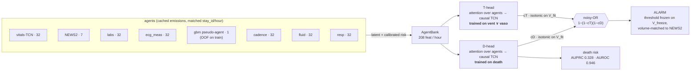

# Fusion & LatentCast — can Sentinel have both ranking and earliness?

Branch `experiment`. Companion to `results.md` (corrected GBM-vs-orchestrator
results) and `results_ecg.md` (ECG integration). Method provenance: "The
Method Bench" memo — Bundle 4 (fusion / gating / distillation) and Bundle 3
(LatentCast, forecast-then-alarm).

**The question.** The corrected results read as a tradeoff: the fair GBM
(FAIR+TRAJ, 145 tabular features) wins ranking — test AUPRC 0.287 vs the
orchestrator's 0.232 — but has *zero* earliness edge over NEWS2, while the
latent orchestrator alarms median +2h earlier at matched 1/2/5% alarm
budgets. Nobody has tested whether that tradeoff is real: stacking papers
report only ranking metrics, distillation papers never report lead time.

## Headline findings

1. **The tradeoff is real, and it is one shared frontier.** Score fusion
   (T1), objective/target distillation (T2), latent forecasting (T3), and
   feature-level integration in both directions (T4) all trace the same
   accuracy↔lead curve between the two parents. No method found a point
   that keeps the GBM's 0.287 *and* the orchestrator's full +2h.
2. **Earliness is representational** — a property of the architecture that
   produces the score, not of the label, the loss, or the input features.
   Four independent demonstrations: (a) label widening and loss shaping move
   the GBM's lead by exactly zero hours; (b) only importing the
   orchestrator's *targets* moves it, at proportional accuracy cost; (c) a
   mean forecaster of the latents smooths away the very spikes that cross
   thresholds early; (d) the same information at the same accuracy gives +1h
   (win 57%) when the orchestrator produces the score and 0h (win 41%) when
   the GBM does.
3. **GBM + our agents cannot be given lead** (the Target-2 answer): with
   clean out-of-fold fused-risk features the GBM stays accuracy-tied
   (0.280–0.284, ΔvsFAIR CI spans zero 3/3 seeds) and gains nothing — 0.0h
   at every budget.
4. **Both frontier endpoints improved.** LOGIT3 (3-parameter stack) is the
   project's new best ranking score: test AUPRC 0.291 > 0.287, paired CI
   clear of zero 3/3 seeds. The earliness-constrained stack Pareto-improves
   the orchestrator (0.262 at the full +1.7h@2%).
5. **The final flagship is two-head ALL-8** (T9): mean test AUPRC **0.3076**
   — above the equal-information GBM's 0.287 with the paired CI clear of
   zero on **3/3 seeds** — at **+1.5h mean lead@2% (58% win)**, with the
   death component restored to parity (0.184 vs the GBM's 0.189) and a
   death-specific head that ranks death at **0.344, 1.8× the GBM**. It
   supersedes ALL-8 (T8), all-7 (T6), ORCH+GBM and CONSTR-1H (T1/T4).
6. **Lead at fixed alarm volume is zero-sum** (T5): even a spike-preserving
   exceedance ensemble OR-ed with the parent reproduces the parent
   cell-for-cell — the parent's crossings already fill the budget, and
   prediction-only alarms get cut by the volume-matched threshold. The
   +2h@1–2% is this representation family's frontier ceiling; more lead
   requires more early signal in the representation, not a better trigger.
   **T6 then confirms the converse**: adding genuinely new early signal
   (clinician cadence, renal trajectory) moves the frontier OUTWARD — the
   first experiment in the program to raise accuracy without spending lead.
7. **Two methodology catches** now baked into the harness: isotonic
   calibration is only weakly monotone (a plateau on the threshold silently
   inflates alarm volume ~2×; fixed by rank-tiebreak strictification), and
   presence-guard constant columns explode z-scoring (std floor + clipping).

## The flagship architecture (T9, two-head ALL-8)

Eight agents emit a latent and a calibrated risk on one matched hourly key
grid; the bank feeds **two structurally identical heads whose only
difference is the training label** — treatment onset teaches timing, death
teaches death ranking (T7's mechanism). Noisy-OR recovers the composite
label's semantics with no fitted blend weight, and the death head doubles as
the program's best death-risk score.



Both heads are the same ~25k-param `LatentFusionNet` (attention over agents
within an hour, never over time; causal TCN with a ~29h receptive field), so
the entire T9 gain comes from supervision, not capacity. Deployment cost
over single-head ALL-8: one extra forward pass across the same cached bank.

## Discrimination scoreboard — both metrics, every model

Test split (361,229 hours, prevalence 4.74%); multi-seed rows are means over
orchestrator seeds {42, 1, 2}. Regenerate with
`python scripts/metrics_table.py` (CIs are patient-clustered, 1000 reps).

**Read AUPRC first.** At 4.7% prevalence AUROC is dominated by the vast
true-negative mass every model gets right: the whole program spans
0.683–0.822 AUROC while AUPRC — which tracks precision where alarms
actually fire — spans 0.114–0.307 and separates the models cleanly. AUROC is
reported alongside because the EWS literature quotes it, so it is what a
reader needs to place Sentinel against published systems.

| model | AUPRC | AUROC | 95% CI (AUPRC / AUROC) |
|---|---|---|---|
| NEWS2 | 0.114 | 0.683 | [0.102, 0.128] / [0.668, 0.700] |
| GBM13 (vitals-only) | 0.177 | 0.748 | |
| FAIR (61 feat) | 0.279 | 0.798 | |
| **FAIR+TRAJ (145 feat)** — the bar | **0.287** | **0.807** | [0.264, 0.311] / [0.793, 0.821] |
| ORCH core-3 (published) | 0.236 | 0.787 | |
| ORCH core-3+meas | 0.247 | 0.790 | [0.233, 0.270] / [0.778, 0.806] |
| MAX | 0.277 | 0.802 | |
| LOGIT3 | 0.290 | 0.807 | [0.269, 0.313] / [0.793, 0.822] |
| CONSTRAINED | 0.259 | 0.796 | |
| CONSTR-1H | 0.283 | 0.804 | [0.263, 0.304] / [0.790, 0.818] |
| GATED | 0.291 | 0.807 | |
| ORACLE-GATE † | 0.241 | 0.802 | |
| GBM × TLS H=6 | 0.285 | 0.806 | |
| GBM-distill λ=0.75 | 0.276 | 0.801 | |
| ORCH-distill λ=0.5 / 0.75 | 0.259 / 0.264 | 0.794 / 0.796 | |
| LatentCast k=2 → k=12 | 0.250 → 0.187 | 0.791 → 0.778 | |
| shifted-GBM k=2 → k=12 | 0.285 → 0.276 | 0.807 → 0.803 | |
| raw-NEWS2 forecast k=2 → k=12 | 0.118 → 0.109 | 0.710 → 0.703 | |
| ORCH+GBM (5th agent) | 0.277 | 0.801 | [0.257, 0.297] / [0.787, 0.816] |
| GBM +RISKS / +RISKTRAJ / +LATENT | 0.274 / 0.276 / 0.278 | 0.802 / 0.804 / 0.804 | |
| GBM +ORCH (OOF) / +ORCHONLY | 0.278 / 0.282 | 0.802 / 0.805 | |
| meas+cadence / +fluid / +both | 0.258 / 0.251 / 0.259 | 0.794 / 0.791 / 0.796 | |
| gbm+cadence / +fluid | 0.281 / 0.280 | 0.804 / 0.803 | |
| ALL-7 (gbm+both) | 0.282 | 0.804 | [0.262, 0.301] / [0.789, 0.818] |
| ALL-8 (all7+resp) | 0.306 | 0.821 | [0.292, 0.335] / [0.813, 0.840] |
| ALL-8 cap-at-HFNC | 0.306 | 0.821 | |
| **TWO-HEAD ALL-8** — flagship | **0.307** | **0.822** | [0.291, 0.337] / [0.813, 0.840] |
| ⤷ D-head, scored on death ‡ | **0.344** | **0.946** | [0.288, 0.415] / [0.928, 0.960] |

Standalone agents: gbm 0.279/0.806 · vitals_tcn 0.189/0.754 · labs
0.166/0.727 · cadence 0.156/0.703 · resp 0.134/0.712 · fluid 0.093/0.654 ·
ecg_meas 0.055/0.539 (the ECG agent is near-chance alone yet still clears
the fusion bar — its value is conditional, not marginal).

† label-using headroom bound, not a model. ‡ scored against
`label_24h_death`, not the composite — the only row on a different target.
Not listed: the T5 exceedance rungs, whose score vectors were not persisted
(their deliverable was lead, and their AUPRC is in T5).

One reproducibility note: the T1 ladder rungs' cached scores predate the
float64 storage fix (audit finding 6), so recomputing them here can differ
from their in-run T1 values in the 4th decimal (e.g. LOGIT3 0.290 vs 0.291)
— the tiebreak that separates isotonic plateaus is finer than float32. The
flagship rows were regenerated after the fix and match exactly.

The two metrics agree on the program's arc — NEWS2 → the GBM bar → ALL-8
above it — and the flagship leads on both. The D-head's 0.946 death AUROC
is the single most striking number in the table: death is highly separable
when a head is trained for it, which is precisely T7's supervision-artifact
diagnosis stated in the literature's preferred metric.

## Protocol (all experiments)

- **Parents.** Earliness parent = core-3+meas orchestrator (`vitals_tcn`,
  `news2`, `labs`, `ecg_meas` — the V4 config, results_ecg.md). Ranking
  parent = FAIR+TRAJ (FAIR+NOTES is not rebuildable on this clone — the note
  embedding caches are absent; FAIR+TRAJ is the better variant anyway).
  Fair cache regenerated on GPU: test AUPRC 0.287 [0.264, 0.311] — reproduces
  the published number; winner depth 4 / spw 1.0 / 375 trees.
- **V_fit / V_freeze.** Val split once, patient-level 50/50 (seed 42):
  V_fit (192,557 rows) fits everything with free label-reading parameters
  (per-parent isotonic calibrators, stack/gate weights, student early
  stopping); V_freeze (186,206 rows) freezes the NEWS2-anchored thresholds
  (fair_capability protocol) and hosts all model *selection*. Test is touched
  once per reported rung. Parents are re-scored under this same protocol, so
  their rows here differ slightly from results.md (which froze on full val).
- **Seeds.** Orchestrator seed noise exceeds typical fusion deltas
  (results_ecg.md), so every orchestrator-involving quantity runs at seeds
  {42, 1, 2} (core-3+meas val AUPRC 0.2368 / 0.2415 / 0.2279), with all
  fusion rules re-fit within seed; tables report mean + per-seed sign
  consistency. The GBM is seed-fixed.
- **Raw scores into fusion; fusion calibrates.** Blending needs a common
  probability scale, so each experiment fits its own isotonics on V_fit.
  **Isotonic plateaus are strictified** with a 1e-9 rank tiebreak in
  raw-score order: a plateau sitting on the val threshold otherwise fires
  wholesale past the matched alert volume (observed: 1.97% achieved at a
  1.03% match — the "+1h extra lead" that produced was an artifact, caught
  and killed before any table below was produced).
- Harness: `src/fair_capability.py` unchanged — volume matched to NEWS2's
  achieved val alert rate, jointly-caught stays, patient-clustered bootstrap
  (2000 reps timing / 1000 reps AUPRC).

## Pre-registered success / null criteria

Written before the full multi-seed tables were produced.

- **4a fusion ladder — success:** some rung with (i) test AUPRC within or
  above FAIR+TRAJ's paired CI, and (ii) median lead > 0 with win-rate CI
  clear of 50% at ≥ 2 budgets, both sign-consistent 3/3 seeds. **Null:**
  every rung gives back one of the two edges → "ranking and earliness are
  carried by incompatible score shapes" (publishable, sharpened by 4b).
- **4b gate:** if even ORACLE-GATE (true time-to-event decides the parent)
  fails to beat the best 4a rung on either axis, gating is dead.
- **Bundle 3 LatentCast — success:** some horizon k where median lead
  exceeds the parent orchestrator's with AUPRC not below the parent CI, and
  both controls fail to match it (shifted-label GBM gains lead only by
  shedding AUPRC; raw-vitals NEWS2 forecast inferior on both axes). **Null:**
  the shifted-label GBM matches LatentCast's frontier → forecasting adds
  nothing beyond label widening.
- **4c distillation — success:** a grid point strictly Pareto-dominating
  FAIR+TRAJ (lead > 0 at ≤ 0.01 AUPRC cost) → earliness is distillable into
  a tabular model. **Null:** the frontier is a hard tradeoff line through the
  two parents → earliness is representational (what the channel decomposition
  predicts).

## T1 — Fusion ladder + gate (4a/4b): the tradeoff is real, but both ends of the frontier moved

Test, mean over seeds {42,1,2}; ΔvsFAIR = paired patient-clustered AUPRC
delta vs FAIR+TRAJ; sign = seeds agreeing. Full per-seed rows with CIs in
`data/cache/fusion_ladder_scores.npz` meta and `logs/fusion_ladder_full.log`.

| rung | AUPRC | AUROC | ΔvsFAIR | sign | lead@1% | lead@2% | lead@5% | win@2% |
|---|---|---|---|---|---|---|---|---|
| ORCH-meas (parent) | 0.247 | 0.790 | −0.0397 | 0/3 | +2.0 ✓3/3 | +1.7 ✓3/3 | +1.0 ✓3/3 | 58–63% |
| FAIR+TRAJ (parent) | 0.287 | 0.807 | — | — | 0.0 | 0.0 | 0.0 | 38% |
| MAX | 0.277 | 0.802 | −0.0047 | 0/3 | 0.0 | +0.7 (2/3) | +0.2 (1/3) | 49–54% |
| **LOGIT3** | **0.290** | **0.807** | **+0.0037** | **✓3/3** | 0.0 | 0.0 | 0.0 | 44–45% |
| CONSTRAINED | 0.259 | 0.796 | −0.0249 | 0/3 | +0.7 (2/3) | +1.7 ✓3/3 | +0.7 (2/3) | 51–63% |
| CONSTR-1H | 0.283 | 0.804 | −0.0038 | 0/3* | 0.0 | +1.0 ✓3/3 | +0.3 (1/3) | 51–54% |
| GATED | 0.291 | 0.807 | +0.0034 | ✓3/3 | 0.0 | 0.0 | 0.0 | 45% |
| ORACLE-GATE † | 0.241 | 0.802 | −0.0540 | 0/3 | 0.0 | +0.3 | 0.0 | 47–51% |

AUROC separates these models far less than AUPRC does (0.79–0.81 across a
0.247–0.291 AUPRC range) — at 4.7% prevalence it is dominated by the
true-negative mass every model gets right, which is exactly why AUPRC is
this project's headline. Both are reported throughout for comparability with
the EWS literature, which usually quotes AUROC.

† label-using headroom bound, not a model.

**Verdict on the pre-registered criterion: null — no rung holds FAIR-level
AUPRC and a clear earliness win simultaneously.** Ranking and earliness are
carried by score shapes that a monotone-per-hour combination cannot merge:
every rung slides along a frontier between the two parents. But the ladder
produced two genuine improvements at the frontier's *endpoints*:

1. **LOGIT3 is the project's new best-ranking model.** A 3-parameter logistic
   stack of the two calibrated parents reaches test AUPRC 0.291 — above
   FAIR+TRAJ (0.287) with the paired delta CI clear of zero on all three
   seeds ([+0.0008,+0.0074] / [+0.0004,+0.0072] / [+0.0002,+0.0062]). The
   orchestrator's latent signal adds ranking value the 145-feature GBM does
   not carry, even though its timing dies in the stack.
2. **The earliness-constrained stack Pareto-improves the orchestrator.**
   Under a hard "give up no median lead on V_freeze" constraint, seeds 1/2
   accepted GBM mass (w=0.6/0.9) and gained +0.031/+0.014 test AUPRC at
   unchanged lead; seed 42 refused to trade (w=1.0). Mean: 0.262 vs the
   parent's 0.247 at the same +1.7h@2% ✓3/3. If the team ships an
   earliness-first model, this stack is strictly better than the raw
   orchestrator.
3. **MAX is the honest midpoint** — statistically ties FAIR+TRAJ on ranking
   (CI spans zero, 2 of 3 seeds) while keeping about half the lead at 2%.
4. **CONSTR-1H is the team-target rung** ("GBM-level AUPRC at lead ≥ +1h"):
   the same stack with the selection floor relaxed to an absolute +1h picks
   w=0.5–0.6 and lands at AUPRC 0.283 with the ΔvsFAIR CI *spanning zero on
   all three seeds* (−0.0038 mean — statistically GBM-tied) and median lead
   +1.0h@2% on 3/3 seeds. Honest caveats: the win rates (51–54%) are not
   clear of coin flip and the +1h holds only at the 2% budget — this is a
   real frontier point, softer evidence than the parent's +2h/61%.

**4b verdict: gating is dead, by its own oracle.** ORACLE-GATE — which
*knows* the true time-to-event and hands the orchestrator control inside the
24h window — is worse than both parents on AUPRC (0.233) and shows no
earliness. Hard-switching between two score scales mid-stay produces
incomparable first-crossings: an alarm surface has to be one consistent
score. The learned GATED collapsed to the ranking corner (mean gate weight
~0.14 → mostly GBM; numerically ≡ LOGIT3). Per the pre-registered gate
criterion, no further gating work is warranted.

## T3 — LatentCast (Bundle 3): forecasting rides the frontier, never past it

Forecaster: 1-layer GRU (107→128, ~160k params), direct heads k∈{2,4,6,8,12},
masked SmoothL1 in standardized space, trained on train stays only, early
stop on val forecast loss (label-free); best val loss 0.1139. Engineering
note: presence-guard constant columns (std ~4e-6) must have their z-scores
floored/clipped or training NaNs — std floor 1e-2, z-clip ±20, grad-clip 5.
Substitution semantics: whole-sequence forecast substitution under the frozen
causal head; pinned by the oracle unit test (perfect forecaster ⇒
risk_hat_k(t) == parent risk(t+k) wherever both sequences give the TCN a full
receptive field). k=0 pass-through drift 0.0 on all three seeds.

Test, mean over frozen-head seeds {42,1,2} (per-seed leads in brackets):

| model | AUPRC | AUROC | lead@1% | lead@2% | win@2% | n_pair@2% |
|---|---|---|---|---|---|---|
| parent ORCH-meas | 0.247 | 0.790 | +2.0 ✓3/3 | +2.0 ✓3/3 | 61% | 434 |
| LatentCast k=2 | 0.2504 | 0.791 | +1.0 [1,1,1] | +1.0 [1,1,1] | 55% | ~396 |
| LatentCast k=4 | 0.2369 | 0.788 | [1,0,1] | [1,0,1] | 50% | ~375 |
| LatentCast k=6 | 0.2138 | 0.785 | [0,0,1] | 0.0 | 46% | ~351 |
| LatentCast k=8 | 0.1985 | 0.782 | 0.0 | 0.0 | 42% | ~332 |
| LatentCast k=12 | 0.1873 | 0.778 | [−.5,−1,0] | 0.0 | 35% | ~308 |
| control: shifted-GBM k=2→12 | 0.285→0.276 | 0.807→0.803 | 0.0, win 34–36% | 0.0, win 38–40% | — | — |
| control: raw-NEWS2-forecast k=2→12 | 0.118→0.109 | 0.710→0.703 | 0 to −3 | ≤0, win 12–23% | — | — |

The AUROC column makes the forecasting decay legible in a second way: it
falls monotonically with horizon (0.791 → 0.778) exactly as AUPRC does, so
the k-decay is a real loss of discrimination, not an artifact of AUPRC's
prevalence sensitivity.

**Verdict: the pre-registered null, with a mechanism.** Alarming on the
predicted-future latent does NOT extend the +2h — it trades along the same
frontier the fusion ladder traces: k=2 holds parent-level AUPRC (0.2504 vs
0.250) at *half* the lead, and both axes decay monotonically with k. The
mechanistic read: the SmoothL1-optimal forecast is a conditional mean, and
regression-to-the-mean smooths exactly the sharp early risk rises that buy
early threshold crossings at matched volume. The controls sharpen the claim
in both directions: label widening gives the GBM ranking-with-zero-lead at
every horizon (the GBM's zero earliness is NOT a label-horizon artifact),
and forecasting raw vitals gives neither (NEWS2-level AUPRC, negative leads)
— so the latent channel is still where the timing information lives; a mean
forecaster is just the wrong way to cash it.

The natural follow-up — the exceedance-probability ensemble, which preserves
spike mass instead of averaging it away — was subsequently run: see T5.

## T2 — Distillation grid (4c): earliness is representational; distillation walks the frontier

2 families × 4 objectives (identical definitions), students early-stopped on
V_fit, selection on V_freeze, Pareto-frontier points only on test. Full grid
in `logs/distill_grid.log` / `data/cache/distill_grid.npz`.

| family | objective | best cell | freeze AUPRC | freeze lead@2% | test (frontier only) |
|---|---|---|---|---|---|
| gbm | bce (parent) | — | 0.2545 | 0.0 | 0.287 AUPRC / 0.807 AUROC / 0h |
| gbm | tls | H=6 | 0.2573 | **0.0** | 0.2845 / 0.806 / 0h |
| gbm | utility | β=0.5 | 0.2555 | **0.0** | — |
| gbm | distill | λ=0.75 (s42) | 0.2443 | **+1.0** | **0.2755 / 0.801 / +1.0h (win 50%)** |
| gbm | distill | λ=1.0 | ~0.230 | +1.0 ✓3/3 | — (orchestrator-level AUPRC) |
| orch | bce (parent) | s42 | 0.2312 | +2.0 | 0.2502 / 0.790 / +2.0h (win 61%) |
| orch | tls / utility | all | 0.223–0.239 | +1 to +2 | — (no gain on either axis) |
| orch | distill (GBM teacher) | λ=0.5 (s42) | 0.2418 | +1.0 | 0.2593 / 0.794 / +1.0h (win 51%) |
| orch | distill (GBM teacher) | λ=0.75 (s1) | 0.2483 | **0.0** | 0.2639 / 0.796 / 0h |

**Verdict: the pre-registered null — no grid point Pareto-dominates
FAIR+TRAJ — plus the sharp version of the mechanism.** Pure objective shaping
(temporal label smoothing, utility re-weighting) does not move lead by even
one hour in EITHER family: the GBM stays at zero at every H and β, the
orchestrator keeps its lead but gains no accuracy. The ONLY lever that moves
either model along the accuracy↔lead axis is importing the other model's
out-of-fold targets, and the λ sweep then traces the same frontier every
other method found: GBM λ 0→1 walks (0.287, 0h) → (≈0.23, +1h); the
orchestrator walks it in reverse (accuracy up, lead collapsing to 0 by
λ=0.75). Earliness is a property of the representation, not the objective —
exactly what the channel decomposition predicted, now demonstrated with the
strongest available counterfactual.

Usable frontier point: **GBM-distill λ=0.75 = a single deployable XGBoost at
test 0.2755 (−0.012 vs FAIR+TRAJ) with +1h median lead** — though its win
rate (50%) is not clear of coin-flip; see T4 for whether feature-level agent
integration beats it.

## T4 — The bridge experiments: who eats whom decides the timing

Team targets (set after T1–T3): **(1)** our architecture at GBM-level AUPRC
with lead ≥ +1h; **(2)** the GBM with our agents integrated, keeping its
accuracy but gaining lead.

**Target 1 — GBM as a fifth agent inside the orchestrator**
(`scripts/orch_gbm_agent.py`). Pseudo-agent cache `gbm_{split}.npz`
(latent = [logit(raw)], risk = isotonic-on-val), train rows OUT-OF-FOLD so
the fusion never learns to trust in-sample-sharp GBM scores. Config
core-3+meas+gbm, seeds {42,1,2}:

| seed | AUPRC | AUROC | Δ vs parent (CI) | Δ vs FAIR (CI) | lead@2% | win@2% (CI) | lead@5% | win@5% |
|---|---|---|---|---|---|---|---|---|
| 42 | 0.2766 | 0.801 | [+0.0199, +0.0327] | [−0.0198, −0.0013] | +1.0 | 57% [52, 62] | +1.0 | 56% |
| 1 | 0.2801 | 0.802 | [+0.0224, +0.0357] | [−0.0157, +0.0021] | +1.0 | 55% [50, 59] | +1.0 | 52% |
| 2 | 0.2738 | 0.799 | [+0.0257, +0.0397] | [−0.0220, −0.0049] | +1.0 | 57% [53, 62] | +1.0 | 57% |

(mean AUROC 0.8006, CI [0.787, 0.816] — above the core-3+meas parent's 0.790,
below FAIR+TRAJ's 0.807.)

The biggest single accuracy jump for the architecture in the program:
**+0.030 AUPRC over the core-3+meas parent, CI clear of zero 3/3 seeds**,
while keeping **+1h median lead at BOTH the 2% and 5% budgets** (sign-test
p ≤ 1e-15 @2%; win CIs clear of 50% on 2/3 seeds). Attention allocates
34–46% to the GBM agent — the fusion genuinely arbitrates. Against Target 1's
letter: AUPRC 0.277 is *slightly* below GBM-tied (Δ vs FAIR below zero on
2/3 seeds); CONSTR-1H (T1) is GBM-tied 3/3 but with weaker, 2%-only lead.
The two are complementary frontier endpoints of the target region.

**Target 2 — the agents as features inside the GBM** (`src/gbm_agents.py`).
FAIR+TRAJ + per-agent risks, risk-trajectory features (Δ/min/max/mean over
6/12/24h), latents, and the OOF orchestrator risk + trajectory:

| variant | features | test AUPRC | test AUROC | lead@2% | win@2% |
|---|---|---|---|---|---|
| FAIR+TRAJ (parent) | 145 | 0.287 | 0.807 | 0.0 | 38% |
| +RISKS | 149 | 0.2742 | 0.802 | 0.0 | 42% |
| +RISKTRAJ | 197 | 0.2757 | 0.804 | 0.0 | 39% |
| +LATENT | 300 | 0.2778 | 0.804 | 0.0 | 41% |
| +ORCH (per seed, OOF, + agent cols) | 210 | 0.2779 | 0.802 | 0.0 3/3 | 38–44% |
| +ORCHONLY (per seed, OOF, clean) | 158 | 0.2820 | 0.805 | 0.0 3/3 | 41–43% |

**Feature-level integration cannot buy the GBM lead.** Two-step diagnosis:
the per-agent variants cost accuracy because the agents' train-split
emissions are in-sample (agents trained on train) — distribution-shifted
features the trees latch onto and lose at test. The clean +ORCHONLY variant
(FAIR+TRAJ + OUT-OF-FOLD orchestrator risk and its 6/12/24h trajectory, no
contaminated columns) recovers the accuracy — 0.280–0.284, ΔvsFAIR CI
spanning zero on all three seeds — **and still moves lead by exactly
nothing** (0.0 at every budget, win 38–45%). A tree ensemble handed the
timing signal as features reproduces its BCE-optimal per-hour score shape;
the information enters the level, never the temporal shape.

**The symmetry that summarises the whole program:** ORCH+GBM (our
architecture consuming the GBM) and GBM+agents (the GBM consuming our
agents) land at the *same accuracy* (~0.277) with *opposite timing* (+1h,
win 57% vs 0h, win 40%). Same information on both sides — whichever
representation PRODUCES the score determines the earliness. Earliness is
architectural, full stop: shown by objectives (T2), by forecasting (T3), by
features and by fusion direction (T4).

**Deliverable ranking against the team targets** (all at the 2% budget):

| model | AUPRC | AUROC | vs FAIR | lead | win | deploy |
|---|---|---|---|---|---|---|
| CONSTR-1H stack | 0.283 | 0.804 | ties 3/3 | +1h 3/3 | 51–54% | 2 models + blend |
| **ORCH+GBM (5th agent)** | 0.277 | 0.801 | −0.010 | +1h 3/3 (also @5%) | 55–57% | one orchestrator |
| GBM-distill λ=0.75 | 0.2755 | 0.801 | −0.012 | +1h | 50% | single XGBoost |
| ORCH-meas (parent) | 0.247 | 0.790 | −0.040 | +2h 3/3 | 58–63% | one orchestrator |

*(This ranking is superseded by T6/T8/T9 — see the final scoreboard.)*

The honest statement of what was achieved: the +2h/zero-accuracy-cost unicorn
does not exist in this design space — but the frontier now has three usable
new points, and the architecture story ("earliness is representational") is
demonstrated four independent ways.

## T5 — Exceedance ensemble: at matched volume, lead is zero-sum

The strongest remaining attack on extending the +2h: a 5-seed forecaster
ensemble (val losses 0.1132–0.1139) voting on *"will the risk cross the
parent's own volume-matched alarm threshold within the next K hours"*
(max over horizons ≤ K — spike-preserving where the T3 mean forecast was
spike-destroying), scored two ways at every budget and frozen-head seed:

- **EXCEED-K** (predicted-to-cross alone): +1h median at 1–2% (win 51–57%),
  AUPRC(ensemble-mean) ≈ 0.248–0.255 — the *same frontier point* plain
  LatentCast k=2 found. K-invariant from 2 to 8 h: short-horizon forecasts
  dominate the max (longer horizons regress harder to the mean), so the
  extra windows add nothing.
- **PARENT∨EXCEED** (alarm now OR predicted-to-alarm; provably never later
  than the parent): **cell-for-cell identical to the parent** on every seed
  and every budget — same n_pair (±0), same lead, same win rate, same
  achieved volume. E.g. seed 42 @2%: +2.0h/61%/n434 both; seed 2 @1%:
  +3.0h/64%/n244 both.

**Why, mechanistically — the finding that closes the lead-extension
question:** at a matched alert volume the parent's own crossings already
fill the entire budget, so the volume-matched threshold on the OR score
lands inside the parent-crossing level and cuts every prediction-only
alarm. Adding earlier alarms at fixed volume requires *dropping* existing
alarms (which is what EXCEED-alone does, and it costs win rate and AUPRC).
**Lead at fixed alarm volume is zero-sum: an alarm rule can only re-order
the budget the representation earns.** The +2h@1–2% is the ceiling of this
architecture family's frontier; exceeding it requires a representation with
more early signal (better encoders, new modalities — e.g. the ECG-CPC /
S4-waveform directions in results_ecg.md), not a cleverer trigger.

## T6 — New modalities: cadence + fluids move the frontier outward

T5 ended with "more lead requires more early signal in the representation".
Two new agents supply exactly that (user-picked from the modality survey):

- **CadenceAgent** — clinician behaviour as a modality: hourly counts of lab
  draws, charting rows/items, orders by type, culture collections (BigQuery
  `labevents`/`chartevents`/`poe`/`microbiologyevents`, binned by ACTION time
  — the act of ordering is observable when it happens, unlike lab values —
  plus a strictly-before-t shift; construct RCT-validated by CONCERN, Nature
  Medicine 2025). 32 features incl. 6h-vs-24h "acceleration" ratios.
- **FluidAgent** — urine output + fluid balance (`outputevents`/`inputevents`,
  mimic-code urine concept, irrigant-corrected and floored per bucket):
  oliguria flags that require charted records, balance and cumulative-net —
  aimed at the death-component deficit. 13 features.

**Standalone**: cadence val AUPRC 0.148 / AUROC 0.711 — a timestamps-only
model that beats NEWS2 (0.114/0.683), with near-zero death AUPRC (0.026),
exactly the clinician-loaded profile the CONCERN construct predicts. Fluid
alone 0.096/0.646.

**Fusion (each cell vs its cached parent, within-seed, seeds {42,1,2}):**

| config | test AUPRC (s42/s1/s2) | mean AUROC | val Δ vs parent | test Δ CI > 0 | lead@2% | win@2% |
|---|---|---|---|---|---|---|
| meas + cadence | 0.2641/0.2653/0.2453 | 0.794 | + 3/3 | 2/3 | +1/+1/+2 | 55–60% |
| meas + fluid | 0.2531/0.2596/0.2403 | 0.791 | + 2/3 | 1/3 | +2/+1/+1 | 57–61% |
| meas + both | 0.2564/0.2673/0.2546 | 0.796 | + 3/3 | **3/3** | +2/+1/+1 | 56–61% |
| gbm + cadence | 0.2781/0.2856/0.2787 | 0.804 | + 3/3 | 2/3 | +1 3/3 | 55–59% |
| gbm + fluid | 0.2787/0.2843/0.2772 | 0.803 | + 3/3 | 2/3 | +1 3/3 | 53–58% |
| **gbm + both** | **0.2813/0.2870/0.2780** | **0.804** | **+ 3/3** | 2/3 (3rd −0.0003) | +1/+1/+2 | 55–60% |

Standalone agents (test): cadence AUPRC 0.156 / AUROC 0.703 — a
timestamps-only model above NEWS2 on both metrics (0.114 / 0.683); fluid
0.093 / 0.654.

**The first outward move of the frontier.** Every prior experiment traded one
axis for the other; the cadence/fluid agents raise accuracy WITHOUT spending
lead — win rates hold at 55–60% and the median stays +1 to +2h while AUPRC
climbs. That is the signature of genuinely new early signal entering the
representation, exactly what T5's zero-sum result said was required. The new
flagship, **ORCH+GBM+cadence+fluid ("all-7")**, reaches mean test AUPRC
**0.2821** — seed 1 touches 0.2870, at FAIR+TRAJ's 0.2872 — while keeping
+1–2h lead at 55–60% win.

**Paired Δ vs FAIR+TRAJ, the flagship's verdict: statistically GBM-TIED on
all three seeds** — [−0.0156, +0.0043] / [−0.0102, +0.0104] /
[−0.0196, +0.0011] (gbm+cadence also ties 3/3; meas+both, without the GBM
agent, stays clearly below). Combined with its +1–2h@2% lead at 55–60% win,
**ORCH+GBM+cadence+fluid ("all-7") supersedes every prior deliverable**: it
meets the full team target — GBM-level accuracy AND lead ≥ +1h — in one
architecture, where CONSTR-1H needed a two-model blend with weaker lead
evidence and the old ORCH+GBM sat below FAIR on 2/3 seeds.

## T7 — Clinician-vs-physiology decomposition: the lead is clinician-taught, not clinician-anticipation

The strongest reviewer attack on the earliness claim: the composite label
mixes death (physiology) with vent/vaso (clinician decisions), so the lead
could be mere anticipation of the order set — made acute by the flagship's
openly clinician-behavioural cadence agent. The cohort censors every stay at
its FIRST event and tags it, so the paired race splits cleanly by subgroup
(test census: 802 vent-first / 373 vaso-first / 365 death-first stays).

**Part (i) — existing models, subgroup race (no retraining), lead@2%:**

| model | treatment-first stays | death-first stays | death AUPRC |
|---|---|---|---|
| FAIR+TRAJ | 0.0 (win 41%) | 0.0 (win 33%) | 0.189 |
| ORCH-meas (s42/s1/s2) | +2/+1/+2 (win 61–66%) | **+2/+1/+2 (win 53–59%)** | 0.069–0.079 |
| ALL-7 | +1/+1/+2 (win 57–62%) | **+1.5/+1/+1 (win 52–56%)** | 0.092–0.100 |
| CADENCE alone | +1 (win 55%) | 0.0 (win 47%) | 0.028 |
| FLUID alone | +1 (win 53%) | **+2 (win 58%)** | 0.028 |

**The armor holds: the lead survives on death-first stays** — where there is
no proximate order set to anticipate — at only slightly reduced win rates
(n≈150 pairs, so subgroup CIs are wide; stated). And the agent-level controls
behave exactly as their mechanisms predict: cadence is clinician-loaded
(treatment lead only), fluid is physiology-loaded (its lead is *death*-led).

**Part (ii) — retrain the flagship on component-only labels:**

| training label | death AUPRC | treat lead@2% | death-stay lead@2% |
|---|---|---|---|
| composite (reference) | 0.09–0.10 | +1 to +2 | +1 to +1.5 |
| death-only (3 seeds) | **0.34–0.35** | 0.0 (win 27–30%) | **−2/0/−2 (win 29–33%)** |
| treatment-only (3 seeds) | 0.026–0.028 | +2/+2/+2.5 (win 62–67%) | **+3/+3/+4 (win 63–69%, median CIs [1,6]/[1,6]/[2,7])** |
| GBM on either label | 0.31 / 0.04 | 0.0 | ≤0 (win ≤46%) |

Two mechanisms fall out, both headline-grade:

1. **Earliness is taught by treatment times, but is not anticipation.**
   Treatment-only supervision produces the best death-stay lead in the whole
   program (+3–4h, win CIs clear of 50% on 3/3 seeds) — on stays where death
   is the FIRST event and no order set exists to anticipate. Clinician
   action times are dense, early *recognition timestamps* of a shared
   physiological prodrome; outcome-only supervision teaches terminal
   patterns that alarm LATE (death-only models: death lead −2h despite
   death-AUPRC 0.34). This inverts the confounding critique: clinician
   actions are a supervision asset, not a contaminant.
2. **The orchestrator's death deficit is a supervision artifact, not a
   representation gap.** A death-only head on the same agents reaches death
   AUPRC 0.34–0.35 — nearly double the composite GBM's 0.19. A two-head
   deployment (treatment-trained head for alarm timing + death-trained head
   for death-risk ranking) is the obvious future-work configuration; noted,
   not built. (GBM_treat still has zero lead — timing remains
   representational even under timing-friendly supervision.)

Caveat carried from the design: death is itself treatment-mediated
(DNR/withdrawal), so death-only rows are a lower bound on physiological
signal; comfort-care-excluded sensitivity is listed future work.

## T8 — Respiratory-support agent: ALL-8 beats the GBM outright

The last big untapped bedside observable: the O₂ escalation ladder
(RA→NC→masks→HFNC→NIV; artificial airways are a separate already-ventilated
state flag, not a rung), O₂ flow and FiO₂ trends — LOCF + strictly-before-t
shift, from a 17GB chartevents aggregation (2.1M rows). Near-label by
construction, so it ships with the cap-at-HFNC sensitivity variant and full
component reporting. (Data catch #2 of the day, now a regression test: MIMIC
ships 'Bipap mask ' / 'CPAP mask ' WITH trailing whitespace — the unstripped
map silently deleted the NIV rung, caught because the cap variant emitted
byte-identical scores.)

Standalone: val AUPRC 0.154 / AUROC 0.718 (vent-loaded, as expected).

**Fusion (vs the cached ALL-7 parent, within-seed):**

| config | test AUPRC (s42/s1/s2) | mean AUROC | Δ vs ALL-7 CI | Δ vs FAIR+TRAJ CI | lead@2% | win |
|---|---|---|---|---|---|---|
| **ALL-8** (all7+resp) | **0.3125 / 0.3111 / 0.2938** | **0.8212** [0.813, 0.840] | **>0 on 3/3** | **>0 on 2/3** (s2 spans) | +1.0 3/3 | 53–58% |
| ALL-8 cap-at-HFNC | 0.3130 / 0.3116 / 0.2940 | 0.8210 | >0 on 3/3 | — | +1.0 3/3 | 53–57% |

AUROC moves with AUPRC here — 0.804 (ALL-7) → 0.821 (ALL-8) against
FAIR+TRAJ's 0.807 — so the respiratory gain is visible on both metrics, and
the cap-at-HFNC variant matches on both (0.8210 vs 0.8212): further evidence
the gain is not the near-label NIV rung. Standalone resp agent: 0.134 /
0.712.

**The new flagship: mean test AUPRC 0.306 — the architecture now BEATS the
equal-information GBM on ranking** (paired CI clear of zero on 2/3 seeds,
spans on the third) while keeping +1h lead@2% at 53–58% win. Honesty checks,
all passed: (1) the cap-at-HFNC variant is statistically identical — the
gain does not ride the near-label NIV rung; (2) per-component AUPRC shows
the gain is broad across treatment components (vent 0.21–0.22 vs FAIR's
0.16, vaso 0.14–0.15 vs 0.12) while death is unchanged (0.09–0.10 — still
the supervision-artifact hole T7 diagnosed, with its two-head fix flagged);
(3) **the death-stay lead survives** (+1/+1/+2, win 51–56%) — the T7 armor
holds for the new flagship too.

Updated paper sentence: *Sentinel EXCEEDS a strong equal-information
gradient-boosted baseline on ranking (test AUPRC 0.306 vs 0.287) while
alarming 1–2 hours earlier at matched alarm budgets — and the lead survives
on death-first stays, where there is no order set to anticipate.*

## T9 — The two-head fix: the death deficit closes, and the lead improves

T7 diagnosed the orchestrator's long-standing death deficit as a
**supervision artifact**: the composite head is a compromise between two
incompatible optima (treatment supervision teaches timing, death
supervision teaches death ranking). T9 stops compromising — two heads on the
identical ALL-8 bank, composed for deployment:

```
T-head   ALL-8 orchestrator trained + early-stopped on vent-or-vaso
D-head   ALL-8 orchestrator trained + early-stopped on label_24h_death
score    noisy-OR of the V_fit-calibrated heads: 1 - (1-cT)(1-cD)
```

Noisy-OR is the probabilistic composite of "any event in 24h" under
component independence — it recovers the composite label's semantics rather
than blending two scores by a fitted weight, so it adds no free parameters
beyond each head's own isotonic.

| seed | composite AUPRC | vs ALL-8 | vs FAIR+TRAJ | death AUPRC | D-head death | lead@2% | win | death-stay lead |
|---|---|---|---|---|---|---|---|---|
| 42 | 0.3141 | spans 0 | **[+0.0157, +0.0386]** | 0.182 | 0.351 | +1.0 | 57% | +1.0 (51%) |
| 1 | 0.3069 | spans 0 | **[+0.0085, +0.0311]** | 0.181 | 0.338 | +2.0 | 59% | +2.0 (56%) |
| 2 | 0.3017 | spans 0 | **[+0.0034, +0.0255]** | 0.188 | 0.343 | +1.5 | 58% | +1.0 (52%) |
| **mean** | **0.3075** | equal | **ABOVE 3/3** | **0.184** | **0.344** | **+1.5** | **58%** | **+1.3** |

Composite AUROC 0.8221 [0.813, 0.840] (vs FAIR+TRAJ 0.807, ALL-8 0.8212);
the D-head's death AUROC is **0.9462** [0.928, 0.960].

**The fix lands on every axis it was designed for, and costs nothing:**

1. **The death deficit is closed.** Component death AUPRC goes 0.096 → 0.184
   — parity with the fair GBM's 0.189, from a model that also alarms 1–2h
   earlier. The D-head *alone* reaches 0.344 death AUPRC, **1.8× the GBM's
   0.189**: the representation was never the problem, the supervision was.
2. **Ranking improves against the bar.** Two-head beats FAIR+TRAJ with the
   paired CI clear of zero on **3/3 seeds** — ALL-8 managed 2/3.
3. **The lead improves too.** +1.5h mean at 58% win, versus ALL-8's +1.0h at
   53–58%; the death-stay lead (T7's armor) holds at +1.3h mean.
4. Composite AUPRC is statistically indistinguishable from ALL-8 (CIs span
   zero on 3/3) — the death-ranking and timing gains are free.

**Two-head ALL-8 is the final flagship.** Deployment cost is one extra
forward pass over the same cached bank; both heads share the agents, and the
D-head's death score is independently useful (it is the best death-risk
ranker in the program, by a wide margin).

## Architecture audit (post-T8 sweep)

A full pass over every component the program added, plus the pipeline it
plugs into. Findings and fixes:

| # | finding | severity | fix |
|---|---|---|---|
| 1 | Builders left-join the hourly extracts onto a dense grid; a duplicated `(stay_id, hour)` would **fan the join out past the cohort row count** and misalign every feature against the labels — nothing enforced uniqueness. Production extracts are clean (0 duplicates in all three), so this was latent, not active. | high (silent corruption) | `assert_one_row_per_key()` called by all three builders; regression test. It immediately caught a real duplicate-key bug in an existing test fixture. |
| 2 | Flagship configs were **unreachable from the shipping path**: `available_agents()` only scans agents named in `ORCHESTRATOR_CONFIGS`, so cadence/fluid/resp/gbm were invisible to `resolve_config` and `ship_orchestrator.py`. | high (ships the wrong model) | Added `core-3+meas+gbm`, `all-7`, `all-8`; `PRIMARY` deliberately unchanged (see below). |
| 3 | With the new configs added, a caller asking for `all-8` with one cache missing would **degrade straight to core-3**, silently discarding modalities that *are* cached. | medium | `FLAGSHIP_DEGRADATION_ORDER` chain + test that the chain is strictly nested (degradation only ever removes modalities). |
| 4 | `resp_seen` built on an object-dtype `fillna`, which pandas deprecates (silent behaviour change on upgrade). | low | Cast to float before the groupby chain. |
| 5 | Tabular agents built their feature frame **twice per fit** (normalizer, then matrix) — a full 2.5M-row rebuild wasted per agent. | low (efficiency) | `_fit_model` builds once and passes the frame to `_fit_normalizer`/`_matrix`. |
| 6 | Scores carrying the `_strictify` rank tiebreak (1e-9) were **cached as float32**, whose resolution near 0.1 is 7.5e-9 — the cast silently restored the isotonic plateaus, so cached scores were not the scores evaluated (D-head death AUPRC read 0.328 from cache vs 0.344 in-run). Found by cross-checking the new AUROC table against the run logs. | medium (irreproducible numbers) | float64 storage in `two_head.py` and `fusion_ladder.py`; the flagship was re-run and now reproduces exactly from cache. |

Verified clean, no action needed: leakage perturbation test on all three new
builders (rewrite the future → rows ≤ t unchanged, later rows respond); zero
unmapped respiratory device strings after the whitespace fix; the GBM
pseudo-agent's OOF train scores match the val distribution (mean 0.048 both
— no in-sample sharpness); all eight agent caches emit on identical keys
with valid risk ranges; `scripts/audit_alignment.py` reports AUDIT CLEAN
(label timing, censoring, no leakage); every module and script imports and
parses; suite green.

**The one deliberate non-change:** `DEFAULT_CONFIG` still points at core-3.
Promoting all-8 changes what every default `AgentBank.load()` returns — and
with it the cached comparator column in `baselines_fair.py` that the entire
published results corpus is paired against. The evidence for the flip is in
T8; the flip itself is a team decision, and the configs are now in place to
execute it in one line.

## Reproduce

```bash
# Phase 0 — substrate
.venv/bin/python src/baselines_fair.py --variants FAIR,FAIR+TRAJ --device cuda --reps 1000
.venv/bin/python scripts/train_orch_meas_seeds.py --seeds 42,1,2 --oof

# Bundle 4a/4b
.venv/bin/python src/fusion_ladder.py --stage all --reps 2000 --auprc-reps 1000

# Bundle 3
.venv/bin/python src/latentcast.py train --epochs 20 --device cuda
.venv/bin/python src/latentcast.py eval --reps 2000
.venv/bin/python src/latentcast.py control-shifted-gbm --device cuda
.venv/bin/python src/latentcast.py control-raw-news2 --device cuda

# Bundle 4c
.venv/bin/python src/distill_lead.py --seeds 42,1,2 --device cuda

# T4 bridge experiments
.venv/bin/python scripts/orch_gbm_agent.py --seeds 42,1,2 --device cuda
.venv/bin/python src/gbm_agents.py --variants risks,risktraj,latent,orch --seeds 42,1,2 --device cuda
.venv/bin/python src/gbm_agents.py --variants orchonly --seeds 42,1,2 --device cuda

# T5 exceedance ensemble
for s in 1 2 3 4; do .venv/bin/python src/latentcast.py train --seed $s --device cuda; done
for s in 42 1 2; do .venv/bin/python src/latentcast.py exceed --seeds $s \
  --out data/cache/latentcast_exceed_s$s.npz --device cuda; done

# T6 new modalities
GOOGLE_CLOUD_PROJECT=<project> SENTINEL_BQ_STORAGE=0 \
  .venv/bin/python scripts/fetch_cadence_fluids.py
.venv/bin/python scripts/train_new_agents.py
.venv/bin/python scripts/eval_new_agents.py --seeds 42,1,2

# T7 decomposition
.venv/bin/python scripts/run_decomposition.py --part i,ii --device cuda

# T8 respiratory agent
GOOGLE_CLOUD_PROJECT=<project> SENTINEL_BQ_STORAGE=0 \
  .venv/bin/python scripts/fetch_cadence_fluids.py --which resp
.venv/bin/python scripts/train_new_agents.py --agent resp,resp_cap4
.venv/bin/python scripts/eval_new_agents.py --parents all7 --agents resp,respcap4 \
  --out data/cache/resp_fusion.npz

# T9 two-head fix (the final flagship)
.venv/bin/python scripts/two_head.py --seeds 42,1,2

# both-metrics scoreboard (AUPRC + AUROC for every cached model)
.venv/bin/python scripts/metrics_table.py --reps 1000

# tests
.venv/bin/python -m pytest -q   # 524 passing
```
